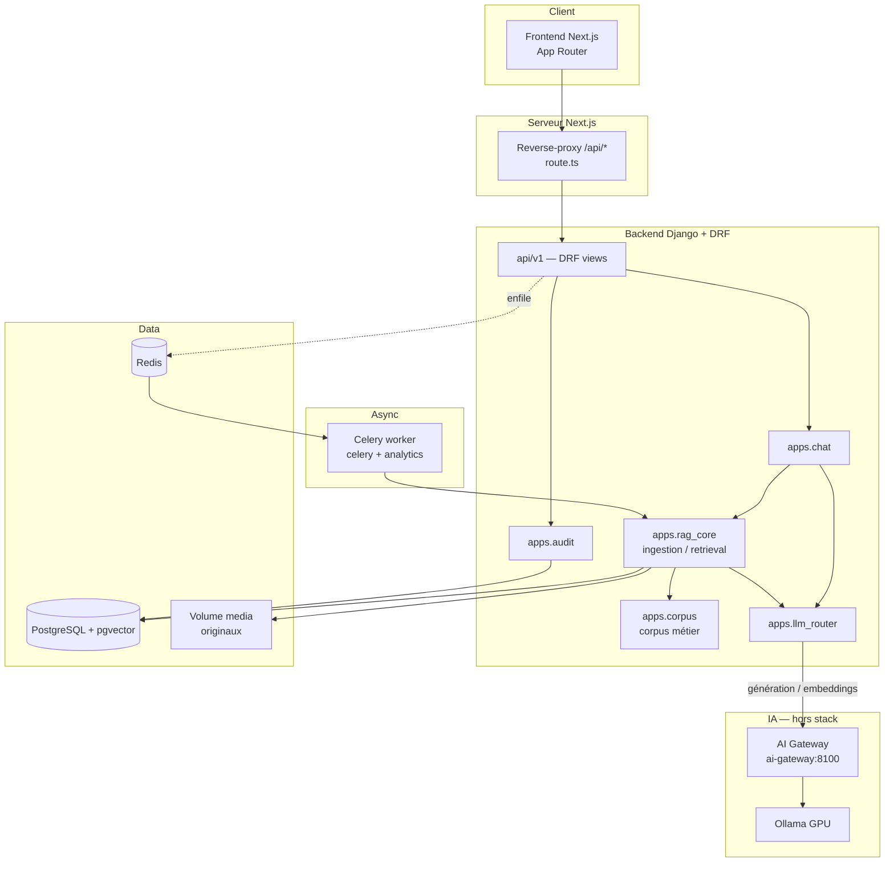
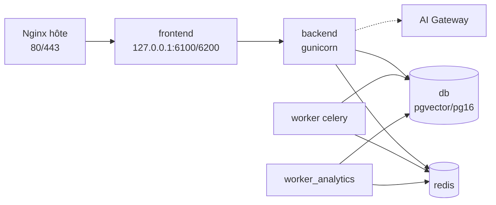
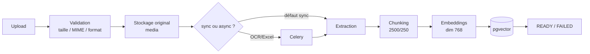
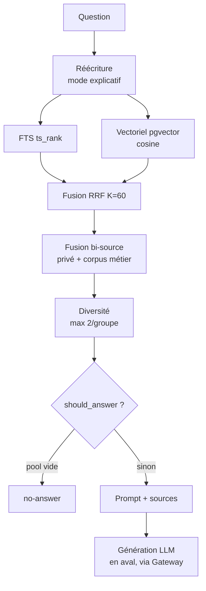

# Architecture

Architecture réelle de RagATM, fondée sur les imports, services et flux du code. Les
diagrammes reflètent le chemin réellement exécuté (pas d'intention non implémentée).

## Architecture logique

Points de vérité :

- Le **navigateur ne parle qu'à `/api/*` en same-origin** ; un reverse-proxy Next
  (`src/app/api/[...path]/route.ts`) relaie vers le backend (`BACKEND_BASE_URL`, variable
  serveur uniquement — aucune variable `NEXT_PUBLIC_*`).
- La **génération IA passe par l'AI Gateway** quand elle est activée ; RagATM n'appelle
  jamais Ollama en direct en environnement officiel (system check `llm_router.E003` dès que la
  Gateway est éteinte). Il
  n'existe aucun provider externe ni repli.
- Les **originaux** des documents sont stockés sur un **volume local `media`** (Django
  FileField, `MEDIA_ROOT`). RagATM n'utilise **aucun stockage objet** : décision explicite,
  voir [decisions/ADR-001-stockage-documentaire.md](decisions/ADR-001-stockage-documentaire.md).

## Architecture d'exécution (conteneurs)

- **Nginx** (hôte) est le seul point d'entrée public ; il proxifie vers le frontend en
  loopback. Aucun autre service ne publie de port public (db/redis/ollama/workers).
- Deux workers Celery : queue `celery` (ingestion, résumés, reindex) et queue `analytics`
  (analyses corpus globales). Voir [../03-backend/taches-asynchrones.md](../03-backend/taches-asynchrones.md).
- Détails d'orchestration : la documentation d'exploitation (hors périmètre de cette édition).

## Flux d'ingestion

Détail : [../03-backend/ingestion-extraction.md](../03-backend/ingestion-extraction.md).

## Flux de retrieval

Détail : [../03-backend/pipeline-retrieval.md](../03-backend/pipeline-retrieval.md) et
[../06-ai/answerability.md](../06-ai/answerability.md).

## Flux chat

Le chemin complet (interceptions déterministes, mémoire, retrieval, génération, streaming,
persistance) est décrit dans [../03-backend/chat-generation.md](../03-backend/chat-generation.md).

## Frontières de permissions

Isolation à trois niveaux : propriétaire global (superuser) ⊃ workspace (RBAC) ⊃ RagSpace
(filtrage par requête). Voir [../03-backend/permissions-isolation.md](../03-backend/permissions-isolation.md)
et la documentation d'exploitation (hors périmètre de cette édition).

## Dépendances critiques

| Dépendance | Rôle | Câblée |
|---|---|---|
| PostgreSQL + pgvector | données + index vectoriel/FTS | oui |
| Redis | broker Celery + cache optionnel | oui |
| Celery | ingestion/résumés/analyses asynchrones | oui (pas de conteneur `beat`) |
| AI Gateway | génération et embeddings | hors stack (service `ai-gateway`) |
| Ollama | moteur LLM local derrière la Gateway | hôte GPU uniquement |
| Volume local `media` | stockage des originaux (`MEDIA_ROOT`) | oui — seul stockage documentaire ([ADR-001](decisions/ADR-001-stockage-documentaire.md)) |

## Références d'implémentation

- `frontend/src/app/api/[...path]/route.ts` — reverse-proxy
- `backend/config/urls.py`, `backend/api/v1/` — routage
- `backend/apps/rag_core/services/query/orchestrator.py` — retrieval
- `backend/apps/chat/services/chat_service.py` — chat
- `backend/apps/llm_router/router.py` — routage LLM
- `deploy/docker/docker-compose.yml` + overrides — exécution
