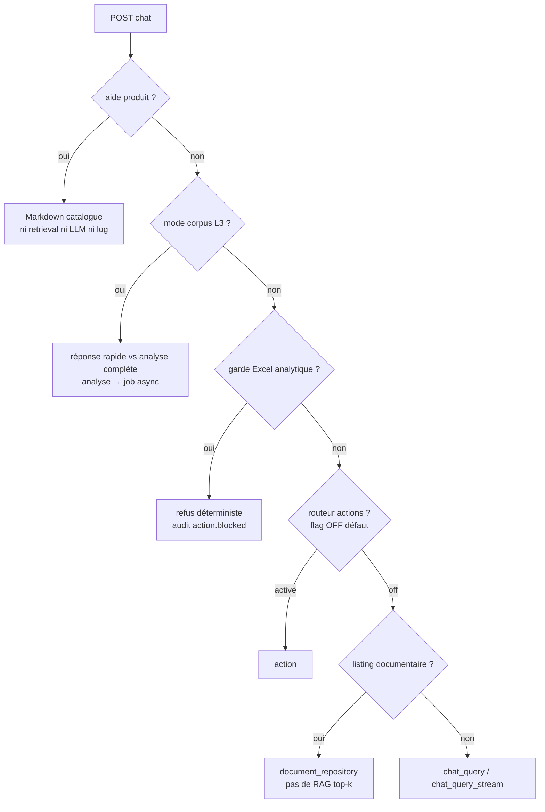

# Chat & génération

Objectif : décrire le chemin **complet** d'une requête de chat, de l'entrée HTTP jusqu'à
la réponse générée et persistée. Public : développeurs backend.

Ce document prolonge le [pipeline de retrieval](pipeline-retrieval.md) : le retrieval
retourne un `prompt` + des `sources`, **le chat génère la réponse**.
Valeurs par défaut : `backend/config/settings/base.py` (voir
[feature flags](../10-reference/feature-flags.md),
[variables d'environnement](../10-reference/variables-environnement.md)).

---

## 1. Entrée HTTP

`backend/api/v1/chat/views.py` :
- `ChatView.post` (synchrone) et `ChatStreamView.post` (SSE).
- Permission : `IsAuthenticated` **+** droit de lecture sur le RagSpace
  (`require_rag_space_access(..., permission="read")`). Auth = token DRF via cookie
  HttpOnly + CSRF (voir [authentification](../05-api/authentification.md)).
- Validation `ChatRequestSerializer` : `rag_space_id`, `question`, `thread_id?`,
  `corpus_choice?`. `request_id` = header `x-request-id` ou UUID généré.

---

## 2. Intercepteurs déterministes (AVANT tout retrieval/LLM)

Dans l'ordre de la vue, chaque intercepteur court-circuite le pipeline RAG :



1. **Aide produit** (`_match_help` / `HelpMatcher`) → Markdown statique. `answer_kind="help"`.
   Ni retrieval, ni embeddings, ni LLM, ni log.
2. **Mode corpus L3** (`_is_corpus_mode_turn`, `corpus_mode_service`) : dialogue « réponse
   rapide vs analyse complète ». Idempotence par `(thread, request_id)`. « Analyse complète »
   → **job async** `CorpusAnalysisJob` (§8). « Rapide » → rejoue la question dans le RAG
   classique avec `answer_prefix=PARTIAL_COVERAGE_WARNING`.
3. **Garde analytique Excel** (`excel_guard.guard_for_request`) : refus déterministe des
   questions analytiques sur classeur (somme/total/liste exhaustive) — le LLM ne voit que
   le top-k, jamais le classeur entier. Audit léger (`emit_action_event`, `action.blocked`).
4. **Routeur d'actions** (`apps.actions.wiring.is_router_enabled`, `ACTIONS_ROUTER_ENABLED`
   défaut **0**) : ignoré par défaut. Les mutations ne sont **jamais** déclenchables par phrase.
5. **Listing** (`_looks_like_listing_query`) : « liste des documents sur X » → recherche
   documentaire (`document_repository`), pas de RAG top-k.

Sinon → cœur RAG `chat_query` / `chat_query_stream`.

---

## 3. Cœur du chat (`services/chat_service.py`)

Ordre : `resolve_thread_strict` → persistance message user → `maybe_update_thread_title` →
`normalize_llm_overrides(rag_space)` → contexte mémoire → routage « news » → retrieval →
gardes → génération → finalisation → persistance.

- **Sélection provider/modèle** (`normalize_llm_overrides`) : lit `rag_space.llm_provider` /
  `rag_space.llm_model` (peuvent être `None` → défauts router). Défaut modèle `rag_space` =
  `ollama` / `llama3.1:8b` (voir [providers & modèles](../06-ai/providers-modeles.md)).
- **Mémoire conversation** (`_conversation_context_payload`) : `CHAT_MEMORY_ENABLED`
  (défaut True) ; résumé hiérarchique + fenêtre récente
  (`chat_threads.get_thread_memory_context`). Réglages `CHAT_MEMORY_*` : fenêtre récente
  de 12 messages / 3000 caractères, résumé glissant déclenché au-delà de **18** messages
  (`CHAT_MEMORY_SUMMARY_TRIGGER_MESSAGES`), entrée bornée à 6000 caractères
  (`..._MAX_INPUT_CHARS`) et résumé stocké borné à 4000 (`..._MAX_CHARS`).
  **La mémoire n'entre que dans le prompt LLM**, jamais dans la question de recherche.

  > Ces valeurs sont celles qui s'appliquent RÉELLEMENT. Jusqu'au 31/07/2026, le registre
  > déclarait `24` et `12000` sous des noms que le code ne lisait pas, tandis que le code
  > lisait `18` et `6000` sous des noms que rien ne projetait. La nomenclature a été
  > alignée sur le comportement observé, pas l'inverse — corriger un nom ne doit pas
  > changer la production en douce. `CHAT_MEMORY_SUMMARY_ENABLED` est désormais
  > réellement lu : à `0`, plus aucun résumé n'est produit (les résumés déjà enregistrés
  > restent utilisés).

- **Retrieval** (`_run_retrieval` → `_dispatch_retrieval`) : appel UNIQUE à la façade
  `apps.rag_core.core.retrieve`. Le flag `RAG_USE_CORE_RETRIEVE` qui sélectionnait un
  appel direct à `query_rag` a été retiré : les deux branches rendaient le même objet.
  Voir [pipeline de retrieval](pipeline-retrieval.md).
- **Seconde garde Excel post-retrieval** (`excel_guard.guard_after_retrieval`) : si un
  classeur est retrouvé → neutralise le prompt (`prompt=None`). Point unique partagé
  sync/stream (décision jamais divergente).
- **Intent « news »** (`intents/news.py`, `llm_route_news_or_none`) : si détecté, résume des
  faits via LLM ; `answer_kind="news"`.

---

## 4. No-answer & Mode B

La décision `no_answer` vient du retrieval (par **seuil `RAG_MIN_SCORE=0.20`**, voir
[pipeline de retrieval §8](pipeline-retrieval.md)). Le module answerability déterministe P1.8
n'est **pas** branché sur ce chemin. Comportement chat :

| Situation | Comportement |
|---|---|
| `no_answer` + Mode B **on** + **0 source** | message fixe « Pas assez d'informations dans vos documents. » (`_no_sources_answer`), aucun LLM |
| `no_answer` + Mode B **on** + sources présentes | **fallback hors-docs** (Mode B) |
| `no_answer` sans Mode B | message fixe, aucun LLM |

**Mode B — fallback hors-documents** (`chat_fallback.py`), `RAG_MODE_B_FALLBACK_ENABLED`
(défaut **0/off**) : prompt « connaissances générales, hors docs, indique l'incertitude ».
Réponse préfixée « ⚠️ Réponse hors documents du RagSpace. », `status="fallback_general"`,
`sources=[]`. Sync et stream. Bloqué si `sources=[]` **en dehors** de Mode B (anti-hallucination).

---

## 5. Génération LLM (chemin nominal)

`resolve_model_for_task(TASK_FACTUAL, ...)` → `generate_text(prompt=retrieval["prompt"],
provider, model, space_provider=llm_provider, allow_external_fallback=rag_space.allow_external_fallback,
options=preset factuel, think=...)`.

- Preset factuel : `RAG_FACTUAL_TEMPERATURE=0.1`, `RAG_FACTUAL_NUM_CTX=8192`,
  `RAG_FACTUAL_NUM_PREDICT=768`. `think=False` seulement pour `qwen3:14b` (évite réponses vides).
- **Providers réellement supportés** = ceux du router : AI Gateway (modèle local servi en amont)
  si activée ; chemin Ollama direct réservé au développement et aux tests (Gateway désactivée).
  Aucun provider externe n'existe ; `allow_external_fallback` n'a aucun effet. Voir [AI Gateway](../06-ai/ai-gateway.md) et
  [politiques LLM](../06-ai/politiques-llm.md).
- Réponse vide / « réponse simulée… » → `heuristic_answer` (heuristique locale).
  `answer_kind` explain/partial → préfixe d'avertissement.
- **Citations** (`finalize_answer_with_sources` → `rag_core/services/answer_contract.py`) :
  retire la ligne « Sources: » du modèle, puis en réappose une construite avec les **seules
  citations réellement émises** (`Sources: [2], [5]`). **Aucune ligne** sous une abstention
  (« Je ne sais pas. ») ni sur une réponse sans citation. Le payload porte le contrat
  `sources_contract` (retrouvées / transmises / citées / abstention) — sync et `done` du flux.
  Voir [politiques LLM §6](../06-ai/politiques-llm.md) et
  [answerability](../06-ai/answerability.md).
- `answer_prefix` (avertissement de couverture) appliqué **après** génération (le LLM ne peut
  pas le retirer, idempotent).

---

## 6. Streaming (SSE)

`chat_query_stream` — contrat d'événements : `meta` → `sources` → `token`(s) → `done`
(+ `error` en cas d'échec).

> **Vrai streaming token-par-token seulement quand l'AI Gateway est DÉSACTIVÉE**
> (`generate_text_stream`, chemin direct). Si `AI_GATEWAY_ENABLED` → génération
> **non-streaming** puis émission en **un seul `token`** (pseudo-stream) : le streaming via
> Gateway n'est pas implémenté et bypasserait la Gateway. Mêmes presets/routage/think/retry
> que le mode sync.

---

## 7. Persistance (fail-open)

- `ChatThread`, `ChatMessage` (`apps/chat/models.py`). `append_message(role, content,
  sources, request_id, rag_query_log_id)`. Idempotence best-effort sur `(thread, request_id, role)`.
- Échec de persistance = **fail-open** : la réponse est déjà rendue ; on logue
  `chat_message_persist_failed` (sans contenu), on ne bloque pas.

### 7.1 Résumés de document dans le fil (*implémenté*)

Un résumé demandé depuis le chat est **persisté comme `ChatMessage`**, pas conservé dans l'état
React. Sans cela il s'affichait puis disparaissait au premier rechargement de l'historique
(nouvelle question, refresh, réouverture du fil).

Service unique : `apps/chat/services/summary_messages.py`, partagé par les **trois** chemins qui
produisent un résumé — la vue REST `DocumentSummaryView`, la tâche Celery
`generate_document_summary_task`, et le routeur d'actions `document.summarize`. Aucune logique de
persistance n'est dupliquée dans les vues.

Cycle de vie :

```text
demande  → ChatMessage(assistant, status=pending) créé à la DATE DE LA DEMANDE
         → DocumentSummary généré ou réutilisé (cache)
finalisation (sync ou Celery)
         → fan-out summary_id → tous les messages pending
         → le MÊME message passe à completed / failed
```

Points structurants :

- **Date de demande, pas de finalisation** : `created_at` n'est jamais retouché, donc un résumé
  long reste à sa place chronologique dans le fil.
- **Fan-out** : `DocumentSummary` étant un cache partagé, un résumé qui aboutit termine *tous* les
  messages qui l'attendent, y compris dans d'autres fils et chez d'autres utilisateurs.
- **Aucune dépendance à un callback frontend** : l'onglet peut être fermé, le résultat arrive.
- **Filets de sécurité** : broker indisponible, retries épuisés et `reap_stale_summaries`
  basculent les messages en `failed` explicite — jamais un « en cours » perpétuel.
- **Idempotence en base** (`uniq_chat_message_summary_request`), l'`IntegrityError` étant récupérée
  et le message du gagnant relu : une course normale ne produit ni doublon ni 500.
- **Hors transaction longue** : la génération LLM (plusieurs minutes) n'est délibérément **pas**
  enveloppée dans une transaction. La cohérence vient de l'atomicité de la création, du fan-open
  filtré sur `status=pending`, et du reaper.

Message utilisateur : persisté **parce que l'interface affiche déjà une entrée utilisateur** pour
cette action. Son libellé est écrit par le **serveur** à partir du document réellement résumé — le
client n'a aucune autorité dessus.

Voir [modèle de données](modele-donnees.md#chatmessage-chat_message) et
[endpoints](../05-api/reference-endpoints.md).
- Audit requête : `RagQueryLog` créé par le retrieval, mis à jour (`maybe_update_log`) avec
  answer/policy/provider/model/tokens/coût. Coût estimé via `compute_cost_from_usage`
  (`apps.rag_core.services.pricing`).

---

## 8. Jobs asynchrones (Celery)

| Job | Flag / statut | Détail |
|---|---|---|
| Suggestions de reformulation | `RAG_REPHRASING_SUGGESTIONS_ENABLED` (défaut **0**) | `generate_rephrasing_suggestions_task` après `no_answer` ; SSE se ferme immédiatement ; `soft_time_limit=5`, `max_retries=0` ; modèle `RephrasingSuggestion` ; `GET /threads/<id>/rephrasing-suggestions/` |
| Analyse corpus globale | implémenté (Celery) | `run_corpus_analysis_job` (mode L3 « analyse complète »), modèle `CorpusAnalysisJob` ; cycle de vie persistant (pending/running/succeeded/partial/failed/cancelled), progression, annulation coopérative, coûts, expiration ; suivi frontend via `analysis_id` |
| Résumés de document | implémenté | `generate_document_summary_task`, `reap_stale_summaries_task` |

Voir [tâches asynchrones](taches-asynchrones.md).

Autres endpoints chat : `ChatThreadsView` (GET/POST), `ChatThreadMessagesView` (GET),
`ChatThreadDetailView` (PATCH titre), `ChatRephrasingSuggestionsView` (GET),
`ChatFeedbackView` (POST feedback — crée un `AnswerFeedback` durable et met à jour
`RagQueryLog.feedback_*` pendant la transition), `ChatFeedbackDetailView` (GET/PATCH).
Voir [feedback-incidents](feedback-incidents.md).

---

## Récapitulatif des statuts

| Mécanisme | Statut | Setting |
|---|---|---|
| Chat sync + SSE | activé | `ChatView` / `ChatStreamView` |
| Intercepteur aide produit | activé | `HelpMatcher` |
| Mode corpus L3 | activé | `corpus_mode_service` |
| Garde Excel (pré + post retrieval) | activé | `excel_guard` |
| Routeur d'actions dans le chat | derrière flag | `ACTIONS_ROUTER_ENABLED=0` |
| Mémoire conversation | activé | `CHAT_MEMORY_ENABLED=True` |
| No-answer par seuil | activé | `RAG_MIN_SCORE=0.20` |
| Mode B fallback hors-docs | derrière flag | `RAG_MODE_B_FALLBACK_ENABLED=0` |
| Vrai streaming | activé si Gateway OFF ; sinon pseudo-stream | `AI_GATEWAY_ENABLED` |
| Suggestions reformulation async | derrière flag | `RAG_REPHRASING_SUGGESTIONS_ENABLED=0` |
| Analyse corpus globale async | activé | `CorpusAnalysisJob` |

---

## Références d'implémentation

- `backend/api/v1/chat/views.py`
- `backend/apps/chat/services/chat_service.py`
- `backend/apps/chat/services/{chat_fallback,chat_formatting,chat_sources,chat_threads,excel_guard}.py`
- `backend/apps/chat/services/intents/news.py`
- `backend/apps/chat/tasks.py`
- `backend/apps/chat/models.py`
- `backend/apps/rag_core/tasks.py` (`run_corpus_analysis_job`), `apps/rag_core/services/pricing.py`
- `backend/apps/llm_router/router.py` (`generate_text`, `generate_text_stream`)
- `backend/apps/help/`, `backend/apps/actions/wiring.py`, `backend/apps/corpus/`
- `backend/config/settings/base.py`
