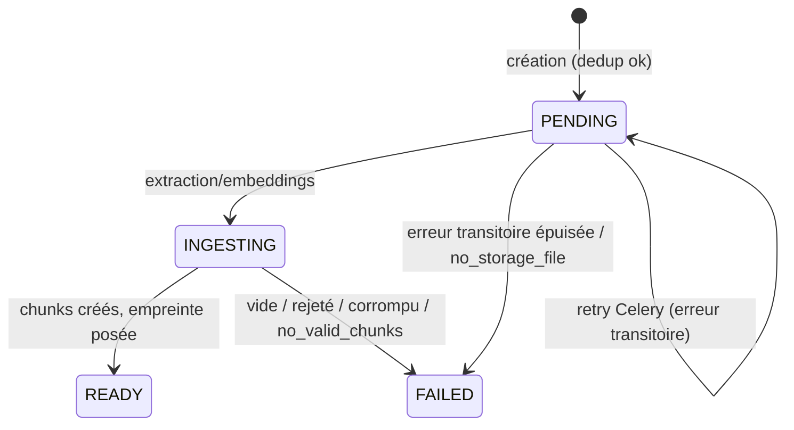

# Ingestion & extraction documentaire

Objectif : décrire le pipeline **réel** qui transforme un fichier (ou du texte brut)
en chunks indexés, de façon sécurisée, bornée et traçable.
Public : développeurs backend, ops. Source de vérité = le code.

Tout ce qui suit reflète les défauts de `backend/config/settings/base.py` ; chaque
valeur est surchargeable via `.env` (voir [variables d'environnement](../10-reference/variables-environnement.md)
et [feature flags](../10-reference/feature-flags.md)).

---

## 1. Points d'entrée

Le module `apps/rag_core/services/ingest/pipeline.py` expose deux fonctions publiques :

| Entrée | Fonction | Chemin |
|---|---|---|
| Upload binaire (fichier) | `ingest_document_from_upload(...)` | multi-format complet (détection MIME + extraction) |
| Texte brut (sans fichier) | `ingest_document_from_text(...)` | **sans** détection MIME (le texte est pris tel quel), mais indexé par le cœur commun `index_extraction_result` : mêmes lots d'embeddings, même identité de pipeline, même verrou d'espace qu'un fichier (*implémenté*, INGEST-1B) |
| Corpus métier (admin) | `ingest_corpus_document_from_upload(...)` | 100 % synchrone, **même** couche extraction, écrit dans `DomainCorpusDocument`/`DomainCorpusChunk` |

Le corpus métier réutilise la couche d'extraction privée mais impose `allow_excel=False`
(voir §5) et un traitement toujours synchrone. Voir [corpus métier](corpus-metier.md).

Côté HTTP, la couche vit dans `api/v1/documents/` (l'app Django `documents` est un
placeholder vide) : `POST /documents/upload/`, `POST /documents/ingest/` (texte),
`POST /documents/<id>/reindex/`. Voir [référence des endpoints](../05-api/reference-endpoints.md).

---

## 2. Formats supportés

Le dispatch réel est dans `extraction/__init__.py` → `validate_and_classify()` :
**la détection MIME se fait par CONTENU** (signature), jamais par extension ni par
le `Content-Type` du client. L'extension ne sert qu'à affiner le libellé des messages
d'erreur. Un extracteur par `format_key` est enregistré dans `_REGISTRY`.

| Format | `format_key` | Extracteur | Librairie réelle | Tables | OCR |
|---|---|---|---|---|---|
| TXT | `txt` | `TextExtractor` | décodage best-effort (utf-8/utf-8-sig/cp1252/latin-1) | non | non |
| Markdown | `markdown` | `MarkdownExtractor` | stdlib pur (`re`) | non | non |
| PDF | `pdf` | `PdfExtractor` | pypdf (primaire) + fallback natif pymupdf/pdfminer/pdfplumber **sous porte native + garde de qualité** ; pdfplumber pour tables | oui (P3) | conditionnel |
| DOCX | `docx` | `DocxExtractor` | stdlib `zipfile` + `xml.etree` (**pas** python-docx) ; gardes zip/xml | non | non |
| CSV | `csv` | `CsvExtractor` | stdlib `csv` + `csv.Sniffer` (`,` `;` tab) | ligne = bloc | non |
| HTML | `html` | `HtmlExtractor` | stdlib `html.parser` (via `htmltext.parse_html_document`) | non | non |
| Image | `image` | `ImageExtractor` | Pillow + OCR pytesseract ; la page est déclarée OCR (`ocr_pages=[1]`) — son texte n'est jamais une preuve chiffrée (correctif EMAIL-27A : il était auparavant classé « texte natif ») | non | **oui, systématique** |
| Excel `.xlsx` | `excel` | `ExcelExtractor` | openpyxl (`read_only`, streaming) | fenêtrage dédié | non |
| PowerPoint `.pptx` | `pptx` | `PptxExtractor` | python-pptx (+ pré-passe stdlib pour les gardes) | Markdown par diapositive | non |
| Courriel MIME `.eml` | `eml` | `EmlExtractor` | bibliothèque standard `email` ; **activable par flag** `DOCUMENT_EML_ENABLED` (fermé par défaut), borné par espace — voir [ingestion des courriels](ingestion-email.md) | non | non |
| XML générique `.xml` | `xml` | `XmlExtractor` | defusedxml 0.7.1 (PSFL), `iterparse` borné ; **activable par flag** `DOCUMENT_XML_ENABLED` (fermé par défaut) | unités structurées | non |
| DXF `.dxf` | `dxf` | `DxfExtractor` | ezdxf 1.4.4 (MIT), lecture stricte sans rendu ; **activable par flag** `DOCUMENT_DXF_ENABLED` (fermé par défaut), **toujours asynchrone** | unités structurées | non |
| IFC `.ifc` | `ifc` | `IfcExtractor` | IfcOpenShell 0.8.5 (LGPL-3.0-or-later, extra `[ifc]`), sémantique seule, import paresseux ; **activable par flag** `DOCUMENT_IFC_ENABLED` (fermé par défaut), **toujours asynchrone, file dédiée `ingest_ifc`** | unités structurées | non |
| DWG `.dwg` | `dwg` | `DwgExtractor` → `DxfExtractor` | GNU LibreDWG 0.14 (GPLv3+, **exécutable séparé**, épinglé et vérifié au build) convertit en DXF ASCII temporaire, lu par le DxfExtractor ; **activable par flag** `DOCUMENT_DWG_ENABLED` (fermé par défaut), **toujours asynchrone, file dédiée `ingest_dwg`** | unités structurées | non |
| Audio `.mp3 .m4a .wav .flac .ogg .webm` | `audio` | `AudioTranscriptExtractor` (lit la **transcription persistée**, jamais les octets sonores) | ASR AI Gateway + ffmpeg sur `worker_audio` | *Activable par flag* `DOCUMENT_AUDIO_INGEST_ENABLED` + `DOCUMENT_AUDIO_RAGSPACE_IDS` ou `DOCUMENT_AUDIO_GLOBAL_ENABLED` ; voir [ingestion-audio.md](ingestion-audio.md) |

Statut : tous ces formats sont **implémentés**, mais **pas tous activés par défaut** : PDF, DOCX,
CSV, TXT, Markdown, HTML, images, Excel et PPTX le sont ; MSG, EML, XML, DXF, IFC, DWG et l'audio
sont **activables par flag** (fermés par défaut, voir les lignes ci-dessus), de même que l'OCR PDF
(§6) et les tables PDF génériques. L'état **réel** d'un environnement se lit dans l'écran
d'administration [Capacités documentaires](capacites-documentaires.md), calculé depuis la
configuration chargée — jamais depuis cette page.

### Socle partagé des formats structurés — *aucun nouveau format activé*

Ce lot n'active **aucun** format (`.mpp` reste classé comme avant : texte brut ou
`octet-stream`) et n'ajoute **aucune dépendance**. Il pose le contrat que les lots de
format consomment — XML générique, DXF puis IFC (sections suivantes) :

- **Unités structurées génériques** : `ExtractionResult.units` (liste de
  `StructuredUnit(text, meta)`, vide par défaut), indexées par `_build_unit_specs` (§5) ;
- **Repère de provenance** `meta.locator` `{type, path, identifier}` (§5, *Provenance
  d'une unité structurée*) ;
- **Hook de détection de signatures structurées** : registre interne
  `mime.register_structured_detector(name, fn, priority=)`. Un détecteur reçoit
  `(data, ctx)` et renvoie un MIME canonique ou `None`. Il est évalué **après** les
  signatures fortes (exécutable, image, OLE2, PDF, famille ZIP) et **avant** les replis
  génériques (`octet-stream`, texte) : il ne peut jamais surclasser un binaire reconnu.
  Ordre déterministe (priorité croissante, puis nom) ; le premier MIME renvoyé gagne. Un
  détecteur qui lève, ou renvoie autre chose qu'une chaîne, fait échouer la détection
  **fermée** : `validate_and_classify` refuse le fichier (`structured_detection_failed`,
  HTTP 400) au lieu de le laisser retomber en texte brut. **Le registre est vide en
  production** : les signatures réelles (`<?xml`, `ISO-10303-21`, DXF) seront enregistrées
  par les lots de format, pas par le socle ;
- **`ExtractionComplexityExceeded`** (sous-classe de `ExtractionLimitExceeded`, code
  `extraction_complexity_exceeded`) : borne de complexité structurelle dépassée (éléments,
  profondeur, entités). Échec **définitif** (`NON_RETRYABLE`, §10) ; les codes utilisateur
  propres à un format restent à la charge de son lot ;
- **Dépendance optionnelle** : aucun helper nouveau — un futur parseur optionnel suit le
  motif existant `msg_email.parser_available()` (`importlib.util.find_spec`, jamais d'import
  au chargement du module).

### XML générique (`.xml`) — *activable par flag, fermé par défaut*

Premier consommateur du socle 1A. Aucune logique de schéma métier (DUME, UBL…), aucun
visualiseur XML, aucun changement de retrieval.

**Détection** (`xml_signature.detect_xml_signature`, enregistré dans le hook 1A, priorité
100) : extension **`.xml`** ET signature structurelle après BOM / blancs / commentaires —
déclaration `<?xml` (non obligatoire), instruction de traitement, `<!DOCTYPE` non-HTML, ou
balise racine bien formée dont le nom local n'est pas `html`. UTF-8 BOM et UTF-16 sont
reconnus. Le Content-Type client n'est jamais une preuve. Un `.html`, `.svg`, `.xsd`,
`.xsl`, `.md`, `.txt` n'est **jamais** reclassé XML ; un `.xml` au contenu HTML
(`<!DOCTYPE html`, racine `<html>`) reste HTML ; un exécutable, un PDF ou un OOXML renommé
`.xml` garde son type réel (signatures fortes évaluées avant) ; du texte brut nommé `.xml`
reste `txt`. MIME canonique : `application/xml`, `format_key` `xml`.

**Porte** (`validate_and_classify`, patron XML) : `DOCUMENT_XML_ENABLED=0` → refus
`xml_ingestion_disabled` (400, aucun Document créé — un `.xml` reconnu n'est **plus**
indexé comme texte brut) ; parseur absent → `xml_dependency_unavailable`. `supported_formats()`
n'annonce `xml` que si la porte est ouverte et le parseur déployé ; le frontend n'ajoute
`.xml` à la liste de dépôt que sur cette annonce.

**Sécurité** (non optionnelle) : pré-refus par octets de tout `<!DOCTYPE`/`<!ENTITY`
(`xml_security.is_unsafe_xml`, code `unsafe_xml`), puis defusedxml `iterparse` avec
`forbid_dtd=True`, `forbid_entities=True`, `forbid_external=True` — XXE, DTD interne ou
externe, bombe d'entités, référence externe : refus `unsafe_xml` **avant** toute expansion,
sans lecture de fichier ni accès réseau, message générique. XML mal formé ou encodage
invalide → `xml_malformed`. Ni fichier temporaire, ni sous-processus.

**Limites structurelles** (indépendantes de la limite d'upload, jamais réglables par le
client) : `DOCUMENT_XML_MAX_DEPTH` = **64** (racine = profondeur 1 ; 64 accepté, 65 refusé)
et `DOCUMENT_XML_MAX_NODES` = **200 000** éléments (comptés de façon identique avec ou sans
texte). Dépassement pendant la lecture en flux → `ExtractionComplexityExceeded` avec le code
`xml_complexity_limit`, arrêt immédiat, rien d'indexé (aucune publication partielle).

**Unités sémantiques** (déterministes, ordre document, jamais triées) :

- chemin par nom **local** (`/Racine/Enfant[2]`), indice `[n]` uniquement entre frères de
  même nom ; les namespaces (défaut, préfixés, multiples) sont conservés dans
  `meta.extraction.namespaces` (bornés : 64 entrées, URI ≤ 200 caractères) et jamais
  répétés dans le texte ;
- **records répétés** : sous un parent, des enfants de même nom local (≥ 2) forment des
  records ; chaque record est une unité à sa frontière la plus **externe** (les
  répétitions imbriquées restent dans le record : aucune double indexation) ;
- le contenu hors records est regroupé par branche directe sous la racine ; attributs et
  texte propres de la racine forment une unité `/Racine` ; sans aucun record, un document
  d'au plus 64 éléments tient dans **une** unité racine ;
- texte canonique autoporteur : `XML path: <chemin>` puis des lignes `chemin/relatif: valeur`,
  `chemin/relatif/@attribut: valeur`, `text: valeur` (texte propre de l'unité). Contenu
  mixte rendu dans l'ordre textuel ; CDATA = texte ; commentaires et instructions de
  traitement **jamais** indexés ; espaces normalisés, valeurs jamais converties ni
  traduites ; élément vide → aucune unité ; document sans contenu → `empty_document` ;
- `unit.meta = {"locator": {"type": "element", "path": …, "identifier"?: …},
  "structured_format": "xml"}` — `identifier` = attribut `id` ou `xml:id` du record, sans
  taxonomie métier.

```text
XML path: /companies/company[2]
@id: B
name: Entreprise DEF
country: BE
```

`result.text` reste vide : le rail `units` (§5) chunke chaque unité avec le chunker commun
(un record long donne plusieurs chunks porteurs du **même** `locator`), `page_number=None`,
citation « `chemin · identifiant` » sans page. `meta.extraction` : `format`, `parser`,
`parser_version`, `root_tag`, `root_namespace`, `namespaces`, `node_count`, `max_depth`,
`record_groups`, `unit_count`, `warnings` (`xml_namespaces_truncated`,
`xml_namespace_uri_truncated`).

**Pipeline** : chemin ordinaire — pas d'async forcé (contrairement à Excel/PPTX/DXF), décision
`resolve_async` inchangée, parité eager (INGEST-1E), source durable relue au reindex,
publication INGEST-1F (parsing hors transaction). Téléchargement de l'original : `attachment`
+ `application/octet-stream` + `nosniff` + CSP sandbox (type actif, comportement existant).

### Matrice des formats de présentation

| Extension | Statut | Détail |
|---|---|---|
| `.pptx` | **supporté** | extraction structurée par diapositive ; flag `DOCUMENT_PPTX_ENABLED` (défaut `1`) |
| `.pptm` | **non supporté** | macro-enabled → refusé par contenu (`macro_enabled_presentation_refused`) |
| `.ppt` | **non supporté** | OLE2 hérité → `legacy_office_format` ; message spécialisé si l'extension est `.ppt` |
| `.odp` | **non supporté** | OpenDocument → `unsupported_presentation_format` |
| OCR des images de diapositives | **non inclus** dans ce lot | seul le texte alternatif SAISI par l'auteur est lu |
| Notes du présentateur | **selon configuration** | `DOCUMENT_PPTX_INCLUDE_NOTES` (défaut `0`) |

### Formats explicitement refusés

Refus décidés par `validation._REJECT`, **par contenu** :

| Cas | Code | HTTP |
|---|---|---|
| Verrou temporaire Office (nom préfixé `~$`) | `office_temporary_file` | 400 |
| `.docm` / `.xlsm` / `.pptm` (macro-enabled) | `macro_enabled_*_refused` | 400 |
| `.ods` | `unsupported_spreadsheet_format` | 400 |
| `.odp` | `unsupported_presentation_format` | 400 |
| `.odt` | `unsupported_text_document_format` | 400 |
| `.xls` / `.doc` / `.ppt` (OLE2 hérité) | `legacy_office_format` | 400 |
| Archive `.zip` générique | `archive_not_supported` | 400 |
| Exécutable (ELF/PE/Mach-O/script) | `executable_refused` | 400 |
| XML Office porteur d'un `<!DOCTYPE`/`<!ENTITY` | `unsafe_xml` | 400 |
| Type inconnu / octet-stream | `unsupported_file_type` | **415** |
| Fichier vide | `empty_file` | 400 |
| Trop volumineux | `file_too_large` | 413 |
| `.xlsx` si `DOCUMENT_EXCEL_ENABLED=0` ou `allow_excel=False` (corpus) | `unsupported_office_format` / `excel_not_supported_here` | 400 |
| `.pptx` si `DOCUMENT_PPTX_ENABLED=0` ou `allow_pptx=False` (corpus) | `unsupported_office_format` / `pptx_not_supported_here` | 400 |

Seul `UnsupportedFormat` produit un **415** ; tous les autres refus lèvent
`RejectedFile` → **400** (sauf taille → 413). Le caractère macro-enabled est déduit
du contenu de l'archive (présence d'un `*/vbaProject.bin` ou d'un Content-Type
`…macroEnabled…` déclaré) — **aucune macro n'est jamais lue ni exécutée** : sa seule
présence suffit au refus. Renommer un `.xlsm` en `.xlsx`, ou un `.pptm` en `.pptx`, ne
contourne rien.

> **Verrous temporaires Office.** `~$rapport.docx` est le fichier de verrouillage que
> Word/Excel écrit à l'ouverture d'un document et supprime à la fermeture ; ceux qui
> subsistent viennent d'un plantage. Il porte l'extension du document mais n'en est pas :
> ~160 octets contenant le nom du propriétaire de la session. Le contenu le refusait déjà
> (`OCTET` → `unsupported_file_type`), mais ce message laissait croire à un format légitime
> non pris en charge — d'où un code dédié. **C'est le seul refus décidé sur le NOM** : la
> doctrine « ne jamais faire confiance à l'extension » interdit d'ACCEPTER sur le nom ;
> refuser ne peut que rejeter davantage. Le frontend les filtre aussi, par ergonomie
> (éviter un aller-retour par fichier) — mais il n'est pas la barrière.

> **Note de sécurité.** Jusqu'à ce lot, `_detect_zip_family` classait en `PPTX`
> toute archive portant un dossier `ppt/`, **sans consulter le marqueur macro** —
> contrairement à Word et Excel. C'était sans effet tant que `.pptx` était refusé en
> bloc. L'ouverture de la porte imposait donc de fermer ce trou d'abord : `M.PPTM` est
> désormais détecté, et la partie canonique `ppt/presentation.xml` est exigée (un dossier
> `ppt/` incomplet reste un ZIP générique, comme un `xl/` incomplet).

---

### DXF (`.dxf`) — *activable par flag, fermé par défaut, toujours asynchrone*

Support **documentaire** d'un dessin CAO : ce que le dessin *dit* (textes, blocs et
attributs, cotes, calques, layouts, XREF déclarées), jamais ce qu'il *montre*. Aucun rendu,
aucune géométrie, aucun viewer, aucune conversion DWG, aucun sous-processus, aucun extra
graphique (ezdxf seul ; `.dwg`, `.dgn`, `.rvt` restent hors périmètre).

**Détection** (`dxf_signature.detect_dxf_signature`, hook 1A, priorité 100) : extension
**`.dxf`** ET signature de contenu — en-tête binaire « `AutoCAD Binary DXF` » ou paires
`0`/`SECTION` puis `2`/`HEADER|CLASSES|TABLES|BLOCKS|ENTITIES|OBJECTS…` en tête
(commentaires `999`, BOM et blancs tolérés). Le mot « SECTION » seul n'est jamais une
preuve ; le Content-Type client (`image/vnd.dxf`, `application/dxf`, `octet-stream`) n'est
jamais décisif — `image/vnd.dxf` ne route jamais vers le pipeline image. MIME canonique
interne : `application/dxf`, `format_key` `dxf`. Exécutable/PDF/OOXML/HTML/CSV renommés
`.dxf` gardent leur type ; texte brut nommé `.dxf` reste `txt` ; un XML nommé `.dxf`
n'est ni DXF ni XML (texte brut).

**Porte** (patron XML) : `DOCUMENT_DXF_ENABLED=0` → `dxf_ingestion_disabled` (400,
aucun Document — un `.dxf` reconnu n'est plus indexé comme texte brut) ; ezdxf absent →
`dxf_dependency_unavailable`. `supported_formats()` n'annonce `dxf` que porte ouverte et
parseur déployé ; le frontend n'ajoute `.dxf` à la liste de dépôt que sur cette annonce.

**Lecture** : `ezdxf.read` (ASCII, encodage UTF-8 dès R2007 sinon `$DWGCODEPAGE`) ou
`Drawing.load(binary_tags_loader)` (DXF **binaire**, en mémoire) — **jamais**
`ezdxf.recover` (il répare silencieusement : 2 correctifs observés sur un fichier tronqué)
ni `doc.audit()` (il mute le document). Fichier invalide/tronqué → `dxf_malformed` ;
`DXFVersionError` → `dxf_unsupported_version` (ezdxf 1.4.4 relève en pratique les fichiers
pré-R12 en R12 sans lever). Ni fichier temporaire, ni sous-processus. **Fins de ligne** : le flux texte en mémoire est ouvert en *universal newlines*
(`io.StringIO(texte, newline=None)`, l'équivalent de `ezdxf.readfile`) — un DXF AutoCAD/Windows
(CRLF) ou à `\r` seuls produit exactement le même document qu'en LF (version, entités, unités,
locators, méta). Avant ce correctif, le `\r` restait dans chaque valeur (`AC1032\r`) et le
dessin était lu comme un R12 vide, sans erreur : 0 chunk. Le DXF binaire n'est pas concerné.

**Limite structurelle** : `DOCUMENT_DXF_MAX_ENTITIES` = **250 000** (entités des layouts +
définitions de blocs), vérifiée dès le chargement, **avant** toute extraction sémantique →
`ExtractionComplexityExceeded` (`dxf_complexity_limit`), rien d'indexé. ezdxf n'a pas de
chargeur en flux : le coût du parsing est borné par la limite d'upload globale.

**Unités sémantiques** (déterministes ; layouts dans l'ordre des onglets, puis ordre du
dessin ; jamais triées par valeur) :

- **résumé du dessin** (`locator.path = "Drawing"`) : version, unités (`$INSUNITS` décodé
  par ezdxf, rien d'inventé si indéfini), layouts, calques, comptes d'entités par type,
  blocs utilisés, XREF déclarées — émis dès qu'il y a une entité (un dessin de géométrie
  seule reste indexable par son résumé ; un dessin vide → `empty_document`) ;
- **annotations** par `layout + calque` (`Layout:RDC/Layer:ELEC_CFO`) : TEXT et MTEXT en
  texte plein (codes de formatage retirés), DIMENSION (`Dimension: 2500 mm` — mesure et
  unité du dessin pour les cotes linéaires, texte de surcharge respecté, `<>` substitué ;
  la mesure déclarée (code 42, facultatif) est ignorée si elle est négative — GNU
  LibreDWG écrit la sentinelle `-1` pour une mesure non stockée, et la mesure est alors
  recalculée depuis la géométrie ; sans ce repli, la grande majorité des cotes des plans réels observés sortaient
  `Dimension: -1 mm`. La cote reste en **unités de dessin** : un facteur d'échelle d'affichage
  (`DIMLFAC`, cotes affichées en cm sur un dessin en mm) n'est pas appliqué),
  MULTILEADER ; calques éteints/gelés **conservés** et signalés (`Layer state: off`) ;
- **une unité par instance de bloc** portant des ATTRIB utiles
  (`Layout:Model/Layer:CVC_EQUIPEMENTS/Block:CTA`, `identifier = handle:<HANDLE>`) :
  `TAG: valeur`, jamais une valeur sans son tag ; un INSERT sans attribut est compté, pas
  indexé ;
- **une unité par définition de bloc nommé** portant du texte (`Block:CTA`) : textes du bloc
  et tags d'ATTDEF (sans valeur — la valeur vit sur l'instance : aucune duplication) ;
  blocs anonymes (`*…`) comptés seulement ; aucune récursion géométrique.

Les entités géométriques (LINE, POLYLINE, ARC, CIRCLE, HATCH, SOLID…) sont **comptées**,
jamais transformées en texte ; aucune coordonnée brute n'est indexée ; aucun dump de
codes de groupe. Un texte long (MTEXT) est borné à 100 000 caractères
(`dxf_text_truncated`) puis découpé par le chunker commun (`page_number=None`, même
`locator` sur tous les chunks — un layout n'est **pas** une page).

```text
DXF block
Layout: Model
Layer: CVC_EQUIPEMENTS
Block: CTA
REPERE: CTA-03
DEBIT: 12000 m3/h
PUISSANCE: 45 kW
```

**XREF — règle absolue** : détectées, décrites (`xrefs_declared: [{name, path}]`, chemin
tel que déclaré, borné), **jamais** ouvertes, suivies, résolues ni parsées — un chemin
`../../etc/passwd`, `file://`, UNC ou URL est rapporté tel quel, sans aucun accès fichier
ni réseau. L'extracteur ne lit que les octets du Document courant.

`meta.extraction` : `format, parser, parser_version, dxf_version, dxf_release, dxf_binary,
units, units_name, layouts(+count), layers(+count), layers_off, layers_frozen,
entity_count, entity_counts, unknown_entity_count, unknown_entity_counts, blocks(+count),
xrefs_declared(+count), semantic_unit_count, annotation_count, block_unit_count, warnings`
(`dxf_layers_truncated`, `dxf_blocks_truncated`, `dxf_xrefs_truncated`, `dxf_layouts_truncated`,
`dxf_entity_types_truncated`, `dxf_text_truncated`, `dxf_unknown_entities`) — listes bornées.

**Entités exotiques** : un DXF **valide** peut contenir des types
qu'ezdxf ne modélise pas (chargés en `DXFTagStorage`, sans attribut `layer` supporté — ex.
`SECTIONOBJECT`, plan de coupe AutoCAD). Ils sont **comptés** (`entity_counts`, résumé du
dessin, plafond `DOCUMENT_DXF_MAX_ENTITIES`), **observés** (un seul warning
`dxf_unknown_entities`, `unknown_entity_count` exact, `unknown_entity_counts` borné à 64 types)
et **ignorés** : ni calque, ni texte, ni tags bruts, aucune unité. Le test est la capacité
d'attribut ezdxf (`dxf.is_supported("layer")`), pas une capture d'exception : un type **connu**
dont l'extraction échoue reste `dxf_malformed`, et un fichier que `ezdxf.read` refuse aussi.
Avant R2, ce cas rejetait tout le document (même un DXF natif AutoCAD).

**Pipeline** : **async forcé** (`async_policy.dxf_forces_async`, non surchargeable, comme
Excel/PPTX ; parité eager INGEST-1E : exécution inline cohérente, jamais `queued` sans
worker), source durable relue au reindex, publication INGEST-1F (parsing hors
transaction). Téléchargement de l'original : `attachment` + `nosniff` + CSP sandbox.

### IFC (`.ifc`) — *activable par flag, fermé par défaut, async absolu, file dédiée*

Extraction **sémantique BIM** d'une maquette IFC (fichier physique STEP, ISO 10303-21) :
ce que le modèle *déclare* (projet, sites, bâtiments, niveaux, espaces, éléments,
propriétés, quantités, matériaux, systèmes, classifications), jamais ce qu'il *montre*.
Aucun rendu, aucune géométrie (ni `ifcopenshell.geom`, ni `create_shape`, ni itérateur,
ni OpenCASCADE — preuve statique dans les tests), aucune coordonnée indexée, aucun
fichier temporaire, aucun sous-processus. `.ifczip`, `.ifcxml`, `.rvt`, `.step`/`.stp`
génériques restent hors périmètre.

**Dépendance** : IfcOpenShell 0.8.5 en **extra** `[ifc]` (et non dépendance cœur) —
~147 Mo de bibliothèque native, ~115 Mo RSS à l'import ; seul le worker `worker_ifc`
l'installe (`Dockerfile`, `WITH_IFC=1`) ; l'image générale (web,
worker, beat) ne le porte pas : l'**admission** d'un `.ifc` (validation, capacités
annoncées) repose sur le seul flag `DOCUMENT_IFC_ENABLED` — invariant de déploiement
« flag ouvert seulement si worker_ifc tourne » — et c'est l'extracteur, côté worker, qui
refuse `ifc_dependency_unavailable` si la dépendance manque. Licence déclarée
LGPL-3.0-or-later ; le wheel n'embarque aucun fichier LICENSE (voir `pyproject.toml`).
**Import paresseux** : `parser_available()` par `find_spec` ; l'import réel n'a lieu
qu'à l'extraction d'un IFC (test `test_ifc_import_isolation.py` en sous-processus).

**Détection** (`ifc_signature.detect_ifc_signature`, hook 1A) : extension **`.ifc`** ET
en-tête `ISO-10303-21;` (BOM/blancs tolérés). Le `FILE_SCHEMA` n'est pas exigé pour le
routage : un `.ifc` STEP à en-tête invalide ou à schéma non IFC atteint l'extracteur
(`ifc_malformed` / `ifc_unsupported_schema`), jamais le texte brut. MIME canonique interne
`application/x-step` (aucun type IANA ; valeur observée en pratique — dans RagATM elle
signifie IFC puisqu'un STEP générique n'est jamais classé) ; Content-Type client
(`application/x-step`, `model/step`, `octet-stream`, `text/plain`) accepté mais jamais
décisif. `format_key` `ifc`.

**Porte** : `DOCUMENT_IFC_ENABLED=0` → `ifc_ingestion_disabled` (400, aucun Document) ;
IfcOpenShell absent → `ifc_dependency_unavailable`. `supported_formats()` n'annonce `ifc`
que porte ouverte et parseur déployé ; le frontend n'ajoute `.ifc` que sur cette annonce.

**Async absolu et isolation** : `async_policy.ifc_forces_async` (non surchargeable, `?async=false`
ignoré) ; parité eager INGEST-1E. Routage **par document** vers la file dédiée
`ingest_ifc` (`ingest/queues.py::ingest_queue_for`, `apply_async(queue=…)`) à tous les
points d'enfilement — upload, reindex unitaire, items des jobs de réindexation, commande
`reembed_documents` ; les relances `self.retry()` restent sur la file d'origine.
**Exploitation** : le service `worker_ifc` existe dans chaque
compose autonome (profil `ifc`, opt-in ; `--queues=ingest_ifc --concurrency=1
--prefetch-multiplier=1`, extra `[ifc]`) — procédure d'activation et rollback dans
docker-compose.md. N'activer `DOCUMENT_IFC_ENABLED`
qu'une fois ce worker démarré et vérifié : sans lui, les maquettes restent PENDING
(jamais de repli vers la file `celery`). Flag refermé après ingestion : rien n'est
supprimé (source, chunks, index restent servis) ; une réindexation d'un IFC est alors
refusée à l'admission (`ifc_ingestion_disabled`), l'index publié est conservé (1F).
Gardes statiques : `tests/tests_root/deploy/test_ifc_worker_isolation.py` et
`test_celery_queue_consumers.py`.

**Sécurité et limites** : en-tête STEP obligatoire ; **pré-scan** structurel borné des
déclarations `#n=` en début de ligne (jamais le parseur, jamais un juge de validité) —
au-delà de `DOCUMENT_IFC_MAX_ENTITIES` (**250 000**) → `ifc_complexity_limit` **sans
charger IfcOpenShell** ; compte définitif des entités du modèle (arrêt anticipé) ;
`ifc_malformed` pour toute structure invalide ou exception native traduite (jamais de
réparation) ; `ifc_unsupported_schema` hors IFC2X3 / IFC4 / IFC4X3 (`IFC4X3_ADD2` lu par
0.8.5) ; parcours de relations **bornés** (agrégation, containment, type, matériau,
classification, système ; ensembles de visite, profondeur ≤ 16) ; valeurs textuelles
bornées à 2 000 caractères (`ifc_value_truncated`), 500 lignes par unité
(`ifc_properties_truncated`). Références externes (`IfcDocumentReference`,
`IfcClassificationReference`, `IfcClassification.Location`) : décrites (compte +
échantillon borné), **jamais** ouvertes ni téléchargées.

**Unités sémantiques** (stratégie hybride, déterministe, jamais « une entité = une unité ») :

- **résumé du modèle** (`Model`) : schéma, projet, site, comptes (sites, bâtiments,
  niveaux, espaces, produits), principales classes d'éléments ;
- **une unité par site / bâtiment / niveau / espace** : chemin, Name/LongName/Description,
  propriétés, quantités, classifications, comptes des éléments directement contenus ;
- **une unité par élément RICHE** (description, tag, propriétés, quantités, matériaux,
  classifications, systèmes, ou nom + type/ObjectType/PredefinedType) : `Path`, `Class`,
  `GlobalId`, `Name`, `Type: <nom du type>`, `Pset_X.Prop: valeur`,
  `Qto_X.Quantité: valeur unité` (unité du projet ou de la quantité, jamais dérivée de la
  géométrie), `Material:`, `Classification: <système> <code> <nom>`, `System:` ;
- **éléments pauvres GROUPÉS** par conteneur + classe + type : `Count`, échantillon de
  noms (≤ 10) — jamais une liste de GlobalId ;
- **une unité par type référencé** (`Types / IfcWallType / <nom>`) : propriétés du type
  portées une seule fois, `Instances: n` ; l'instance ne cite que le nom du type.
- élément sans conteneur → chemin de repli `Projet / Uncontained / Classe / Nom`.

```text
IFC element
Path: Centre hospitalier / Site principal / Building A / Level 02 / Local technique 2.14
Class: IfcDoor
GlobalId: 2Fabcdefghijklmnopqr0D
Name: D-201
Type: Porte EI60 900x2100
Pset_DoorCommon.FireRating: EI60
Qto_DoorBaseQuantities.Height: 2100 mm
Material: Acier
System: VENTILATION-CTA03
```

`meta.locator = {type: "ifc", path: "Projet / Site / Bâtiment / Niveau / Espace / Classe /
Nom", identifier: "GlobalId:<GlobalId>"}` ; `page_number=None` (un niveau n'est pas une
page) ; citation « `chemin · GlobalId:…` » par le rendu 1A. `result.text` reste vide ; le
rail `units` découpe les unités longues avec le même `locator`. `meta.extraction` :
`format, parser, parser_version, schema, schema_identifier, project_name, entity_count,
product_count, element_count, sites_count, buildings_count, storeys_count, spaces_count,
element_class_counts (borné), rich_element_units, grouped_element_units,
spatial_summary_units, type_units, semantic_unit_count, external_references_count,
external_references_sample (borné), prescan_count, warnings`.

### DWG (`.dwg`) — *activable par flag, fermé par défaut, async absolu, file dédiée*

Le DWG est un format **binaire propriétaire** : RagATM ne le parse pas et n'en écrit
jamais. Il est **converti localement** en DXF ASCII, puis lu par le `DxfExtractor` déjà
qualifié (R1 fins de ligne, R2 entités exotiques) :

```
plan.dwg (source DURABLE)
  → GNU LibreDWG 0.14 `dwg2dxf` (sous-processus, hors ligne, répertoire jetable)
  → DXF ASCII TEMPORAIRE (jamais persisté, jamais un second document)
  → DxfExtractor → StructuredUnit (1A) → chunker commun → publication 1F
```

Aucune sémantique CAO n'est réimplémentée : textes, MTEXT, blocs, ATTRIB, cotes, calques,
layouts, unités et XREF **déclarées** viennent du `DxfExtractor`. Aucun rendu, aucune
géométrie, aucun OCR, aucune résolution de XREF / SHX / CTB / image externe.

**Dépendance** : GNU LibreDWG **0.14** (GPLv3+), *archive officielle* `ftp.gnu.org`,
SHA256 `62ebb73b…81275` **vérifié pendant la construction** (le build échoue sinon).
Seul `dwg2dxf` est embarqué (ni `dwgread`, ni `dxf2dwg` — writer expérimental, jamais
source de vérité) et seulement dans l'image du worker `worker_dwg` (`WITH_DWG=1`) :
l'image générale n'a pas de convertisseur. Le texte de licence `COPYING` de LibreDWG est
embarqué dans cette image sous **`/usr/local/share/doc/libredwg/COPYING`** (l'étape de build
installe sous `/out/share/`, copié vers `/usr/local/share/`). La version 0.13.3 est REFUSÉE
(`dwg_dependency_unavailable`) — son writer DXF corrompt les MTEXT longs, ce qui perdait
des documents entiers (qualification interne). **La revue de conformité
GPLv3+ reste une porte de publication ouverte** : ce lot documente la provenance
(version, source, condensé, usage en processus séparé), il ne conclut rien juridiquement.

**Détection** (`dwg_signature.detect_dwg_signature`, hook 1A) : extension **`.dwg`** ET
en-tête plausible — code `ACxxxx` **connu** suivi des cinq octets nuls de l'en-tête DWG,
sur au moins 256 octets. Un texte commençant par « AC1032 », un binaire aléatoire ou un
PDF/PNG/ZIP/ELF renommé `.dwg` ne sont jamais des DWG (les signatures fortes restent
prioritaires). Le Content-Type client n'est jamais décisif : `image/vnd.dwg` ne route
JAMAIS vers le pipeline image/OCR. MIME canonique interne `application/acad`.

**Versions** : supportées `AC1015` (R2000), `AC1018` (R2004), `AC1021` (R2007), `AC1024`
(R2010), `AC1027` (R2013), `AC1032` (R2018) — une par famille, toutes vérifiées sur le
corpus officiel LibreDWG. Une version reconnue hors périmètre (R11/R12, R13, R14, R2000i,
R2002) est refusée **avant toute création de document** : `dwg_unsupported_version`.

**Porte** : `DOCUMENT_DWG_ENABLED=0` → `dwg_ingestion_disabled` (400, aucun Document).
Comme pour IFC, l'admission web ne dépend PAS de la présence locale du convertisseur
(seul `worker_dwg` le porte) ; c'est l'extracteur, côté worker, qui refuse
`dwg_dependency_unavailable` si le binaire manque ou n'est pas en 0.14.

**Conversion** (`dwg_extractor.DwgExtractor`) : répertoire temporaire **généré par le
serveur** (`ragatm-dwg-…`, 0700), noms internes FIXES `input.dwg` / `output.dxf` (0600) —
le nom déposé par l'utilisateur n'atteint ni le système de fichiers ni la ligne de
commande ; `subprocess` avec **liste d'arguments et `shell=False`** (jamais `os.system`,
jamais `/bin/sh -c`) ; `cwd` = répertoire temporaire ; environnement réduit (aucun secret
d'application) ; session dédiée, **groupe de processus tué en entier** au dépassement du
délai ; sorties du convertisseur redirigées vers des fichiers (jamais accumulées en
mémoire) — seuls des **comptes** sont conservés (`converter_warning_count`,
`dwg_converter_warnings`), jamais le texte brut ; taille du DXF vérifiée par `stat`
**avant** toute lecture ; répertoire détruit en cas de succès, d'échec ET de délai.

**Un exit 0 ne suffit pas** : la sortie doit exister, être non vide, tenir sous
`DOCUMENT_DWG_MAX_INTERMEDIATE_DXF_MB` (128 Mo — le DXF pèse jusqu'à ~4,6× le DWG) et
être acceptée par la lecture **stricte** du `DxfExtractor` (jamais `ezdxf.recover`). Un
DXF invalide écrit par le convertisseur est un **échec de conversion**
(`dwg_conversion_failed`, `reason: invalid_dxf`), pas un défaut du dessin déposé.

**Provenance** : la source durable, la citation, le téléchargement et la source de
réindexation restent le `.dwg` déposé ; `locator.type = "dwg"` avec le chemin utile
(`Layout:…/Layer:…/Block:…`), **sans identifiant** — LibreDWG renumérote les handles du
DXF, ils ne peuvent pas servir d'identité stable du DWG. Aucun chemin temporaire
n'apparaît dans les métadonnées, les chunks ou les messages d'erreur. `meta.extraction` :
`format=dwg, converter=libredwg, converter_version, converter_warning_count,
source_dwg_version, source_dwg_release, intermediate_format=dxf, intermediate_dxf_version,
intermediate_dxf_bytes, parser=ezdxf, parser_version` puis les compteurs CAO hérités du
DxfExtractor (`entity_count`, `entity_counts`, `layers`, `layouts`, `blocks`,
`xrefs_declared`, `unknown_entity_*`, `semantic_unit_count`…).

**Pipeline** : **async forcé** (`async_policy.dwg_forces_async`, non surchargeable :
`?async=false` n'exécute jamais une conversion dans la requête HTTP, ni à l'upload ni à la
réindexation explicite) et **file dédiée `ingest_dwg`** routée par document. La
réindexation relit le `.dwg` durable et **reconvertit** ; aucun cache de DXF n'existe.
Un échec de conversion pendant une réindexation conserve l'index publié (contrat 1F/R1).

**Codes** : `dwg_ingestion_disabled`, `dwg_dependency_unavailable` (ENVIRONNEMENTAL) ;
`dwg_malformed`, `dwg_unsupported_version`, `dwg_conversion_failed`,
`dwg_conversion_timeout`, `dwg_complexity_limit` (NON REJOUABLES — la source et le
convertisseur sont déterministes, et un dessin pathologique ne doit pas consommer le
worker en boucle).

**Activation** : voir docker-compose.md. *Activé en
staging* (21/09/2026) après qualification sur un jeu de plans DWG réels ; *non activé* en
production. Réserves connues : les cotes sont restituées en **unités de dessin** (le facteur
d'affichage `DIMLFAC` n'est pas appliqué : une cote lue « 282 » en cm sur le plan est indexée
`2825 mm`) ; un même fait présent dans plusieurs dessins d'un lot (niveaux NGF, calques
communs) n'est pas ciblé par le **nom** du dessin cité dans la question.

## 3. Séquence upload → statut final

```mermaid
sequenceDiagram
  participant API as api/v1/documents
  participant PIPE as ingest_document_from_upload
  participant POL as async_policy.resolve_async
  participant REPO as create_or_get_by_sha
  participant IDX as extract_and_index_bytes
  participant CEL as ingest_document_task (Celery)
  participant DB as Postgres

  API->>PIPE: bytes, filename, content_type, rag_space
  PIPE->>PIPE: sha = sha256(bytes)
  PIPE->>PIPE: validate_and_classify(bytes) → format_key (refus ⇒ exception, rien créé)
  PIPE->>POL: resolve_async(explicit, format_key)
  POL-->>PIPE: sync | async (OCR/Excel/PPTX/DXF/IFC → async forcé ; IFC → file ingest_ifc)
  PIPE->>REPO: create_document_with_quota_reservation (dédup, puis quota + création sous verrou court)
  alt doublon non-FAILED
    REPO-->>API: 200 {deduped:true, document}
  else nouveau
    REPO->>DB: INSERT Document(status=PENDING)
    PIPE->>DB: storage_file.save (MEDIA_ROOT)
    alt async
      PIPE->>DB: on_commit → ingest_document_task.delay
      PIPE-->>API: 200 {queued:true, document_id} (PENDING)
      CEL->>IDX: extract + index (worker)
    else sync
      PIPE->>IDX: extract_and_index_bytes
      IDX-->>API: IngestResult(status, chunks_created)
    end
  end
```

Étapes détaillées de `ingest_document_from_upload` :

1. Charge le `RagSpace`, calcule `sha256(bytes)`.
2. **Classification canonique** `validate_and_classify(bytes, ExtractionContext)` — la
   **même** primitive que l'upload HTTP (taille, MIME par contenu, portes de format,
   refus explicites ; aucune extraction). Elle rend le `format_key` réel. Un fichier
   refusé lève l'exception de validation existante (`RejectedFile` / `UnsupportedFormat`,
   même code que HTTP) **avant** toute création : ni `Document`, ni réservation de quota,
   ni stockage, ni enqueue (*implémenté*, INGEST-1E2). Le pipeline direct n'est donc
   jamais moins strict que HTTP.
3. **Décision sync/async** centralisée dans `async_policy.resolve_async(explicit, format_key)`
   (§4) : un format forcé (Excel, PPTX, OCR) reste asynchrone même avec `async_mode=False`,
   exactement comme l'upload HTTP (*implémenté*, INGEST-1E2). En mode eager, même
   neutralisation que la couche HTTP (§4).
4. Extraction best-effort de la **date document** depuis le contenu (TXT/PDF seulement) —
   ne bloque jamais.
5. **Dé-dup + réservation de quota + création** via `create_document_with_quota_reservation`
   (dédup par `sha256` dans le RagSpace, puis `quota.check_and_reserve` : usage relu et
   ligne créée `PENDING` dans une même transaction courte — cf.
   [../10-reference/quotas-workspace.md](../10-reference/quotas-workspace.md), INGEST-1E3).
   La classification (étape 2) s'exécute **hors** de ce verrou.
   **Identité de contenu** (*implémenté*) : `même RagSpace + même sha256 = même document`.
   `find_existing_by_sha` rend le document **actif** (PENDING/INGESTING/READY) s'il existe,
   sinon la **première occurrence `FAILED`** (`created_at`, `id` croissants) — qui est alors
   **réutilisée** comme cible de reprise : même `document_id`, aucune ligne créée, provenance
   d'origine conservée, fichier source restauré s'il manquait, ré-enfilement
   (`IngestResult.retried = True`, HTTP `detail: "failed_document_retried"`). La contrainte
   `uniq_rag_document_space_sha256_not_failed` reste la garde de **course** : `create_or_get_by_sha`
   relit le gagnant sur une `IntegrityError` portant **exactement** cette contrainte (les autres
   violations sont propagées). Si une ligne `FAILED` ne peut plus redevenir active parce qu'un
   document actif porte déjà son contenu, la transition `FAILED → INGESTING` échoue en
   **`duplicate_content`** (`DuplicateContentError`, non retryable, `meta.duplicate_of`,
   `meta.extraction.error_code`) — jamais en `IntegrityError` brute.
6. **Stockage de l'original** : `Document.storage_file` (Django `FileField`,
   `upload_to=rag_docs/<space>/<doc>/<filename>`) sur le **volume local `MEDIA_ROOT`** —
   RagATM n'utilise **aucun stockage objet** (voir
   [ADR-001](../01-overview/decisions/ADR-001-stockage-documentaire.md)). La persistance
   est **fail-closed** (*implémenté*, INGEST-1E1), en synchrone comme en asynchrone : si
   `storage_file.save` échoue, le document est marqué `FAILED`
   (`error_message=storage_file_save_failed: …`) et la tentative s'arrête **avant**
   extraction, embeddings et publication — un document `READY` possède toujours sa source
   durable. Même règle pour `ingest_document_from_text` (la source texte est stockée en
   `text/plain`), qui propage l'échec en `IngestError`. Les documents `READY` sans source
   créés avant cette règle ne sont pas réparés automatiquement (audit
   `audit_document_sources`, puis re-téléversement).
7. **Async** : `transaction.on_commit` → `ingest_document_task.delay(...)`, retour immédiat
   `PENDING`. À cet instant la source est persistée et le quota réservé : le worker ne
   refait ni l'un ni l'autre.
8. **Sync** : appelle `indexing.extract_and_index_bytes(...)` (l'extraction revalide les
   octets : contrôle redondant assumé, jamais relâché).

`extract_and_index_bytes` :
- `extract_document(bytes, filename, content_type, ocr_enabled)` → `ExtractionResult`.
  Erreurs typées : `RejectedFile`/`UnsupportedFormat` → `FAILED` (rejected) ;
  `ExtractionError` → `FAILED` (conserve `meta.extraction` : `is_image_only_pdf`, `page_count`…).
- `index_extraction_result(...)` : chunking → embeddings par lots → `Chunk.bulk_create` → statut.

**Frontières transactionnelles de l'indexation** (*implémenté*, INGEST-1F1) — le travail
coûteux ne tient jamais de verrou de base :

| Phase | Transaction | Contenu | Verrous tenus |
|---|---|---|---|
| TX1 | courte, commitée | `Document.status = INGESTING`, `error_message=""` | aucun après commit |
| Préparation | **aucune** | chunking (`_build_chunks` / Excel / PPTX / e-mail / tableaux), filtrage des blancs, résolution provider/modèle de l'espace, lots d'embeddings (réseau), identité de pipeline unique — candidat complet en mémoire (`_prepare_candidate`) | aucun : l'ancien index reste publié et visible, document et espace libres pour tout autre acteur (suppression, reaper, second reindex…) |
| TX2 | courte | `lock_ragspace_for_mutation` + **revalidation** de l'identité d'embeddings capturée à la préparation, refus si l'espace a été marqué supprimé (`rag_space_deleted`), `SELECT … FOR UPDATE` du document (disparu ⇒ `not_found`, rien n'est recréé), `DELETE` des anciens fragments, `bulk_create` du candidat, `READY` + empreinte provider/modèle + **métadonnées du candidat** (`meta.extraction` : statut, méthode, MIME, avertissements, entités agrégées, index des tableaux — calculées à la préparation, fusionnées clé par clé dans le `meta` de la ligne verrouillée) (`_publish_candidate`) | espace puis document (ordre canonique du domaine), jusqu'au commit |

Un échec de préparation ne touche à rien ; un échec de TX2 est annulé en bloc (l'ancien
index est rendu par le rollback) ; dans les deux cas le règlement du statut suit
INGEST-1C-R2 — READY si un index publié existe **au moment du règlement**, sinon FAILED —
décidé sur l'état **courant** relu sous verrou de la ligne document, jamais sur
l'instantané pris au départ de la tentative (*implémenté*, INGEST-1F1-R1 : un échec
tardif ne rend jamais inerte un index valide publié entre-temps par une autre tentative) ;
la classification retry/erreur est inchangée. **Cohérence index / métadonnées** (*implémenté*,
INGEST-1F1-R2) : les métadonnées spécifiques au candidat sont écrites dans la **même**
transaction que ses fragments — aucune écriture de `meta.extraction` après le commit ; le
dernier publieur gagne l'index **et** ses métadonnées, et un rollback de TX2 rend les deux.
Le diagnostic d'un échec terminal (`meta.extraction.error_code`, `extraction_status=failed`)
n'est écrit que si la décision est FAILED, sous le même verrou que le règlement : il ne
peut jamais écraser les métadonnées d'un candidat publié entre-temps. Les autres clés de
`Document.meta` (par exemple `import`) sont conservées telles quelles. La durée de TX2 ne dépend ni de la latence du provider
d'embeddings, ni du nombre de lots, ni du document. Le statut du document n'est **pas**
une précondition de publication (le reaper ou un retry peuvent légitimement le modifier
pendant une préparation longue) : la sûreté vient de la source immuable, de l'identité
d'espace revalidée, de l'existence revalidée et de l'atomicité. Deux réindexations
concurrentes du même document préparent en parallèle et publient chacune un candidat
complet : le dernier publieur gagne.

---

## 4. Décision synchrone / asynchrone

Toute la logique vit dans `services/ingest/async_policy.py` (`resolve_async`). Les vues
(`_should_async`) et le pipeline (`_async_ingest_enabled`) y délèguent — **une seule source
de décision**. Ordre de priorité :

1. **OCR activé (`DOCUMENT_OCR_ENABLED=1`) OU Excel OU PPTX OU DXF OU IFC** → **async forcé, non
   surchargeable** (même avec `?async=false`).
2. Override explicite : body `async` (ingest texte) > query `?async=` > header `x-rag-async`.
3. `RAG_INGEST_ASYNC_DEFAULT` (défaut **False** → sync).
4. Fallback historique `RAG_ASYNC_INGEST`.

PPTX est forcé en async pour le même motif qu'Excel : archive compressée, nombre de formes
imprévisible, tableaux à aplatir — le coût n'est pas bornable a priori depuis la couche HTTP.
C'est aussi pourquoi le **corpus métier**, dont l'ingestion est 100 % synchrone, refuse les
deux formats (`allow_excel=False`, `allow_pptx=False`).

**Parité par point d'entrée** (*implémenté*, INGEST-1E2) : `ingest_document_from_upload`
classifie les octets (`validate_and_classify`) **avant** de décider et transmet le
`format_key` réel à `resolve_async`. La façade Core (`core.ingest_upload`) délègue au
pipeline sans logique propre. Mêmes octets + même format + même flag explicite ⇒ même
décision, que l'appel vienne de `POST /documents/upload/`, du pipeline ou de la façade.

En mode `CELERY_TASK_ALWAYS_EAGER=1` (tests/dev sans broker), l'async est **neutralisé** :
exécution en sync explicite (`queued:false` + statut réel). Cette neutralisation
d'environnement s'applique de la même façon à la couche HTTP (`is_celery_eager_mode`) et à
`ingest_document_from_upload` (donc à la façade Core) — elle ne modifie pas la décision de
format de `resolve_async`, qui reste consultée avec le `format_key` réel. Si un enqueue async est demandé mais que le broker est injoignable, le
document part `FAILED` et l'API répond `503 ingest_enqueue_unavailable` — jamais de faux
`queued:true`.

---

## 5. Chunking

`index_extraction_result` sépare trois stratégies :

- **Excel** (`_build_excel_specs`) : l'extracteur a **déjà** fenêtré (lignes × colonnes) ;
  on ne repasse **pas** le chunker texte (sinon coupe des tableaux Markdown). `page_number=None`
  (une feuille n'est pas une page). Fenêtres de `DOCUMENT_EXCEL_ROWS_PER_CHUNK=40` lignes
  ou `DOCUMENT_EXCEL_CHUNK_MAX_CHARS=4000` caractères (**la borne caractères prime**),
  chevauchement 0, en-têtes répétés dans chaque chunk. Découpage horizontal si feuille large
  (`DOCUMENT_EXCEL_WIDE_TABLE_THRESHOLD=16`, `MAX_COLUMNS_PER_CHUNK=8`). **Le plafond
  `DOCUMENT_EXCEL_CHUNK_MAX_CHARS` est STRICT** — voir la stratégie de découpage ci-dessous.
- **PPTX** (`_build_slide_specs`) : **une diapositive = l'unité logique primaire**. Le
  chunker texte générique est appliqué **à l'intérieur** de chaque diapositive (donc mêmes
  `RAG_CHUNK_SIZE_CHARS` / `RAG_CHUNK_OVERLAP_CHARS` que le reste), jamais à cheval :
  une diapositive courte donne **un** chunk, une diapositive longue est découpée avec
  overlap, et **deux diapositives ne sont jamais fusionnées** — même très courtes, car un
  chunk porterait alors deux numéros, donc une provenance ambiguë. `page_number=None` :
  une diapositive n'est pas une page (§ *Provenance* ci-dessous).
- **Unités structurées génériques** (`_build_unit_specs`) :
  **une unité (`result.units`) = l'unité logique primaire**, sans format. Même mécanique
  que les diapositives : chunker commun **à l'intérieur** de chaque unité (une unité longue
  est fenêtrée, deux unités ne sont jamais fusionnées), `page_number=None`, `unit.meta`
  recopiée (copie profonde) sur chaque chunk dérivé, ordre déterministe, aucune unité
  vide/blanche ne produit de chunk. Aucune connaissance de format dans l'indexation.
- **Autres formats** (`_build_chunks`) : `chunk_text_deterministic` **par page**
  (préserve la pagination si `result.pages`) + `_build_table_specs` (P3, un tableau PDF
  donne **un** chunk s'il tient dans le budget, des fragments par lignes logiques sinon —
  voir ci-dessous).

#### Tableaux structurés : fragmentation bornée — *implémenté*

Un tableau était un chunk **atomique jamais refragmenté**, borné par une simple
troncature à `DOCUMENT_TABLE_MAX_CHARS` (12 000). Deux défauts, mesurés sur staging :
la troncature perdait la fin du tableau en silence (22 824 caractères ramenés à 12 000,
soit 47 % du contenu), et la borne ignorait le plafond du modèle d'embeddings gouverné
de l'espace — 6 000 pour `legacy-768`. Le chunk partait quand même, l'AI Gateway refusait
le **lot**, et c'est le **document entier** qui basculait en `FAILED`. Deux documents du
corpus de qualification ont été perdus ainsi, dont un qui portait 68 chunks valides.

`extraction/table_chunking.py` remplace la troncature par un découpage qui suit la
structure : un tableau qui tient sort **inchangé, en un seul fragment** ; sinon on empile
des **lignes entières** en répétant l'en-tête, et on ne coupe à l'intérieur d'une ligne
que lorsqu'aucune frontière de ligne n'existe. Aucun fragment ne dépasse le budget — la
propriété est vérifiée avant de rendre la main, pas déduite de la construction.

Le budget est **reçu**, jamais recalculé : c'est `chunk_size`, issu de
`resolve_chunk_budget(space)`, qui applique déjà `min(RAG_CHUNK_SIZE_CHARS, plafond du
modèle gouverné)`. Deux endroits qui décideraient du même plafond finiraient par diverger.
`DOCUMENT_TABLE_MAX_CHARS` n'est plus une borne d'embeddings — ce qu'elle n'a jamais été —
mais une borne de **volume** par tableau ; `DOCUMENT_TABLE_MAX_FRAGMENTS` (40) borne ce
qu'un seul tableau peut engendrer, ce que `DOCUMENT_TABLE_MAX_PER_DOC` ne voit pas
puisqu'il ne compte que des tableaux. Un tableau écourté le **dit** dans sa meta
(`table_truncated`), au lieu de se lire comme complet.

Les fragments d'un même tableau partagent `table_id`, `table_fragment_index` et
`table_fragment_count` (meta JSON, aucune migration), et héritent tels quels de la bbox,
de la page et de la provenance du tableau : on n'invente pas de bbox par ligne. La
répétition de l'en-tête est intentionnelle et n'est pas une duplication ; en revanche
deux fragments **exactement identiques** ne sont jamais émis, ni un fragment ne contenant
que de la charpente (`| --- |`). Ce n'est pas théorique : sur un bilan réel, MinerU
répétait sa ligne d'en-tête fusionnée, et les deux premières tranches en étaient
identiques au caractère.

Enfin, `_enforce_chunk_budget` écrête ce qui dépasserait encore, **juste avant** les
embeddings, et le journalise. C'est un filet de dernier recours, pas le mécanisme : il
existe parce qu'un chemin a déjà contourné le budget une fois, et parce que la sanction
est hors de proportion avec la faute — un seul chunk hors borne fait échouer tout le
document.

Sa borne est le **plafond dur du modèle d'embeddings gouverné**, jamais la granularité
produit, et la distinction n'est pas théorique. La première version confondait les deux :
l'extracteur Excel fenêtre lui-même ses chunks jusqu'à 3 819 caractères — au-dessus des
2 500 de granularité, bien en dessous des 6 000 acceptés — et les écrêter a fait perdre
8 517 caractères à trois classeurs qui n'avaient aucun problème. Dépasser la granularité
ne casse rien ; dépasser le plafond du modèle détruit le document. Seul le second
justifie une coupe. Un espace non gouverné, dont le plafond est inconnu, n'est jamais
écrêté.

**Contrat de priorité** (`_prepare_candidate`) : `excel_chunks` > `email_sections` >
`slides` > `units` > `text`. Une seule voie est retenue par document : quand `units` est
non vide, `result.text` n'est **jamais** chunké (sinon le texte global et ses unités
seraient indexés deux fois) — il reste un diagnostic (`chars`). Un résultat **sans texte
global mais avec des unités** n'est pas vide (`is_empty()` tient compte des unités) ; un
résultat dont toutes les unités sont blanches suit la garde `empty_document`.

### Plafond strict des chunks Excel (lignes / colonnes / narratif / cellule)

*Statut : implémenté, activé par défaut.* `render_block` (`excel_render.py`) garantit
`len(chunk.text) <= DOCUMENT_EXCEL_CHUNK_MAX_CHARS` pour **100 %** des chunks Excel, par un
découpage **structurel hiérarchique** — jamais `texte[:max]`. Le fenêtrage vise une cible
`max_chars − 100` (marge `SAFETY_MARGIN` pour le rendu final) ; un **garant terminal**
(`_finalize_chunks` → `_hard_wrap_chunk`) rattrape tout résidu sans perte ni silence.

Ordre de découpage, chaque niveau conservant les en-têtes utiles :

1. **Blocs logiques** (déjà fait par `split_sheet_into_blocks`).
2. **Groupes de lignes** — un tableau haut est fenêtré par paquets de lignes ; plage exacte
   `A41:F79`, en-têtes répétés en contexte (jamais dans `cell_range`).
3. **Groupes de colonnes** — une ligne trop large (ex. 226 colonnes) est découpée par
   fenêtres de colonnes (`_split_wide_row`), empaquetées sur la **taille réellement rendue**.
   Chaque sous-chunk : la colonne d'identification reportée + une fenêtre contiguë, plage
   exacte (`AA3:AZ3`), `column_start/end`, `column_part_index/part_count`. La valeur reste
   toujours **collée à son en-tête**.
4. **Bloc narratif** (`_render_narrative`) — découpé par lignes sources, puis par
   espaces/caractères si une ligne seule dépasse ; `narrative_part_index/part_count`, plage
   restreinte aux lignes couvertes.
5. **Cellule géante** (une seule cellule > plafond) — `_hard_wrap_chunk` la fractionne par
   fenêtres de caractères sans perte (`overflow_part_index/part_count`).

**Provenance restreinte** : `cell_range` ne porte JAMAIS la plage globale du bloc si le chunk
n'en couvre qu'une sous-partie — c'est la plage réelle des lignes/colonnes du sous-chunk.

**Métadonnées ajoutées** : `narrative_part_index/part_count` (narratif),
`column_part_index/part_count` + `chunk_axis="columns"` (ligne large),
`overflow_part_index/part_count` (dernier recours cellule/ligne).

**Observabilité** (warnings, agrégés dans `meta.excel` et journalisés sans contenu) :
`excel_narrative_split`, `excel_wide_row_split`, `excel_block_hard_cap_split` ; log
`excel_block_split sheet=… block=… parts=… max_chars=…`.

### Dégradations structurelles — codes stables (correctif M2)

La pré-passe stdlib (`excel_workbook.py`) lit les relations, les fusions et les formules
**avant** openpyxl. Une perte d'information à ce stade n'empêche pas openpyxl d'ouvrir le
fichier : l'extraction se poursuivrait et **paraîtrait complète**. Chaque perte porte donc
désormais un code stable, et positionne `ExtractionResult.partial = True`.

| Code | Déclencheur | Conséquence réelle |
|---|---|---|
| `workbook_relationships_unreadable` | `xl/_rels/workbook.xml.rels` absent, hors borne ou malformé | **aucune** `SheetInfo.part` résolue ⇒ scan XML sauté pour tout le classeur : ni formule, ni fusion, ni dimension déclarée |
| `excel_merged_ranges_truncated` | plus de `MAX_MERGED_RANGES_COLLECTED` (5 000) fusions sur une feuille | fusions écartées ⇒ en-têtes fusionnés potentiellement perdus |
| `excel_merged_range_invalid` | référence de plage fusionnée non parsable | plage écartée de la reconstruction d'en-tête ⇒ repli sur `colN` |
| `excel_sheet_unreadable` | feuille déclarée dans `workbook.xml` mais introuvable côté openpyxl | contenu de la feuille absent de l'extraction |

`WorkbookInventory.structurally_degraded` agrège ces états ; `degraded_cause` conserve la
cause d'origine. Les `CorruptedFile` levés par la pré-passe utilisent `raise … from e` :
sans quoi un `MemoryError` était rapporté comme « classeur corrompu », indébogable.

> Avant ce correctif, un classeur aux relations malformées rapportait `formula_count = 0`
> et `warnings = []` — strictement indiscernable d'un classeur sans aucune formule.

**Avant / après** (feuille `Sol. de placement €`, `A105:AS1876`, bloc narratif) :

| | Avant | Après |
|---|---|---|
| chunks du bloc | 1 | ~25 |
| taille max | ~95 345 | ≤ 4000 |
| plage citée | `A105:AS1876` (globale) | par part, restreinte aux lignes couvertes |

Un tableau haut déjà correctement fenêtré (cas courant) est **inchangé** : le découpage
colonnes/narratif ne s'active que lorsqu'une unité dépasse réellement le plafond.

### Graphiques natifs Office *(implémenté, activable par flag `DOCUMENT_OFFICE_CHART_DATA_ENABLED`, OFF)*

Un graphique Office (DOCX `w:drawing` → `c:chart`, PPTX `graphicFrame` avec
graphique) n'est pas une image : sa partie `chartN.xml` porte le **cache** des catégories et valeurs affichées.
`extraction/office_chart.py` le lit (`c:strCache` / `c:numCache` / littéraux, catégories multi-niveaux jointes par
« / », nuage de points : X en catégorie) et rend un tableau Markdown déterministe :
`Graphique natif (barres, données du fichier) : <titre>` puis `| Catégorie | Série A | Série B |`. Pourcentage :
valeur × 100 si le `formatCode` contient `%` ; aucune autre mise en forme n'est appliquée.

- PPTX : rendu dans le texte de la diapositive à la place de la forme (ordre de lecture inchangé) ;
  `meta.native_charts` par diapositive ; une diapositive ne portant qu'un graphique n'est plus « image seule ».
- DOCX : bloc à la position du paragraphe qui porte le graphique (`Document.meta.extraction.docx_native_charts`).
- Partie illisible, dangereuse (DOCTYPE / ENTITY / imbrication) ou cible hors `word/` : comptée (`failed`,
  avertissement `*_native_chart_unreadable`), le reste du fichier est extrait ; PPTX retombe sur le texte alternatif.
- Aucun appel Gateway, aucune estimation visuelle : les valeurs sont celles du fichier (preuve chiffrée comme le
  texte natif). Limites : cache non relu si le classeur lié a changé ; graphiques `chartex` (cascade, entonnoir…)
  non lus.

### Provenance d'un chunk PPTX

`Chunk.page_number` reste **`None`** — même doctrine qu'une feuille de classeur. Le
renseigner ferait afficher « p. 4 » dans les citations et fabriquerait un lien viewer
`?page=4` vers un fichier qui n'a pas de pages. Le numéro vit dans `Chunk.meta`, remonte
tel quel dans `source.meta` (allowlist `query/source_meta.py`), et le frontend rend
« **Diapositive 4** » (`SourcesPanel`) :

```json
{
  "kind": "pptx_slide",
  "slide_number": 4,
  "slide_title": "Architecture cible",
  "has_images": false,
  "has_text": true,
  "requires_visual_check": false
}
```

Les notes du présentateur, si activées, produisent des chunks **séparés** :

```json
{ "kind": "pptx_notes", "slide_number": 4, "slide_title": "Architecture cible" }
```

La provenance est aussi portée **dans le texte** du chunk (`[Diapositive 4]`, `Titre : …`) :
c'est ce qui la fait survivre à l'embedding et la rend citable par le modèle — même
principe que `Feuille : …` pour un classeur.

### Provenance d'une unité structurée (`meta.locator`)

Un document structuré (XML, DXF, IFC…) n'a **pas de pages** : `Chunk.page_number` reste
`None`, le libellé de source ne porte aucun `p.N`, et le viewer n'ouvre aucune page. Le
repère vit dans `Chunk.meta.locator`, remonte tel quel dans `source.meta` (allowlist
`query/source_meta.py`, seules les trois clés sont projetées, chaînes non vides, `path`
borné à 512 caractères) et le frontend rend une pastille « `chemin · identifiant` »
(`srcLocatorLabel` : chemin + identifiant, chemin seul, ou identifiant seul ; `type` est
technique et n'est jamais affiché) :

```json
{ "locator": { "type": "element", "path": "/projet/lot[3]/clause[7]", "identifier": "CL-0042" } }
```

Chaque clé est **optionnelle** et neutre vis-à-vis du format ; le dict est extensible
(clés supplémentaires tolérées, non rendues). Un locator absent ou malformé n'affiche
rien et ne casse rien — même dégradation qu'un classeur sans feuille.

`chunk_text_deterministic` (`services/chunking.py`) : fenêtre glissante déterministe,
CRLF→LF, `char_start/end` déterministes, aucun chunk vide, `chunk_index` strictement ordonné.
Découpage **par caractères** (pas par tokens).

| Paramètre | Défaut |
|---|---|
| `RAG_CHUNK_SIZE_CHARS` | **2500** |
| `RAG_CHUNK_OVERLAP_CHARS` | **250** |

> Ces deux settings ne sont pas déclarés dans `base.py` : lus via `settings_int` avec les
> défauts ci-dessus. Le chemin `ingest_document_from_text` applique le même budget effectif
> (`resolve_chunk_budget`) que les fichiers, puis délègue à `index_extraction_result`.

Étapes complémentaires avant embeddings :
- Enrichissement P2 (`_annotate_specs`) : entités métier + `page_type` + flags
  `source_is_ocr`/`requires_visual_check` dans `spec.meta`.
- `filter_nonblank_specs` : retire les chunks blancs **avant** embeddings (préserve
  l'alignement spec→vecteur ; sinon un chunk blanc ferait échouer tout le document).

---

## 6. OCR

- **OCR PDF désactivé par défaut** : `DOCUMENT_OCR_ENABLED=0`. Provider `tesseract`
  (local, pytesseract), rastérisation via `pypdfium2`, langues `fra+eng`, scale 2.0,
  auto-rotate OSD. **Aucun OCR cloud** : un provider inconnu lève
  `ocr_provider_not_implemented` **avant toute I/O réseau**.
- **Déclenchement PDF conditionnel** : extraction native d'abord (pypdf + fallbacks
  `DOCUMENT_PDF_NATIVE_FALLBACK_ENABLED=1`, moteurs `pymupdf,pdfminer,pdfplumber`,
  seuil `DOCUMENT_PDF_MIN_TOTAL_CHARS=200`), **porte native** et **garde de qualité**
  ci-dessous. L'OCR ne tourne que pour les pages **vides ou
  inexploitables** (cf. §6 bis) **et** si OCR activé. `DOCUMENT_OCR_MAX_PAGES=50`,
  timeout 60 s **par page**, désormais **réellement annulable** (ci-dessous). PDF scanné + OCR off → `FAILED` `pdf_scanned_requires_ocr`
  (sous-statut API `ocr_required`). OCR activé → **ingestion forcée async**.

### Budget de page annulable et sémantique d'échec *(implémenté)*

Le budget de page est **passé à Tesseract lui-même** (`timeout=` sur `image_to_osd`,
`image_to_string` et `image_to_data`). Auparavant, `run_with_timeout` rendait la main à
l'appelant sans **arrêter** le travail : mesuré localement sur une planche dense avec un
budget de 2 s, le processus `tesseract` survivait au-delà du budget et brûlait **3,43 s
de CPU après l'abandon** ; avec le budget natif, **zéro processus** subsiste à T+2 s.
Cela exige `pytesseract >= 0.3.13`, d'où le relèvement du plancher de dépendance.

Le budget est **total pour la page**, sous forme d'échéance partagée : les trois appels
se le répartissent au lieu de le redémarrer chacun. Un budget déjà épuisé **ne lance pas**
l'appel suivant. Il est transportable par appel :
`extract_document(..., ocr_page_timeout_seconds=…)` → `ocr_pdf_pages(..., page_timeout_s=…)`
→ provider. `None` = `DOCUMENT_OCR_TIMEOUT_SECONDS`.

`run_with_timeout` subsiste en **filet de second niveau**, avec une marge strictement
supérieure au budget natif : deux délais réglés à la même valeur créeraient une course
dont l'issue déciderait du code d'erreur affiché.

**Deux causes, deux codes.** Un `except Exception` unique étiquetait `ocr_page_timeout`
*toute* défaillance de page — une image corrompue se présentait comme un dépassement de
délai et envoyait l'exploitant relever un budget hors de cause. Désormais :

| Situation | Warning | Métadonnée | Statut du document |
|---|---|---|---|
| Budget de page expiré | `ocr_page_timeout` | `ocr_timeout_pages` | `FAILED` `ocr_page_timeout` **si** aucun texte exploitable ; sinon succès **partiel** |
| Autre défaillance de page | `ocr_page_failed` | `ocr_error_pages` | inchangé (`ocr_no_text` si aucun texte) |

Cette priorité vaut pour les **deux** voies, PDF et image autonome : ce qui a empêché
d'obtenir le texte l'emporte sur ce qui a échoué ensuite. Sur la voie image, l'échec du
rail visuel masquait auparavant la cause OCR (`visual_analysis_failed`), et, rail éteint,
le document tombait en `ocr_no_text` — un code classé « fournissez un meilleur fichier
source », donc une impasse conseillée pour un fichier sain.

`ocr_failed_pages` **existait avant** et garde son sens : pages sans natif non
récupérées, quelle qu'en soit la cause. Les deux nouvelles clés en sont des causes, pas
des synonymes.

Un document dont l'OCR a expiré **sans produire de texte** échoue même quand le rail
visuel est actif : le laisser devenir `READY` sur la seule foi des chunks visuels
afficherait un document « traité » dont le texte n'a jamais été lu, indistinguable d'un
document réellement sans texte — donc jamais repris. Le succès **partiel** multipage
reste intact : quelques pages expirées n'invalident pas un document dont les autres
pages portent du texte.

Compteurs exposés par `/ops/metrics` : `ocr_pages_completed_total`,
`ocr_page_timeout_total`, `ocr_page_failed_total` (entiers, sans dimension libre).

> **Risque résiduel connu, non traité par ce lot** : `DOCUMENT_EXTRACTION_TIMEOUT_SECONDS`
> (budget du **document**) repose toujours sur `run_with_timeout` et n'annule donc rien.
> Le durcissement ci-dessus porte sur le budget de **page** uniquement.

### Confiance OCR : second passage optionnel *(implémenté)*

Le chemin OCR exécute **deux** reconnaissances Tesseract sur la même image :
`image_to_string` produit le texte indexé, `image_to_data` ne sert qu'à la moyenne des
confiances. Mesuré sur 25 pages du corpus terrain : ce second passage coûte **36,4 %** du
temps OCR médian, jusqu'à **48 %**, et 60,1 s sur les 105,5 s d'une planche A1 à scale 3.

`DOCUMENT_OCR_COMPUTE_CONFIDENCE=0` l'éteint. **Le texte indexé est alors strictement
identique** : `text` est affecté avant cette branche et n'est jamais réécrit — vérifié au
SHA-256 sur le chemin réel. Ce qui disparaît, et seulement cela :

| champ / signal | mode ON | mode OFF |
|---|---|---|
| `ocr_confidence` | valeur mesurée | **absent** |
| `page_ocr_confidences` | dictionnaire | **absent** |
| warning `ocr_low_confidence` | émis si < 50 | **jamais émis** |
| `ocr_confidence_computed` | `true` | `false` |

**Aucune confiance n'est jamais inventée** : ni 0, ni 100, ni estimation. `ocr_confidence_computed`
lève l'ambiguïté qu'une simple absence laisserait — « non calculée » contre « calcul tenté et échoué ».

Ne dépendent pas de ce réglage : l'orientation (l'OSD est décidé **avant**), la santé OCR
(`ocr_used`, `empty_pages`, `text_pages`, warnings de timeout, `extraction_status`,
`text_quality_*`), et la reconstruction de tableaux OCR (`image_to_words`, gardée par
`DOCUMENT_TABLE_OCR_ENABLED`), qui garde son propre appel à `image_to_data`.

**Le texte ne doit jamais être reconstruit depuis le TSV d'`image_to_data`** : mesuré, il
diffère de `image_to_string` sur 7 pages sur 7 (lignes vides écrasées), pour un coût
supérieur au simple `image_to_string`.

### Porte native et garde de qualité *(implémenté)*

Deux règles encadrent la sélection multi-moteur (`select_best_native_pdf_extraction`).

**Porte native.** Quand pypdf reste sous le seuil, PyMuPDF est sondé **explicitement**,
avant les autres moteurs et quel que soit l'ordre de
`DOCUMENT_PDF_NATIVE_FALLBACK_ENGINES`. S'il a **énuméré les pages** sans y trouver un
seul caractère exploitable, pdfminer et pdfplumber ne sont plus tentés et le document
poursuit vers la logique OCR inchangée. Mesuré sur 1947 PDF du corpus terrain : sur les
91 documents concernés, **aucun** moteur suivant ne récupérait quoi que ce soit, pour
**80 % du temps d'extraction** (pdfminer jamais au-delà de 196 caractères en 109
tentatives ; pdfplumber aucune sélection remportée).

Deux conditions font la sûreté de la porte, et aucune n'est facultative :
- la liste de pages doit être **non vide** — les moteurs sont import-gardés et rendent
  `[]` aussi bien quand la bibliothèque manque que quand le PDF leur est illisible ;
- PyMuPDF doit figurer dans la configuration — la porte ne réintroduit jamais un moteur
  qu'un exploitant a retiré.

La porte est **au document**, la décision d'OCR reste **à la page** : un PDF hybride
n'est jamais basculé en bloc vers l'OCR.

**Garde de qualité.** Un candidat plus riche ne remplace plus l'extraction courante si sa
classe `classify_text` est **strictement pire** (ordre `empty` < `glyph_garbage` <
`cid_garbage` < `degraded` < `partial` < `usable`). Sur une planche A0 réelle, pdfminer
rendait 40 caractères `partial` — « Voie privée » éclaté caractère par caractère et
inversé — contre 32 caractères `usable` de pypdf, et l'emportait au seul compte.

**Traçabilité** : `meta.extraction.pdf_native_gate_applied`. Quand la porte déclenche,
`pdf_native_fallback_attempted_engines` et `pdf_native_chars_by_engine` ne contiennent
plus pdfminer/pdfplumber ; `pdf_native_engine`, `pdf_native_fallback_used`, `method`,
`source_is_ocr`, `warnings`, `extraction_status` et les scores de qualité sont inchangés.
Rails tabulaire et visuel non concernés : les deux rails tabulaires sont gardés par
`if text_pages` (sans texte natif ils sont déjà sautés), et la découverte visuelle ne
dépend pas du texte.
- **OCR à la demande** : `POST /documents/<id>/reindex/?ocr=true` force l'OCR local pour
  cette réindexation seulement, sans activer `DOCUMENT_OCR_ENABLED` globalement (async forcé,
  worker requis).
- **Images** : porte séparée `DOCUMENT_IMAGE_INGEST_ENABLED=1`, **indépendante** de l'OCR PDF.
  Une image acceptée (jpeg/png/tiff/webp) est **OCRisée systématiquement**. Comme
  `ocr_forces_async` ne lit que `DOCUMENT_OCR_ENABLED`, une image peut être OCRisée **en
  synchrone** dans le cycle HTTP. Formats hors MVP (gif/bmp/svg) → `image_unsupported_format`.
- **Analyse visuelle** des images autonomes et des visuels intégrés
  d'un PDF, d'un DOCX ou d'un PPTX
  (*activable par flag*),
  `DOCUMENT_VISUAL_ANALYSIS_ENABLED=0` — voir ci-dessous.

### Analyse visuelle *(activable par flag)*

**État : image autonome qualifiée en staging réel ; visuels PDF
qualifiés en staging réel ; visuels DOCX implémentés, jamais
qualifiés contre un Gateway réel ; images intégrées PPTX implémentées,
jamais qualifiées contre un Gateway réel ni activées dans aucun environnement.** Quatre
sources sont branchées — `image`, `pdf`, `docx` et `pptx`
(`DOCUMENT_VISUAL_ANALYSIS_SOURCES`). Le défaut n'ouvre que `image`, et **chaque source a
sa propre porte** : ouvrir `image` ne déclenche rien sur un PDF, un DOCX ni un PPTX.
Porte éteinte, ou source hors allowlist : comportement **identique** à la ligne de base
(OCR, échec `ocr_no_text`, `pdf_scanned_requires_ocr`, politique sync/async).

Flux (porte ouverte) : ouverture sûre → OCR (inchangé) → l'extracteur **découvre** le
visuel (PNG RVB, transparence sur fond blanc, première image d'un multi-images avec
`visual_multiframe_first_frame_only`, métadonnées d'origine retirées) → **rail visuel en
PRÉPARATION** : `VisionGatewayClient` (V1, cf.
[ai-gateway.md §4ter](../06-ai/ai-gateway.md)) puis normaliseurs 1A → candidat 1F.

#### Vision différée *(VISUAL-ENRICHMENT-DEFERRED — implémenté)*

**READY ne dépend plus de la vision quand le document a déjà une évidence non visuelle.**
Mesure fondatrice (RCA staging du 21/09/2026) : 97 % des PDF du rail visuel avaient un texte
natif exploitable et attendaient pourtant une heure derrière une file de vision à un slot ;
un 504 sur UN visuel rejouait extraction, OCR et tous les visuels déjà réussis (21 % du temps
du worker). Décision **déterministe**, sur le résultat réel de l'extraction
(`ingest/visual/deferred.py`) :

| Source | Évidence non visuelle | Visuels | Mode |
|---|---|---|---|
| image autonome, ou reprise `visual_primary` | — | — | **en ligne** : vision AVANT READY (inchangé) |
| PDF / DOCX / PPTX, source ouverte | oui | oui | **différé** : READY, puis enrichissement |
| PDF / DOCX / PPTX, source ouverte | oui | non | READY, `not_applicable` |
| PDF / DOCX / PPTX, source ouverte | non | oui | **reprise primaire** sur `ingest_visual` (`visual_primary=True`) |
| source fermée | — | — | chemin historique inchangé |

- **Passe primaire** (file par défaut, jamais `ingest_visual`) : extraction, OCR, tableaux et
  découverte inchangés ; publication du texte **sans appel vision** ; `Document.status=READY`.
  L'état `Document.meta["visual_enrichment"]` (`status`, `generation`, `content_sha256`,
  `asset_hashes`, compteurs) est publié dans la **même transaction** — aucune migration.
- **Enrichissement** (`visual_enrichment_task`, file `ingest_visual`) : message de
  **références seulement** (`document_id`, `generation`, contexte d'accès — jamais d'octets).
  Relit la source durable ; **redécouvre** les visuels (PDF : découverte SEULE, avec les
  régions tabulaires persistées par la passe primaire — ni texte, ni OCR, ni tableaux refaits ;
  DOCX/PPTX : relecture du conteneur sans OCR, seule voie d'accès aux médias et à leur
  contexte). Chaque visuel non encore publié est analysé puis **publié dans sa propre
  transaction courte**, en ajout (index après le dernier fragment, même pipeline d'embeddings
  que le texte, sinon abandon `embedding_pipeline_changed`) : le texte n'est ni supprimé ni
  ré-embarqué. États : `pending`, `running`, `partial`, `succeeded`, `failed`, `not_applicable`.
- **Relance AU NIVEAU DU VISUEL** (`rail.analyze_asset_with_retry`, en ligne comme différé) :
  une défaillance relançable rejoue **ce seul visuel**, dans la tâche, avec le budget du
  contrat existant (3 relances, attente 2/4/8 s) borné par la moitié du plafond souple
  Celery ; un 413 / 502 de schéma / dérive n'est jamais rejoué. **Aucune défaillance visuelle
  ne relance plus le document** (`ACTION_RETRY` n'est plus rendu). Budget de temps épuisé en
  différé : continuation de la même génération (au plus 8), les visuels publiés sont sautés.
- **Borne par visuel et par génération** (CV-3D1) : **au plus 4 appels** (1 + 3 relances)
  par visuel pour toute la génération, continuations comprises. Une *relance* est une
  nouvelle tentative d'un visuel ; une *continuation* reprend le travail **restant** du
  document et ne rouvre **jamais** le budget d'un visuel. L'état d'enrichissement persiste
  `asset_attempts` (appels engagés, écrits **avant** chaque appel : un arrêt brutal compte)
  et `terminal_failures` (visuel épuisé, non relançable, ou en échec d'indexation) : un
  visuel terminal n'est plus jamais appelé dans la génération. Une interruption réelle
  (échéance de tâche, arrêt du worker) reste reprenable avec le budget **restant**. Une
  réindexation crée une nouvelle génération, donc un état neuf. Échéance murale : une
  relance — et tout premier appel d'un visuel — n'est lancée que si attente
  (max(backoff, `Retry-After`)) + timeout client tiennent avant l'échéance. Statut final
  et `failure_codes` comptent les échecs **de la génération**, pas de la seule dernière
  passe.
- **Idempotence** : un visuel dont l'empreinte a des fragments publiés (ou déjà analysé sans
  rien d'indexable par la génération courante) n'est ni ré-analysé ni republié ; la
  publication d'un visuel remplace ses propres fragments sous verrou.
- **Génération** : réindexation, changement de source (`sha256`), document non READY,
  supprimé ou espace supprimé ⇒ la tâche périmée ne publie rien (no-op sûr).
- **Réindexation** : les fragments visuels publiés d'un visuel toujours présent (même
  empreinte, même modèle logique) sont **reportés** tels quels dans le nouveau candidat
  (ré-embarqués, jamais ré-analysés) ; seuls les visuels nouveaux sont enrichis. La garde
  « fonctionnalité éteinte » (`visual_analysis_disabled_would_degrade`) est inchangée.
- **READY ≠ vision terminée** : l'API expose `visual_enrichment_status` (facultatif) et
  l'écran Documents affiche « Analyse visuelle en cours » sous « Prêt ».

**Préflight image autonome** : la représentation ENVOYÉE est réduite à la borne du contrat V1
(`DOCUMENT_PDF_VISUAL_MAX_PIXELS`, 2 Mpx) par la même fonction que les visuels PDF — ratio
conservé, jamais d'agrandissement, déterministe ; l'original stocké et l'OCR (pleine
résolution) sont inchangés. Motif : un JPG de 2487×2635 envoyé en pleine résolution rendait
un 413 `image_too_large`, alors que les visuels PDF réduits n'en ont produit aucun sur 215
appels.

**Messages périmés** (`ingest/enqueue_token.py`) : chaque enfilement grave un jeton
(`meta["ingest_enqueue"]`) ; seule la tâche porteuse du jeton courant traite le document. Un
ancien message sans jeton, livré par le broker, sur un document déjà READY/FAILED ou en
INGESTING est ignoré (`stale_duplicate_task_skipped`) ; un ancien message sans jeton pour un
document qui porte DÉJÀ un jeton est antérieur au dernier enfilement et ignoré lui aussi, même
s'il s'agit d'une relance (`superseded_by_newer_enqueue` — cas réel : d'anciennes relances de deux
PDF en boucle de timeout retraitaient, après leur réindexation, des documents déjà READY). Sans
enfilement plus récent, relances Celery et redélivrances passent toujours.

#### Visuels intégrés d'un PDF

Le PDF n'a **pas** de rail visuel à lui : il alimente le même rail générique. Seul
l'**adaptateur de source** est propre au format
(`ingest/extraction/pdf_visual.py` → `VisualAsset`).

**Une ouverture, une itération, aucun rendu.** La traversée PDF existante n'expose aucun
handle réutilisable dans le cas courant : `select_best_native_pdf_extraction` s'arrête à
pypdf dès que le texte natif suffit, et pypdf n'expose ni bbox ni xref. La découverte
ouvre donc le document **une seule fois** avec PyMuPDF et itère les pages **une seule
fois**, pour lire ce qui est déjà présent : page, bbox, xref, dimensions, masque doux,
octets. `get_pixmap` n'est jamais appelé, aucun appel vision n'a lieu pendant la découverte,
aucune page n'est rouverte, et l'extraction texte/OCR/tableaux n'est pas dupliquée. Les
compteurs `extraction.pdf_visual.{pdf_opens, pages_scanned}` rendent cet invariant
**exécutable** — il est vérifié par test, pas seulement documenté.

**Régions vectorielles rendues** (*implémenté, activable par flag*
`DOCUMENT_PDF_VECTOR_REGION_RENDER_ENABLED` + espace dans `DOCUMENT_PDF_VECTOR_REGION_RAGSPACE_IDS`, OFF et
vide par défaut). Drapeau éteint : seuls les **rasters intégrés** sont découverts, aucun code vectoriel
n'est exécuté (sortie identique, vérifiée par test). Allumé, `extraction/pdf_vector.py` repère dans le MÊME
document ouvert les régions de tracés (`page.get_drawings()`), puis chacune est rendue SEULE
(`get_pixmap(clip=…)`, jamais la page entière) :

- primitives : chemins non dégénérés, hors fond de page (≥ 85 % de la page) et hors tableau natif ;
  regroupement par proximité (10 pt, grille d'accélération), petits groupes (axes, graduations, légende)
  rattachés au groupe principal à moins de 40 pt ; mots à moins de 40 pt (libellés, titre) inclus, marge 6 pt ;
- rejets comptés (`extraction.pdf_visual.vector_*`) : région trop mince (`thin`), trop petite (côté
  < 48 pt ou < 1,5 % de la page), cadre sans contenu (`frame`), grille de tableau à texte (`table_like` :
  règles pleine largeur / hauteur majoritaires, aucun aplat ni courbe, ≥ 8 mots), même dessin répété sur
  plus de 3 pages (`decorative`), région contenue à ≥ 95 % dans une image intégrée (`inside_raster`),
  région couvrant un tableau natif (`table_overlap`) ; page de plus de 4 000 chemins ignorée
  (`page_too_complex`) ; ≤ 200 pages, ≤ 40 000 chemins, 20 s par document ; au plus
  `DOCUMENT_PDF_VECTOR_REGION_MAX_CANDIDATES` (24) régions ;
- rendu : `DOCUMENT_PDF_VECTOR_REGION_RENDER_DPI` (150) réduit sous `DOCUMENT_PDF_VISUAL_MAX_PIXELS` ;
  bbox dans le repère des images intégrées (page NON tournée, relatif à la CropBox), zone rendue = bbox ×
  `rotation_matrix` (image orientée comme affichée) ;
- même vivier, mêmes filtres (taille, aplat, tableau natif), même déduplication perceptuelle, même
  sélection S4-prop et MÊME budget `DOCUMENT_PDF_VISUAL_MAX_ASSETS` que les images : aucun appel Gateway de
  plus par document ; une image intégrée contenue (≥ 90 %) dans une figure retenue est remplacée par le
  rendu composite (`vector_raster_superseded`) ;
- `VisualAsset` : `origin="rendered"`, `render_dpi`, `source_locator = {type: pdf, page, region: vector,
  bbox, rotation, render_dpi}` (persisté dans `Chunk.meta.locator`) ; analyse par la tâche `describe`
  existante ; la décision vectorielle est la MÊME à l'extraction et à la re-découverte de l'enrichissement
  différé (même espace, mêmes réglages). Vision V2 (staging) reste limitée aux rasters intégrés.

**Le natif garde la main** (ordre d'autorité : texte natif → structure tabulaire native →
OCR → description visuelle). Un visuel qui recouvre une région déjà extraite par le rail
tabulaire générique est **écarté** (`omitted_table_overlap`, seuil
`DOCUMENT_PDF_VISUAL_TABLE_OVERLAP_RATIO`) : une description appauvrie ne doit pas
concurrencer une représentation ligne/colonne sûre. Le recouvrement est **purement
géométrique** — aucun contenu de cellule n'est lu.

**Admission générique**, sans le moindre vocabulaire de corpus, nom de fichier ni marque :
côté minimal et aire minimale (`DOCUMENT_PDF_VISUAL_MIN_SIDE_PX`, `..._MIN_PIXELS`) pour
écarter puces, filets et icônes ; **répétition d'empreinte** au-delà de
`DOCUMENT_PDF_VISUAL_MAX_REPEATS` traitée comme décorative (logo, bandeau, filigrane) ;
plafonds par page et par document (`..._MAX_PER_PAGE`, `..._MAX_ASSETS`). Un dépassement
est **compté** (`omitted_limit`), jamais un échec : un PDF riche en texte reste indexé.
Au-delà de `..._MAX_PIXELS` (2 Mpx, borne du contrat V1) l'image est **réduite de façon
déterministe**, pas écartée — même image, mêmes octets, donc même identité de requête.

**Masques doux et aplats** *(implémenté, actif dès que la source `pdf`
est ouverte)*. `extract_image` rend les octets de l'image **de base**, sans son `/SMask` :
une ombre portée (aplat noir dont toute la forme vit dans le masque) sortait en rectangle
noir opaque, une photo détourée sortait sur fond noir, et ces aplats consommaient le
budget vision pour finir en `vision_schema_validation_failed`. Désormais :

- **image à `/SMask`** (détecté par `page.get_images(full=True)`) : décodée **par son xref**
  (`Pixmap(doc, xref)`, un décodage d'image, jamais un rendu de page), convertie en RVB si
  son espace n'est ni gris ni RVB (CMYK…), puis recomposée avec son masque. Un masque
  d'une autre définition que la base est reporté sur la grille de la base (le PDF affiche
  les deux sur le même rectangle). La composition sur blanc reste celle de la
  normalisation commune ;
- **image sans masque** : chemin historique **strictement inchangé** (`extract_image` +
  PIL). Le décodeur JPEG de MuPDF ne rend pas les mêmes pixels que PIL : l'employer
  changerait l'identité de presque toutes les photos. Mêmes octets, même
  `content_hash` — barrière vérifiée par test ;
- **dimensions déclarées** : une image dont la **base** est trop petite est écartée
  (`omitted_too_small`) sans rien décoder ni recomposer ; les dimensions du masque ne sont
  jamais prises pour celles de l'image ;
- **repli** : si MuPDF refuse la recomposition (erreur MuPDF ciblée, pas un
  `except Exception`), l'image retombe sur le chemin historique, un avertissement
  `smask_recompose_failed` est journalisé (page, xref, xref du masque, dimensions — jamais
  de pixels) et le document n'échoue jamais ;
- **aplat** : une image dont l'écart-type de luminance, une fois recomposée et composée sur
  blanc, est inférieur à 2 **sur l'image entière ou sur sa zone centrale** (retrait d'un
  huitième de chaque côté) n'est pas envoyée et est comptée dans
  `extraction.pdf_visual.omitted_uniform`. Une ombre portée est unie en son centre et ne
  varie qu'à ses bords doux ; un plan, même clairsemé, garde des traits contrastés. La
  règle « couleur dominante ≥ 0,80 et au plus 64 couleurs » envisagée par
 n'a **pas** été retenue : sur un échantillon réduit, les traits
  fins d'un plan clairsemé s'estompent en quelques gris et le plan passait pour un aplat.
  Le filtre s'applique **après** la recomposition, jamais avant : une silhouette dont tout
  le contenu est dans le masque paraîtrait noire sans elle. Aucun détecteur de logo.

**Identité.** Le `content_hash` d'une image à `/SMask` **change** : c'est la correction
voulue, l'ancienne empreinte portait des pixels jamais affichés. À la réindexation, le
garde de publication s'applique **sans changement** : l'évidence publiée sous l'ancienne
empreinte fait partie des pertes évaluées en préparation (`baseline − candidat`) et est
remplacée. Conséquence assumée du contrat existant : si l'analyse de l'image corrigée
échoue, l'ancienne évidence n'est **pas** protégée (la nouvelle empreinte n'était pas
publiée), le document reste READY avec `visual_analysis_partial`.

**Sélection sur tout le document** *(implémenté, actif dès que
la source `pdf` est ouverte)*. Auparavant, le premier visuel admissible était le premier
servi : un PDF illustré épuisait son budget dans ses premières pages (mémoire technique
de 30 pages : 0 image analysée sur 27 recevables en pages 15–23). La découverte se fait
désormais en **deux passes**, à budget **inchangé** (`..._MAX_ASSETS` = 12,
`..._MAX_PER_PAGE` = 4, aucun nouveau réglage) :

1. **passe 1** — chaque image distincte traverse les filtres ci-dessus (répétition,
   tableau natif, taille déclarée, recomposition du masque, lisibilité, aplat), puis est
   **mesurée** sans qu'aucun pixel ni PNG ne soit conservé : surface affichée de sa plus
   grande occurrence réelle, résolution raster, bandeau haut/bas, répétitions, dHash
   64 bits et vignette 32×32 en niveaux de gris ;
2. **vivier dans le budget** (`candidates_eligible` ≤ `..._MAX_ASSETS`) — **tout est
   gardé, dans l'ordre de découverte**, exactement comme avant (aucun score, aucune
   suppression de quasi-doublon ; `selection.strategy = discovery_order`) ;
3. **vivier au-delà du budget** — les **quasi-doublons perceptuels** (même contenu à une
   autre résolution ou compression) sont regroupés : distance de Hamming des dHash ≤ 6,
   écart de proportions |ln(ratio_a / ratio_b)| ≤ 0,08, **et** corrélation des vignettes
   ≥ 0,90 (sans cette troisième barrière, deux plans clairsemés différents, aux dHash
   presque vides, fusionnaient). Le groupe garde son meilleur score (puis le plus petit
   index de découverte) ; les autres membres sont comptés dans
   `omitted_visual_duplicate`. **Aucune provenance n'est ajoutée** au représentant : ses
   `occurrences` restent celles de son propre xref, seule sa pénalité de répétition
   augmente. Puis **S4-prop** (`selection.strategy = s4_prop_v1`) :
   - score = `0,6 × min(surface / 0,10, 1) + 0,4 × résolution − 0,5 × bandeau − 0,25 × (répétitions − 1)`,
     où résolution = ln(px / 20 000) / ln(1 000 000 / 20 000), bornée à [0, 1] (une image
     géante n'écrase pas les autres signaux) et bandeau = occurrence principale
     entièrement dans les 10 % haut ou bas de la page ;
   - le document est découpé en **4 segments** de pages égaux,
     `segment = min((page − 1) × 4 // pages, 3)` ;
   - chaque segment **non vide** reçoit une place ; les places restantes suivent la
     **masse de score** du segment (somme des scores positifs), par la méthode des **plus
     forts restes** (égalité : plus petit segment ; masses toutes nulles : répartition
     uniforme) ;
   - dans un segment, on retient itérativement le meilleur
     `score − 0,3 × (visuels déjà retenus sur la même page)` (diversité de pages) ;
   - les places qu'un segment ne peut pas consommer (plafond par page, candidats
     insuffisants) reviennent au meilleur candidat restant du document, avec la même
     pénalité ; le plafond par page s'applique partout — un PDF dont toutes les images
     sont sur une page n'obtient donc au plus que 4 visuels ;
4. **passe 2** — seuls les visuels retenus sont décodés à nouveau (même chemin qu'en
   passe 1) et normalisés, **dans l'ordre documentaire** : `ordinal` reste un rang
   d'admission (0…N−1), jamais un rang de score ; `content_hash` est calculé comme avant
   (le dHash ne sert qu'à la sélection et n'est jamais persisté).

Toutes les égalités sont départagées par l'index de découverte (page, puis ordre de
`get_images`) : mêmes octets, même sélection, même ordre, mêmes statistiques. Les
constantes (4 segments, 0,3, seuils de doublon, poids du score) sont **internes**,
documentées ici, et ne sont pas des réglages. La sélection ne lit aucun texte ni aucun
vocabulaire métier. Coût mesuré sur la mémoire technique de référence : 12
normalisations au lieu de 54, 1,4 s au lieu de 2,9 s.

**Compteurs** (`extraction.pdf_visual`, additifs) : `candidates_eligible` = candidats
restant après tous les filtres **et** la suppression des quasi-doublons, avant le budget ;
`omitted_limit` = candidats éligibles non retenus (budget global ou plafond par page) ;
`selection` = `{strategy, eligible, selected, budget, segments}`. Comptabilité : visuels
distincts = décoratifs + tableau + trop petits + illisibles + aplats + quasi-doublons +
éligibles, et éligibles = admis + `omitted_limit` + `omitted_too_large`.

**Budget.** `..._MAX_ASSETS` borne les visuels **envoyés**, donc les tentatives Gateway
par passage du rail — **jamais** un nombre de réussites : un visuel retenu dont l'analyse
échoue consomme sa place, sans candidat de remplacement. La Gateway, le rail visuel
générique, DOCX et PPTX ne changent pas.

**Réindexation.** Pour un PDF au-delà du budget, la nouvelle sélection remplace l'ancien
jeu d'évidences. Le garde de publication s'applique **sans changement** :
- les anciennes évidences non resélectionnées font partie des pertes évaluées en
  préparation (`baseline − candidat`) et sont retirées ; une image resélectionnée garde
  son identité ;
- si l'analyse d'un visuel **déjà publié** échoue, la réindexation est refusée
  (`visual_reindex_degraded`) et l'index publié reste intact ;
- si l'analyse d'un visuel **nouvellement retenu** échoue, ce n'est pas une perte
  d'évidence publiée : le document reste READY avec `visual_analysis_partial`, sans ce
  visuel, et les anciennes évidences non resélectionnées sont tout de même retirées.

**Limites connues.** Un grand logo isolé en fin de document peut encore être retenu
(aucun détecteur de logo) ; une ombre de texte floue n'est pas un aplat et peut aussi
occuper une place ; de petites vignettes nombreuses (planche de matériel) sont peu
prioritaires. Recomposition, filtre d'aplat et sélection sont **propres au PDF**.

**Provenance et citation.** Chaque visuel porte `source_page` (1-based, comme les
citations), `source_bbox` dans le repère de la page, un repère stable
`{type: pdf, page, xref}` et l'empreinte des octets **réellement envoyés**. Les fragments
visuels d'un PDF sont donc cités **à leur page** — contrairement à l'image autonome, qui
n'a pas de pagination propre et conserve `page_number=None`.

**Rôle et file.** Le rôle reste calculé au niveau **document**, après le texte, l'OCR et
les tableaux : ENRICHMENT si une évidence non visuelle est utile, PRIMARY sinon — jamais
PRIMARY parce qu'une page isolée est vide. Source `pdf` ouverte : l'ingestion PDF est
**forcée asynchrone** et routée vers la file dédiée `ingest_visual`.

#### Visuels intégrés d'un DOCX

Le DOCX n'a **pas** de rail visuel à lui non plus : seul l'**adaptateur de source** est
propre au format (`ingest/extraction/docx_visual.py` → `VisualAsset`).

**Aucune ouverture de paquet supplémentaire.** L'extracteur DOCX ouvre déjà l'archive et
parse `word/document.xml` ; la découverte se greffe **dans ce même bloc**, sur le même
handle et le même arbre XML. Elle ne rouvre ni le paquet ni un média, ne reparse rien, et
ne duplique aucune extraction de texte ou de tableaux. Le compteur
`extraction.docx_visual.package_opens_additional` (toujours `0`) rend l'invariant
**exécutable** : le test compare le nombre d'ouvertures rail allumé et rail éteint.

**Aucun rendu, aucune pagination.** Ni conversion DOCX→PDF, ni LibreOffice, ni capture de
page. Un DOCX n'a **pas de page** tant qu'il n'est pas rendu : `source_page` reste `None`
et les fragments visuels sont publiés **sans `page_number`**. Inventer un numéro de page
reviendrait à fabriquer une citation fausse. C'est la différence de fond avec le PDF, qui
cite ses visuels **à leur page**.

**Provenance structurelle.** Chaque visuel porte un repère
`{type: docx, story: body, block, paragraph | table/row/cell, rel_id, part, anchored}` et
l'empreinte des octets **réellement envoyés**.

**Périmètre : le corps, comme le texte.** L'extraction textuelle DOCX ne considère que
`w:body` (ni en-tête, ni pied, ni note, ni commentaire) : le périmètre visuel suit
**strictement** le périmètre textuel. Indexer la description d'une image d'en-tête alors
que le texte d'en-tête n'est pas indexé produirait une évidence que le lecteur ne pourrait
pas situer.

**Le graphe de relations fait foi.** Les visuels sont résolus par
`word/_rels/document.xml.rels`, jamais par un balayage de `word/media/*` : un média
**orphelin** (sans relation) n'est pas un visuel du document. Une image **liée**
(`r:link`, ou `TargetMode="External"`) est **omise** et n'est jamais récupérée — aucun
accès réseau ni fichier. Une cible qui sort du paquet est refusée.

**Limitation déclarée.** Seuls les **rasters intégrés** sont découverts. Un visuel
**vectoriel** (SmartArt, formes DrawingML, EMF/WMF/SVG) et le VML hérité ne produisent
aucun `VisualAsset` : les rendre exigerait précisément le rendu que ce lot s'interdit. Un
tel DOCX se comporte exactement comme avant.

**Admission générique** — mêmes bornes que le PDF, **réutilisées telles quelles** plutôt
que dupliquées (`DOCUMENT_PDF_VISUAL_MIN_SIDE_PX`, `..._MIN_PIXELS`, `..._MAX_PIXELS`,
`..._MAX_BYTES`, `..._MAX_REPEATS`, `..._MAX_ASSETS`). Le préfixe `PDF` de ces noms est
une **dette de nommage assumée** : huit réglages en double auraient été pires qu'un nom
imparfait. La répétition d'empreinte au-delà de `..._MAX_REPEATS` est traitée comme
décorative (logo, bandeau, filigrane) — signal **générique**, jamais un nom de fichier ni
une marque.

**Rôle et file.** Rôle calculé au niveau **document**, comme pour les autres sources :
ENRICHMENT si une évidence non visuelle est utile, PRIMARY sinon. Source `docx` ouverte :
l'ingestion DOCX est **forcée asynchrone** et routée vers `ingest_visual`.

**La version d'extracteur ne bouge pas.** Le rail est **additif** : `ExtractionResult.text`
est identique rail allumé ou éteint, donc `docx-v1` reste valide et aucun offset d'aperçu
ne se déplace. C'est vérifié par test, pas seulement affirmé.

#### Images intégrées d'une présentation PPTX

**Périmètre V1 : les images raster INTÉGRÉES (`p:pic`) des diapositives, et rien
d'autre.** Le PPTX n'a pas de rail visuel à lui : seul l'**adaptateur de source** est
propre au format (`ingest/extraction/pptx_visual.py` → `VisualAsset`, tâche `describe`).

**Hors périmètre, explicitement** : rendu de diapositive (ni PPTX→PDF, ni LibreOffice, ni
capture), SmartArt, graphiques PowerPoint natifs, formes et connecteurs, arrière-plans,
masques et mises en page, formes remplies d'une image, formats vectoriels (SVG, EMF, WMF —
omis avec le compteur `omitted_vector`, aucune chaîne vectorielle ajoutée), images liées.
Une diapositive construite uniquement en formes ne produit aucun visuel.

**Aucune ouverture de paquet supplémentaire, aucune seconde traversée.** python-pptx a
déjà chargé en mémoire les parties atteignables, bornées par la garde anti zip-bomb de la
pré-passe. Les images sont relevées **pendant la traversée existante** des formes (groupes
compris) et leurs octets lus sur la partie déjà chargée. Le compteur
`extraction.pptx_visual.package_opens_additional` (toujours `0`) rend l'invariant
exécutable ; le delta d'ouvertures d'archive rail allumé/éteint est vérifié par test.

**Intégrées seulement.** Chaîne admise : `p:pic` → `a:blip/@r:embed` → relation de la
diapositive → partie sous `/ppt/media/`. Une image **liée** (`r:link`) n'est jamais
suivie — ni requête, ni fichier local, ni partage réseau (`omitted_external`). Une
relation absente, cassée ou visant une partie hors `/ppt/media/` est omise
(`omitted_unresolved`). Un média **orphelin** n'est jamais un visuel : seule la traversée
des formes alimente l'adaptateur. Les octets sont bornés (`..._MAX_BYTES`) **avant** tout
décodage ; décodage défensif, réduction et normalisation PNG RVB sont ceux du DOCX.
Formats raster admis : PNG, JPEG, GIF (première image), BMP, TIFF, WEBP.

**Une diapositive n'est pas une page.** `source_page` reste `None` et les fragments
visuels sont publiés **sans `page_number`**. Repère structurel :
`{type: pptx, slide_number (1-based), shape_order, rel_id, part, grouped}`, plus
`slide_numbers` quand les mêmes octets apparaissent sur plusieurs diapositives
(`rel_id` est local à sa diapositive). Aucune bbox : la position d'une forme n'est pas un
repère de remappage sans rendu. Le numéro de diapositive est aussi projeté au premier
niveau du fragment (`slide_number`, clé de citation générique) : le panneau Sources
affiche « Diapositive N », jamais « p. N ».

**Dédoublonnage AVANT le contexte.** La clé d'analyse du rail inclut le contexte ; le
regroupement par octets normalisés se fait donc dans l'adaptateur : la même image sur 2 ou
3 diapositives = **un** visuel, **un** appel (contexte de sa première occurrence). Au-delà
de `..._MAX_REPEATS`, elle est décorative (logo, bandeau) : **aucun** appel. Une partie
média partagée n'est décodée qu'une fois.

**Bornes réutilisées, aucune nouvelle variable** : `..._MAX_ASSETS` (par document),
`..._MAX_PER_PAGE` appliqué **par diapositive** (même borne d'unité structurelle, nom non
modifié), `..._MIN_SIDE_PX`, `..._MIN_PIXELS`, `..._MAX_PIXELS`, `..._MAX_BYTES`,
`..._MAX_REPEATS`.

**Contexte envoyé au modèle** : `alt_text` = texte alternatif **saisi par l'auteur**
(même filtre que l'extraction native : `Picture 3`, noms de fichier, placeholders écartés ;
non transmis si `DOCUMENT_PPTX_INCLUDE_ALT_TEXT=0`), `nearby_text` = **titre** de la
diapositive (borné), `caption` = `None`. Jamais le corps de la diapositive, jamais les
notes du présentateur.

**Rôle, file, échecs.** Rôle calculé au niveau **document** : ENRICHMENT si la
présentation porte du texte natif utile, PRIMARY sinon (présentation faite d'images).
Une diapositive image seule n'obtient **aucune** unité native fabriquée : son évidence
est le fragment visuel. Un tableau PowerPoint natif reste traité par l'extracteur natif ;
une image de tableau est décrite (`describe`), sans `VisualTable` propre au PPTX. Source
`pptx` ouverte : l'ingestion (déjà toujours asynchrone) est routée vers `ingest_visual`.
Sémantique d'échec, relances et garde de réindexation : identiques au PDF et au DOCX —
`visual_source_kind="pptx"` est posé **même porte fermée**, ce qui arme
`visual_analysis_disabled_would_degrade`.

**Vision éteinte = extraction historique.** Porte fermée ou `pptx` hors allowlist : aucune
image relevée, aucune métadonnée visuelle, texte, diapositives, avertissements et notes
**identiques** à une référence figée capturée avant le lot
(`tests/tests_root/unit/visual/_pptx_vision_off_baseline.json`). Porte ouverte, la sortie
native reste identique : le rail ne fait qu'ajouter des fragments.

**Aperçu.** L'aperçu de présentation rejoue des positions de texte natif : un fragment
visuel n'en a pas. Il est refusé (`slide_not_previewable`) et le panneau Sources ne propose
pas de lien d'aperçu pour lui (la pastille « Diapositive N » reste affichée). Voir
[apercu-presentation.md](apercu-presentation.md).

**Dette connue, hors lot.** `_slide_has_picture` ne descend pas dans les groupes : une
diapositive dont la seule image est groupée reste classée `empty_slides` (au lieu de
`image_only_slides`) vision éteinte. Le comportement est conservé pour ne pas modifier la
sortie historique ; porte ouverte, l'image groupée est bien découverte.

> **Capacité réellement qualifiée.** Le Gateway ne gouverne
> aujourd'hui qu'une seule tâche vision : **`describe`**. L'adaptateur image autonome
> demande donc `task="describe"`, jamais `auto` — cette tâche est un fait de
> **gouvernance**, déclaré dans `ingest/visual/capability.py`, ni réglable à l'exécution,
> ni choisi par l'appelant, ni déduit du fichier. Les tâches `auto`, `table`, `diagram`,
> `chart` et `technical_drawing` restent du vocabulaire V1 valide mais **ne sont pas
> qualifiées** : le Gateway les refuse en échec fermé (400 `vision_task_not_qualified`).
> RAGatm n'essaie **jamais** une autre tâche en repli, et ne sonde aucune capacité par
> document.
>
> Ce que l'analyse visuelle apporte donc réellement aujourd'hui : une **description
> factuelle** de l'image, les **textes visibles** observés et les objets/relations
> permis par `PhotoPayload` (ou un résultat `unknown`/`decorative`). L'extraction
> **structurée** — tableaux tramés, diagrammes, graphiques, dessins techniques, images
> mixtes — reste **bloquée** tant qu'un modèle/tâche n'est pas qualifié, même si le code
> de normalisation existe et est testé au niveau contrat. Une réponse servie sous une
> autre tâche que celle demandée est une **dérive de contrat**, jamais une preuve.
>
> L'OCR n'est pas concerné : il continue d'extraire le texte, y compris celui d'une image
> de tableau ou de graphique.

- **L'OCR n'est jamais remplacé.** Rôle déduit de l'évidence, jamais de l'extension :
  **ENRICHMENT** si l'OCR (ou un autre rail) est déjà utile, **PRIMARY** sinon. Porte
  ouverte, « aucun texte OCR » n'est plus terminal avant que la vision ait pu produire
  une évidence.
- **Rails** : unités visuelles dans `ExtractionResult.visual_units` (rail ADDITIF, distinct
  de `units`, `page_number=None`) ; tableaux analysés dans `tables` via le rail générique
  (`cell_states`) ; texte visible déjà présent dans l'OCR omis à l'identique.
  `no_valid_chunks` et `_has_indexable_content` évaluent le candidat **complet** (texte +
  tableaux porteurs d'une valeur lue + unités visuelles) : un candidat fait seulement de
  tableaux, ou seulement d'évidence visuelle, est indexable. Jamais READY à zéro fragment.

| OCR / autre évidence | Vision | Tentatives restantes | Issue |
|---|---|---|---|
| utile | exploitable | — | READY, OCR + vision |
| utile | `unknown` / `decorative` | — | READY, visuel omis (compteur) |
| utile | erreur non relançable (4xx, dérive…) | — | READY + `visual_analysis_partial` |
| utile | erreur relançable | — | le visuel seul est rejoué (3 relances) ; épuisé : READY + `visual_analysis_partial` |
| aucune | description exploitable (`describe`) | — | READY, vision PRIMARY |
| aucune | `unknown` / `decorative` | — | FAILED `visual_no_usable_evidence` |
| aucune | erreur relançable / non relançable | — | le visuel seul est rejoué si relançable ; épuisé : FAILED `visual_analysis_failed` |

Table du chemin **en ligne** (image autonome, reprise primaire). Pour un PDF/DOCX/PPTX à
évidence textuelle, voir *Vision différée* ci-dessus : la vision n'y décide plus de READY.
Relances : **typées seulement** (`detail.retryable`, 4xx jamais), **au niveau du visuel**
(VISUAL-ENRICHMENT-DEFERRED) — jamais une relance Celery du document.

**Réindexation non destructive** (en plus d'INGEST-1F) :

- un visuel dont l'évidence est **publiée** (empreinte `asset_hash` en `Chunk.meta.visual`)
  et dont l'analyse **échoue** refuse le candidat (`visual_reindex_degraded`) : relance si
  possible, sinon index conservé, document READY ;
- une analyse **réussie** qui change de résultat (`unknown`, autre contenu) n'est pas un
  échec ; un visuel **retiré** de la source (empreinte différente) non plus ;
- porte éteinte et évidence visuelle publiée : réindexation refusée
  (`visual_analysis_disabled_would_degrade`, index conservé) sauf opt-in explicite
  `{"drop_visual_evidence": true}` sur `POST /documents/<id>/reindex/` (booléen strict,
  400 `invalid_drop_visual_evidence` sinon ; **distinct de** `force`) ;
- TX2 revalide sous verrou l'évidence visuelle publiée (lecture DB seule) : une
  publication concurrente plus riche n'est jamais écrasée.

Tout le travail visuel (Gateway, normalisation) est hors TX2 ; le rail n'écrit rien.
Asynchrone : porte ouverte, une image est **toujours** asynchrone et routée vers la file
dédiée `ingest_visual` (une tâche = un document, visuels séquentiels, aucune tâche fille)
— **aucun worker ne la consomme encore** : ne pas ouvrir la porte avant d'en déployer un
(concurrence 1 recommandée). Budget : `AI_GATEWAY_VISION_TIMEOUT_SECONDS` (lecture, un
appel par visuel) doit rester sous la limite souple Celery (540 s) ; le calibrage relève
de la qualification réelle.

Métadonnées bornées : chaque fragment visuel porte `visual.{kind, unit, asset_hash,
region_index, region_bbox_norm, region_bbox_source, source_page, schema_version, task,
warnings, requires_visual_check, model{logical, concrete, digest}, pipeline{prompt_profile,
prompt_profile_version, pipeline_id}}` et `locator={"type": "image"}` ;
`Document.meta.extraction.visual` résume `role`, `assets_total/unique`, `analyzed`,
`failed`, `unknown`, `decorative`, `requires_check`, `skipped_limit`,
`visible_text_deduplicated`, `regions_omitted`, `units`, `tables`, `failure_codes` (≤ 10),
`failed_locators` (≤ 10), `pipelines` (≤ 10 tuples distincts). Jamais d'octets, de base64,
de contexte ni de charge Gateway brute ; l'identité d'embeddings n'est pas touchée.
- Reconstruction de tables depuis OCR (P3-b) : `DOCUMENT_TABLE_OCR_ENABLED=0`
- Tableaux PDF **génériques** : `DOCUMENT_PDF_GENERIC_TABLES_ENABLED=0` (*activable par flag*), limité aux RagSpace de `DOCUMENT_PDF_GENERIC_TABLES_ALLOWED_RAGSPACE_IDS` (vide par défaut = aucun)

### Vision V2 orchestrée des crops *(implémenté (CV-3E1), désactivé par défaut)*

Pour un PDF dont la version (`DocumentVersion`) existe, le déclenchement automatique n'a
lieu que si toutes les portes sont ouvertes — drapeau, garde de production, espace dans
l'allowlist, **politique en base `enabled` en mode `auto`** (CV-3E4A ; absente = fermée),
préflight `/health/vision` V2 avec empreinte allowlistée (cf.
[ai-gateway.md §4quinquies](../06-ai/ai-gateway.md)). En mode `explicit`, aucun
déclenchement automatique, jamais de préparation créée au passage READY : le rail V1
différé reste inchangé. Drapeau éteint : **aucun** travail supplémentaire (ni base, ni
réseau, ni tâche).

**Atomicité READY / préparation** *(implémenté, CV-3E4C)* — la préparation durable
(`VisualPrepareRun`, `requested_kind=auto`, `state=pending`, curseur 1, `requested_by`
NULL, `enqueued_at`) est écrite **dans la même transaction** que la publication READY :

| Étape | Où | Réseau / broker |
|---|---|---|
| Décision (portes, politique `auto`, préflight, empreinte) | `extract_and_index_bytes` → `orchestration.resolve_ingest_scope`, **avant** toute transaction | un GET `/health/vision` |
| Transaction READY : verrous, fragments, `READY`, métadonnées, **préparation** | `indexing._publish_candidate` → `orchestration.persist_auto_prepare` | aucun |
| Envoi `visual_v2_prepare_version` | rappel `transaction.on_commit` (`_enqueue_persisted_prepare`), **après** commit | broker |
| Envoi perdu ou en échec | balayeur existant (`pending_lost`, grâce 10 min) | broker |

Conséquences : rollback ⇒ ni READY ni préparation ; READY visible ⇒ préparation durable
présente ; un broker en panne ne rend jamais le texte FAILED (l'échec est journalisé
`ready_auto_prepare_enqueue_failed`, la ligne reste `pending` pour le balayeur). Clé
idempotente `(version, génération, empreinte)` : republication, rejeu, réindexation des
mêmes octets ou publications concurrentes convergent sur **une** ligne ; une préparation
finale n'est jamais renvoyée. La politique qui décide est celle lue avant la transaction :
fermée avant, aucune préparation ; fermée après, la ligne reste en base mais claim,
`before_attempt` et balayeur bloquent toute inférence jusqu'à réouverture. `persist_auto_prepare`
est le **seul** propriétaire du déclenchement automatique et refuse de s'exécuter hors
transaction : ne jamais réintroduire un déclencheur « après READY » hors de cette transaction.
La tâche `visual_v2_prepare_version` n'accepte plus qu'un `run_id` déjà persisté : un message
de l'ancien format (`version_id`/`fingerprint`, antérieur à CV-3E4A) est refusé
(`missing_run`) sans rien créer.
Journaux : `ready_auto_prepare_persisted` / `ready_auto_prepare_reused` /
`ready_auto_prepare_enqueue_failed` (identifiants seulement, jamais de contenu).

- **Un seul rail visuel par document** : dans le périmètre V2 effectif, le rail V1
  **différé** n'est pas enfilé ; l'état `visual_enrichment` le dit (`status =
  not_applicable`, `superseded_by = visual_v2`). Hors périmètre (drapeau éteint, espace non
  listé, Gateway sans V2, production) : V1 **inchangé**. La reprise V1 *primaire*
  (`handoff`, PDF sans autre évidence que ses visuels) n'est pas concernée.
- **Préparation** (worker `ingest_visual`, une page à visuels par activation) : relecture des
  octets vérifiés contre `content_sha256`, `Page` créées/réutilisées (politique paresseuse et
  ciblée, aucun rattrapage de masse), régions = rectangles d'images intégrées de
  `pdf_visual` (≤ 12 par document, ≤ 4 par page) **projetés** dans le raster (CropBox,
  `/Rotate`, DPI — cf. [modele-donnees.md](modele-donnees.md)), crops `ragatm-crop/2` avec
  marge de 8 px, un `VisualCropJob` par crop **envoyable** (jamais un parent logique). Aucun
  appel Vision dans la préparation. Réindexation des mêmes octets : même génération, même
  raster, mêmes crops, mêmes jobs, **aucun rendu ni appel** si tout existe.
- **Isolation du texte** : aucune erreur visuelle (crop, capacité, Gateway, provenance, job)
  ne modifie `Document.status` ni les `Chunk` ; le succès partiel est admis (statut dérivé
  des jobs : `in_progress` / `succeeded` / `partial` / `failed` / `parked`).
- **Commande explicite** (jamais automatique) : `python manage.py visual_v2_prepare
  --version-id <uuid> [--dry-run | --reprocess | --resume]` — cf.
  [commandes.md](../10-reference/commandes.md).

### Tableaux PDF génériques *(activable par flag)*

Le rail P3 historique ne reconnaît qu'un seul schéma métier (`pile_head_forces`) : tout
autre tableau est abandonné, et son contenu n'est indexé que sous forme de texte de page
aplati. La qualification interne a mesuré ce que cela coûte sur un
document réglementaire de 188 pages : 166 tableaux détectables, 0 retenu, association de
colonne nulle, et 107 pages de continuation dont la ligne d'origine était perdue.

`apps.rag_core.services.ingest.extraction.pdf_tables` ajoute un rail **générique**. Il ne
connaît aucun en-tête, aucun identifiant de ligne, aucun nom de section : toutes ses
décisions sont structurelles.

| Étape | Signal utilisé |
|---|---|
| Admission | ≥ 2 colonnes sémantiques ; une bbox incluse dans une autre est un sous-fragment de l'analyseur |
| Colonnes | une cellule d'en-tête **et sa portée de fusion**, exprimée en intervalle *x* ; les cellules du corps rejoignent la colonne qu'elles recouvrent le plus |
| En-tête | rangée de tête répétée d'une page à l'autre, ou contraste de type (texte / numérique) avec le corps ; à défaut, **bandeau d'en-tête réglé** de la même grille (ci-dessous) ; sinon étiquettes neutres `Column N` |
| Chaînage de pages | pages adjacentes **et** schéma normalisé identique **et** même gouttière, plus une preuve de coupure : continuité verticale **ou** reprise typographique. L'égalité d'en-tête seule ne suffit jamais. Un corps **sans en-tête répété** se chaîne aussi, mais seulement sur preuve géométrique : mêmes bords de colonnes au filet près (`RULING_TOLERANCE_PT`) **et** continuité verticale ; un fragment intercalé (cartouche reconnu comme tableau en tête de page) ne rompt plus la chaîne |
| Continuation de ligne | cellule d'ancrage **absente** (débordement dans la page) ; reprise en tête d'un fragment chaîné avec ancrage vide ; ou reprise **typographique** quand l'ancrage porte la suite de son propre texte |
| Séparateur | rangée dont tout le contenu tient dans une cellule couvrant **plusieurs** colonnes ; l'étiquette est reportée en contexte, jamais interprétée |
| Matrice | grille feuille modale, profondeur d'en-tête de colonnes et de lignes inférées de la topologie de fusion ; le coin peut être rempli |

Unité indexée : **une ligne logique × une page physique**. Chaque fragment porte
`table_id`, `logical_row_id`, le schéma, l'étiquette de ligne si elle existe, et surtout
`page_number` = sa page **réelle** — une ligne à cheval sur trois pages produit trois
chunks citant trois pages différentes, et non trois fois sa page de départ.

Deux garde-fous :

- une région structurée est retirée du texte de page **par position des mots**, pour qu'un
  doublon aplati ne concurrence pas la représentation sûre à la recherche ;
- un candidat non structurable ne supprime rien : le texte de page d'origine reste, avec
  l'avertissement borné `pdf_table_unstructured`. Sa page est listée dans
  `Document.meta["extraction"]["generic_table_unverified_pages"]` et ses fragments de texte portent
  `meta.native_table_unverified = true` (lot NATIVE-TABLE-GUARD-1) : ce texte aplati n'est jamais une
  preuve chiffrée pour le chat (voir [pipeline-retrieval.md §10](pipeline-retrieval.md)). Un encadré
  d'une seule colonne (`rejected`, `single_semantic_column`) ne marque rien ;
- deux colonnes ne portent jamais la même étiquette (NATIVE-TABLE-GUARD-1, constat réel : deux en-têtes
  « … BDF » identiques, la seconde cellule écrasait la première et une valeur disparaissait). Comme pour
  la matrice, la rangée suivante est annexée à l'en-tête si elle est textuelle et rend les chemins
  uniques ; sinon les étiquettes deviennent neutres (`Column N`), sans perte de valeur.

Une cellule vide reste vide. Le module n'infère jamais une valeur depuis une ligne
voisine, une colonne voisine ou un modèle de langage.

**Activation par RagSpace (qualification interne, *implémenté*, aucun espace par défaut).** Le drapeau
global ne suffit plus : `extraction.config.pdf_generic_tables_decision(rag_space_id)` n'applique le rail
qu'à un document dont le RagSpace figure, en UUID complet, dans
`DOCUMENT_PDF_GENERIC_TABLES_ALLOWED_RAGSPACE_IDS`. Échec fermé, dans cet ordre :

| Raison (`native_tables_decision`) | Cas |
|---|---|
| `global_disabled` | drapeau `DOCUMENT_PDF_GENERIC_TABLES_ENABLED` éteint (l'allowlist est ignorée) |
| `missing_space_identity` | identité d'espace absente ou non UUID (corpus métier, appel sans espace) |
| `allowlist_invalid` | une entrée de la liste n'est pas un UUID complet canonique : **toute** la liste est refusée |
| `space_not_allowed` | liste vide, absente, ou espace non listé |
| `visual_rail_conflict` | espace aussi dans `STRUCTURED_VISUAL_RAGSPACE_ALLOWLIST` (rail visuel structuré) |
| `native_tables_enabled` | rail appliqué |

L'identité est portée par `ExtractionContext.rag_space_id`, renseigné par `extract_and_index_bytes` depuis
l'espace du document — seul point de passage de l'upload (synchrone, asynchrone), de la réindexation
(tâches unitaires et par lot) et de la commande `reindex_documents`. Le contexte traverse le fork du
processus d'extraction annulable ; rien n'est mémorisé par le worker, d'où l'absence de contamination entre
tâches successives d'espaces différents. La raison est persistée dans
`Document.meta["extraction"]["native_tables_decision"]` (PDF seulement) et journalisée
(`native_pdf_tables_decision document=… ragspace=… enabled=… reason=…`, sans contenu). Un document déjà
indexé garde sa représentation jusqu'à sa réindexation ; retirer un espace de la liste puis réindexer
redonne le texte de page aplati.

**Bandeau d'en-tête réglé et texte résiduel (lot NATIVE-TABLE-RECOVERY-2, *implémenté*, effectif avec
`DOCUMENT_PDF_GENERIC_TABLES_ENABLED`).** Constat réel (NATIVE-TABLE-GUARD-1R) : un tableau paginé titré
sur sa seule première page, dans un bandeau que l'analyseur ne reconnaît pas, sortait en `Column N` sur
les pages suivantes, et le cartouche de page structuré faisait réécrire le texte d'une page aux glyphes
non droits lettre à lettre (« B o rd u re s »), rendant deux lignes introuvables.

- **Bandeau** (`_ruled_header_band`) : un corps sans rangée d'en-tête est nommé par un bandeau réglé
  situé juste au-dessus (≤ `HEADER_BAND_MAX_GAP_PT`) ou au sommet de la grille de la page précédente
  (corps repris en haut de page, grille descendant en bas de page). Exigé : un filet vertical à **chaque**
  bord intérieur de colonne du corps, mêmes bords extérieurs, aucun tableau intercalé, au plus
  `HEADER_BAND_MAX_LINES` lignes par niveau, chaque étiquette **avec une lettre et sans nombre isolé**,
  chemins distincts. Un niveau supérieur (filets partiels) devient parent : `Measure > Qty`. Sinon :
  colonnes neutres, rien d'inventé. Un bandeau reconnu comme tableau autonome est absorbé par son corps
  (issue `structured`, motif `header_band`). Texte des étiquettes : mots du moteur natif (PyMuPDF) quand
  le repère des deux moteurs coïncide.
- **Provenance** (clés additives de `meta.table`) : `cell_boxes` (enveloppe des cellules physiques de
  chaque valeur sur `source_page`) et `header_source` (`kind`, `relation`, `page`, `bbox` du bandeau).
- **Texte résiduel** (`_residual_text`) : avant de remplacer le texte natif d'une page, la fidélité des
  mots `pdfplumber` est mesurée contre ceux de PyMuPDF ; sous `RESIDUAL_FIDELITY_MIN` (0,85), le résiduel
  est reconstruit depuis les mots natifs (`TableExtractionReport.residual_engine[page] = "pymupdf"`). Une
  telle page est ajoutée à `generic_table_unverified_pages` : son texte reste cherchable mais ne prouve
  plus aucun chiffre (rendu lisible, il « prouvait » des valeurs d'une autre colonne — rejeu réel).

**Grille à colonnes réglées sans filets horizontaux (lot NATIVE-TABLE-GROUNDING-3, *implémenté*, effectif
avec `DOCUMENT_PDF_GENERIC_TABLES_ENABLED`).** Constat réel : une page dont les colonnes sont tracées mais
pas les rangées n'est reconnue par aucun analyseur ; ses valeurs restaient du texte non probant.
`_ruleless_grids` certifie ses cellules, rangée par rangée, seulement si :

- **colonnes** : filets verticaux DESSINÉS (`_column_grids` — au moins deux filets intérieurs aux mêmes
  coupures, deux bords continus ; traits dégénérés ignorés ; jamais un simple alignement de mots), région
  non couverte par un tableau déjà reconnu ;
- **en-tête** : le premier segment des filets est un bandeau d'étiquettes démontré (`_band_paths`, mêmes
  règles que le bandeau réglé ; hiérarchie conservée) — sans en-tête : refus
  (`ruleless_grid_header_not_proven`) ;
- **sections** : les interruptions communes des filets intérieurs portent les libellés de groupe ;
- **rangées** : ligne d'ancrage occupant au moins `ANCHOR_MIN_COLUMN_SHARE` des colonnes ; chaque autre
  ligne rejoint l'ancre la plus proche (égalité : refus) ; rangée certifiée seulement si CHAQUE cellule est
  centrée sur son ancre (`ROW_CENTERING_TOLERANCE_PT`), qu'aucun mot ne chevauche un filet et qu'elle porte
  un nombre ; au moins `RULELESS_MIN_ROWS` rangées.

Seules les rangées certifiées sont publiées (`meta.table.structure = "ruled_columns_anchor_rows"`,
`header_source.relation = "same_grid"`, `cell_boxes`) et retirées du texte de page ; les autres y restent,
et le statut non probant de la page n'est jamais levé. Les mots viennent du moteur natif (PyMuPDF) quand
le repère coïncide. Limite : un en-tête séparé du corps par un filet HORIZONTAL seulement (filets
intérieurs continus) n'est pas reconnu.

**Grille à filets de colonnes SEGMENTÉS (lot NATIVE-TABLE-GEOMETRY-12, *implémenté*, effectif avec
`DOCUMENT_PDF_GENERIC_TABLES_ENABLED`).** Constat réel (tableau de surfaces) : filets dessinés en rectangles fins
(deux bords par filet), filets intérieurs interrompus à des hauteurs DIFFÉRENTES par une rangée de total qui fusionne
deux colonnes, rangées de section, filets horizontaux partiels ; `_column_grids` n'y voyait aucune grille et le
fragment de l'analyseur, rejeté (`single_semantic_column`), masquait la région. `_segmented_column_grids` ajoute une
grille au même certificateur de rangées seulement si :

- **filets normalisés** (`_normalized_rules`) : des bords distants d'au plus `SEGMENTED_EDGE_MERGE_PT` (2 pt, aucune
  colonne de texte n'y tient) forment UN filet ; pas de chaînage au-delà de cet écart ;
- **bandeau d'en-tête** : un segment commun (mêmes bornes, au filet près) à au moins deux filets intérieurs ; tout
  autre filet intérieur et les deux bords le couvrent ; un filet qui coupe le bandeau sans le couvrir ⇒ refus
  (deux découpages possibles) ; étiquettes démontrées par `_band_paths` ;
- **corps** : intervalles sous le bandeau où TOUS les filets intérieurs ET les deux bords sont tracés ; aucun filet
  étranger entre les bords sur la hauteur de la grille ;
- **arrêts** (grille segmentée seulement) : une interruption qui porte du texte dans PLUSIEURS colonnes ou un nombre
  (rangée de total, nouvel en-tête, autre tableau) clôt la grille ; une ligne d'étiquettes sans nombre occupant
  plusieurs colonnes DANS un segment aussi — les rangées suivantes ne sont jamais rattachées à ces en-têtes ;
- **rangées** : règles de `_ruleless_grids` inchangées (ancrage, centrage, aucun mot sur un filet, un nombre).

Structure publiée `segmented_ruled_columns_anchor_rows` (provenance `cell_boxes`, `header_source.relation =
"same_grid"`) ; issue `segmented_grid`. Un fragment REJETÉ `single_semantic_column` ne masque plus sa région (les
deux certificateurs de grilles réglées y apportent une preuve indépendante) ; un fragment STRUCTURÉ la masque
toujours, et une grille segmentée n'est jamais examinée là où une grille a déjà été certifiée. Aucune unité n'est
déduite d'un libellé de colonne.

**Statuts de lecture (`SourceFragment.cell_states`).** Extension
**additive** : colonne → `unreadable` | `approximate` | `ambiguous` (`exact` n'est jamais
stocké, c'est l'absence). Le rail natif ne remplit jamais ce champ : texte et
métadonnées restent **octet pour octet** identiques (parité appariée prouvée sur les 50
cas neutres et le corpus de qualification, 492 fragments). Quand il est rempli —
aujourd'hui seulement par l'adaptateur des tableaux analysés par le Gateway vision
(`ingest/visual/table_adapter.py`, non branché) :

| Statut | Texte indexé | `columns_present` | `requires_visual_check` |
|---|---|---|---|
| vide | colonne omise | absente | inchangé |
| `unreadable` | `Col:\n[unreadable]` — jamais confondu avec le vide | absente | `true` |
| `approximate` | `Col:\nvaleur (approximate)` | présente | inchangé (valeur étiquetée) |
| `ambiguous` | `Col:\nvaleur (ambiguous)` | présente | `true` |

`fragment_to_meta` n'ajoute la clé `cell_states` que si elle est non vide.

### Continuation typographique

Une cellule coupée par un saut de page reprend **sans espacement de paragraphe** ;
une nouvelle ligne en ouvre un et porte donc son espace avant. L'écart entre le bord
haut d'une rangée et son premier glyphe distingue les deux, mais sa valeur dépend des
styles du document : elle est donc **calibrée dans le document**, par la médiane des
écarts et leur écart absolu médian. Aucune bimodalité n'est exigée, un document
pouvant ne contenir qu'une seule ligne coupée. Sans échantillon suffisant, ou si
aucune rangée ne passe sous la coupe, la règle **s'abstient** et seules les règles
structurelles s'appliquent.

> **État de qualification.** Sur le corpus de 188 pages : oracle de 26 cellules à
> 20/20 en association de ligne et 20/20 en colonne, 0 fausse association ;
> **109/109 continuations** rattachées et **37/37** tableaux indépendants séparés,
> pour **0 fausse jonction** ; matrice hiérarchique de la page 6 reconstruite
> (profondeur d'en-tête 4, une colonne d'étiquettes de lignes). Le rail reste
> **éteint par défaut** : son activation est une décision d'exploitation.
  (**opt-in, expérimental**, confiance forcée `low`).

---

## 6 bis. Qualité d'extraction : long ≠ exploitable

*Statut : implémenté (P1.9-e).* Code : `extraction/text_quality.py` (module pur).

L'utilité d'un texte se mesurait à sa **longueur**. Un PDF dont les polices n'exposent pas de
table `ToUnicode` produit pourtant des milliers de caractères de **sélecteurs de glyphes**
(`/1 /44 /42 □`) ou de marqueurs `(cid:12)` : long, mais vide de sens. Conséquence observée
sur un corpus réel — 418 chunks de 2 documents indexés et **vectorisés** en `READY`, jamais
retrouvables, le fallback natif et l'OCR ne s'étant jamais déclenchés.

`useful_pdf_chars` et le déclencheur OCR comptent désormais les caractères **exploitables** :
une page inexploitable vaut zéro, ce qui relance la chaîne (autre moteur → OCR → échec).

**Détection structurelle, pas statistique.** `fonts_lack_unicode_mapping` inspecte les
polices : une majorité de **Type 3 sans `ToUnicode`** signifie que le fichier ne porte
*aucun* caractère — c'est un fait de format, pas une heuristique. Le texte natif est alors
intégralement ignoré. L'absence de `ToUnicode` seule ne suffit pas (55–80 % des PDF sains en
manquent) : c'est la conjonction avec Type 3 qui tranche.

`classify_text` complète au niveau du texte : `empty` · `glyph_garbage` · `cid_garbage` ·
`degraded` · `partial` · `usable`. Les causes sont distinguées à dessein — réextraire,
OCRiser et réviser ne sont pas la même remédiation. Le signal principal est le **ratio de
mots contenant une voyelle** ; `alpha_ratio` n'est jamais un verdict autonome (un tableau
financier est massivement chiffré tout en étant lisible).

> ⚠️ **Limite connue** : sur un corpus très tabulaire, ces mesures ne distinguent pas un
> charabia OCR (`VANE TANLNW 110349`) d'un vrai tableau de codes (`RESEAU CMB 301444`). La
> détection au niveau des polices, elle, reste fiable.

**Politique d'échec** — un document dont le texte reste inexploitable après tous les
fallbacks ne produit **ni chunk, ni embedding, ni `READY` trompeur** : `FAILED` avec le motif
`pdf_text_unrecoverable` (distinct de `pdf_scanned_requires_ocr` : un scan s'OCRise, une
police non mappable relève d'un autre problème). Les pages restées illisibles d'un document
par ailleurs accepté sont **écartées de l'index** (`unusable_pages_dropped`, statut `partial`).

**Deux correctifs OCR** issus du même lot :

- `DOCUMENT_OCR_MIN_ORIENTATION_CONFIDENCE=10.0` — l'OSD tesseract se prononce avec une
  confiance faible sur les pages pauvres en prose et **retourne des pages droites à 180°**,
  détruisant un texte lisible. Les deux erreurs n'ont pas le même coût : une rotation manquée
  laisse une page déjà illisible, une rotation à tort en détruit une bonne. On n'agit que sur
  preuve forte (une confiance de 5,7 a suffi à produire un retournement erroné).
- **Caractères de contrôle** : l'OCR émet parfois des octets `NUL`, que PostgreSQL refuse —
  un document entier était perdu pour un octet. `sanitize_text` les retire avant indexation.

**Réindexation ciblée** : `python manage.py reindex_documents --document-id <id> [--ocr]
[--backup <fichier>]`. Idempotente, sauvegarde l'état avant/après. `--ocr` n'autorise l'OCR
que pour ces documents, sans toucher au réglage global. Un rattrapage de gros documents
demande de relever `DOCUMENT_EXTRACTION_TIMEOUT_SECONDS`, `DOCUMENT_OCR_TIMEOUT_SECONDS` et
`DOCUMENT_OCR_MAX_PAGES` (calibrés pour l'upload interactif, pas pour un backfill).

---

## 7. Embeddings

Résolution : provider/modèle **par RagSpace** (`resolve_space_embedding`), repli global si vide.
Détail dans [embeddings](../06-ai/embeddings.md).

- Provider réel unique : `ai_gateway` (pipeline gouverné de l'AI Gateway — voir
  [AI Gateway](../06-ai/ai-gateway.md)) ;
  `stub` (déterministe, dev/test — **escape hatch**, interdit en prod).
- Envoi **par lots** de `RAG_EMBED_BATCH_SIZE=64` (la Gateway refuse > 64 textes/appel).
- **Dimension figée** : `RAG_EMBEDDING_DIM=768`, alignée sur la colonne pgvector
  `rag_chunk.embedding` (`VectorField(768)`). System check `rag_core.E001` échoue en cas de
  divergence ; un mismatch runtime lève `EmbeddingsError` (fail-closed).
- Garde fail-closed : aucun texte blanc n'est transmis à un vrai provider.

Stockage : `Chunk.bulk_create(batch_size=200)`. Chaque chunk porte `embedding`,
`page_number`, `meta` (chunk_index, source, char_start/end, meta métier). Empreinte posée
sur le document (`embedding_provider`/`embedding_model` snapshot, `reindex_required=False`).

Index : **HNSW cosine** (`vector_cosine_ops`, migration 0014) + **GIN FTS**
`to_tsvector('simple', text)` (migration 0014, index français ajouté 0023).

---

## 8. Dé-duplication

- Clé : `sha256(bytes)` (ou du texte normalisé pour l'ingest texte). **Scope = RagSpace**.
- Soft dedup : `find_existing_by_sha` ignore les docs `FAILED` (permet ré-upload/retry).
- Hard dedup : contrainte unique partielle `uniq_rag_document_space_sha256_not_failed`
  (`sha256 != '' AND status != FAILED`) → gère la concurrence (IntegrityError → renvoie
  l'existant).
- Un doublon renvoie `deduped=True` + `chunks_created` si READY. **Pas de réindexation.**
- Un doublon d'un document **PENDING ou INGESTING** n'est **jamais ré-enfilé** : réponse
  `200 {ok, queued: true, deduped: true, document_id, status, detail:
  "ingestion_already_in_progress"}` (upload de fichier et ingestion de texte). L'autorité
  est l'état d'ingestion, pas « 0 chunk » (qui veut aussi dire « pas encore traité ») —
  même invariant que `reindex_already_in_progress`. Un PENDING réellement orphelin se
  reprend par `POST /documents/<id>/reindex/?force=true`. Hors de ces états (READY sans
  chunk), comportement historique inchangé.
- Corpus : dédup par sha256 **dans** le corpus ; le même fichier reste autorisé ailleurs.
- Provenance (CV-3B) : un doublon renvoie le document existant, donc **la même**
  `DocumentVersion` et **les mêmes** `Page` — rien n'est dupliqué. Une réindexation garde
  la version (octets inchangés) et ses pages ; seuls les chunks sont recréés. Un réimport
  après suppression crée un nouveau document, une nouvelle version et de nouvelles pages
  (pas de déduplication historique). Voir [modele-donnees.md](modele-donnees.md).

---

## 9. Machine à états

Enum DB `DocumentStatus` (UPPERCASE) :



- `READY` : chunks créés, `reindex_required=False`.
- `FAILED` : toujours avec `error_message`. Un **document vide n'est jamais indexé
  silencieusement** (`empty_document` → FAILED).
- Détail fin conservé hors enum : `Document.meta.extraction.extraction_status`
  (`success/partial/empty/failed/rejected`) — projeté par l'API en sous-statut
  (`ready_with_warnings`, `ocr_required`…), sans nouvel état DB.
- **Une erreur appartient à sa tentative** (*implémenté*, lot STALE-ERROR-METADATA) : le
  passage à `INGESTING` (worker, réindexation, TX1, vue synchrone — tous via
  `services/ingest/attempts.ingesting_update_fields`) retire **dans le même `UPDATE`** les
  marqueurs d'erreur active de la tentative précédente (`meta.extraction.error_code`,
  `meta.extraction.extraction_status` ∈ {`failed`, `rejected`}, `meta.duplicate_of`) et vide
  `error_message`. Les métadonnées valides (`method`, `pages`, `warnings`, `extraction_status`
  ∈ {`success`, `partial`} d'un index publié, `import`, `ingest_enqueue`, `visual_enrichment`)
  sont conservées. L'historique des tentatives reste dans `ActionAuditEvent` (append-only).
- `Document.status` (technique) ≠ `Document.document_status` (métier, CharField défaut
  `active`, **inerte**).

---

## 10. Gestion des erreurs

- **Transitoire** (provider embeddings indispo, 429/5xx/timeout, connexion reset) :
  en async (worker Celery, `allow_retry=True`) → `RetryableIngestError` (retry
  `max_retries=3`, backoff exponentiel ≤ 60 s). En sync → `FAILED` propre
  `transient_ingest_error: <Cls>` (jamais de 500).
- **Métier/définitive** (no_valid_chunks, corrompu, DB, `no_storage_file_for_reindex`,
  `source_file_missing`, `extraction_complexity_exceeded`, `structured_detection_failed`,
  `unsafe_xml`, `xml_malformed`, `xml_complexity_limit`, `dxf_malformed`,
  `dxf_unsupported_version`, `dxf_complexity_limit`, `ifc_malformed`,
  `ifc_unsupported_schema`, `ifc_complexity_limit`) → `FAILED` + message, sans retry.
  `xml_ingestion_disabled` / `xml_dependency_unavailable` / `dxf_ingestion_disabled` /
  `dxf_dependency_unavailable` / `ifc_ingestion_disabled` / `ifc_dependency_unavailable`
  sont environnementaux (refus avant création, 400).
- **Source indisponible** : deux codes, jamais fondus. `no_storage_file_for_reindex`
  = aucune source conservée ; `source_file_missing` = source déclarée mais introuvable
  dans le stockage (classé `replace_source_recommended`, cf.
  [réindexation](reindexation-jobs.md)). Sur le chemin HTTP synchrone, les deux
  répondent **409** avec `error_code` et `retryability`, au lieu d'un 500 anonyme.
- Les tâches `ingest_document_task` / `reindex_document_task` partagent `_run_ingestion` et
  émettent des `ActionAuditEvent` (started/completed/failed). Voir
  [tâches asynchrones](taches-asynchrones.md).

### Code d'erreur STRUCTURÉ

Tout échec persiste un `meta.extraction.error_code` appartenant à un ensemble fermé —
jamais seulement un message. C'est ce code, et lui seul, qui décide de la **stratégie
de reprise** d'un document ([reindexation-jobs.md](reindexation-jobs.md)) : faire
dépendre cette décision du parsing d'une phrase humaine serait un pari sur sa
formulation.

Les chemins hors couche d'extraction l'écrivent aussi (`empty_document`,
`transient_ingest_error`, `internal_error` à défaut de mieux). Pour les documents
tombés en échec **avant** cette normalisation, un repli lit le **préfixe** de
`error_message` (`« code: détail »`), jamais sa prose.

**Portée par tentative** (*implémenté*, lot STALE-ERROR-METADATA). Le code est celui de la
tentative **courante**, jamais d'une tentative antérieure :

- il est **retiré au début de chaque tentative**, dans le même `UPDATE` que `INGESTING`
  (voir §9) : s'il est présent sur un document `FAILED`, c'est que le règlement de cette
  tentative l'a écrit ;
- les règlements qui ne passent pas par la couche d'indexation (collision DB avant
  réparation, `SoftTimeLimitExceeded`, erreur technique de la tâche, fichier source absent,
  enfilement, reaper) **n'y écrivent rien** — le champ n'est pas un fourre-tout : pour eux
  l'autorité est `error_message` (toujours réécrit) et l'événement d'audit terminal, lus via
  le repli borné sur le préfixe ;
- en lecture (`retry_strategy.document_error_code`), un préfixe de `error_message` qui est un
  code **connu des tables** et qui diffère du code `meta` prime : aucun règlement n'écrit
  deux codes connus différents au même instant, donc le code `meta` vient alors d'une
  tentative antérieure (ligne antérieure au reset). Un message en prose ne contredit jamais
  un code `meta`. L'API (`extraction.error_code`) expose cette même lecture pour un document
  `FAILED`, cohérente avec `retryability` / `recommended_strategy`.

Les lignes **historiques** (réglées avant ce lot) ne sont pas réécrites : elles sont
corrigées à leur prochaine tentative.

### Budget d'extraction annulable *(implémenté)*

Le budget du **document** s'exécute désormais dans un **processus réellement terminable**.
`run_with_timeout` rendait la main sans rien arrêter — Python ne sait pas tuer un thread.
Mesuré sur une planche A3 scannée, budget 2 s : **7,47 s de CPU brûlées dans les 6 s
suivant l'abandon**, 3 threads encore vivants ; avec le processus annulable, **0,00 s**
et un seul thread.

**Primitive** : `billiard.Process` en `fork` (`billiard` est déjà une dépendance de
Celery). Le choix n'est pas esthétique — dans un worker prefork, dont les processus sont
`daemon = True`, `multiprocessing.Process` de la bibliothèque standard est **refusé**
(`daemonic processes are not allowed to have children`) alors que `billiard.Process`
passe. Le `fork` évite de redémarrer Django dans l'enfant : 1,4–2,8 ms mesurés, pour un
surcoût total de 64–126 ms par extraction.

**Terminaison** : l'enfant devient chef de session (`setsid`). À l'expiration, le parent
relève l'arbre des descendants — *avant* de frapper, car ensuite le reparentage vers
`init` a effacé la filiation — puis envoie `SIGTERM` au groupe et au relevé, laisse une
courte grâce, puis `SIGKILL`, puis moissonne. Le relevé n'est pas redondant avec le
groupe : un descendant lancé avec `start_new_session=True` (le convertisseur DWG) en
**échappe**, et un `killpg` seul le laissait vivant — mesuré.

**Garde de sécurité du `fork`** : `fork()` ne reproduit que le thread appelant ; un verrou
détenu ailleurs n'est jamais relâché dans l'enfant. Sur un processus à 4 threads en
contention, **40 enfants sur 40 ont bloqué**. Or les deux appelants diffèrent : l'enfant
du pool prefork Celery est **mono-thread** (mesuré), tandis que gunicorn tourne avec
`--threads 4`. L'isolation est donc **refusée** depuis un processus multi-thread, avec
repli sur la sémantique antérieure, un journal de niveau *warning* et le compteur
`extraction_cancellable_refused_total` — un correctif qui se désactive en silence est
pire qu'un correctif absent.

**Frontière** : seule `extractor.extract()` passe dans l'enfant. Le découpage, les
embeddings et la publication en base restent dans le processus appelant, comme avant.
C'est ce qui rend la terminaison brutale sans conséquence : `extraction/` ne contient
**aucun** accès ORM, et l'enfant n'écrit rien de persistant.

**Connexions base** : l'enfant hérite la socket du parent. La refermer proprement
enverrait au serveur un message de terminaison qui **casserait la connexion du worker**
— mesuré. L'enfant abandonne donc la référence sans y toucher. Un `SIGKILL` de l'enfant,
lui, n'a jamais cassé la connexion du parent.

**Temporaires** : les `finally` des bibliothèques ne tournent pas sur signal. Les
temporaires de l'enfant sont donc confinés dans un répertoire que le **parent** possède
et supprime dans tous les cas. Sans cela, chaque dépassement pendant Tesseract laissait
son PNG d'entrée et deux fichiers de travail.

**Codes d'erreur** : un dépassement reste `extraction_timeout` (sémantique métier
inchangée, reprise `extended_timeout` conservée). Un enfant mort **sans** que le budget
ait expiré donne `extraction_worker_crashed` — segfault, mémoire insuffisante : le budget
n'est pas en cause, et le proposer comme remède enverrait sur une fausse piste.

> **Risque résiduel connu** : les limites Celery ne sont **pas** recalibrées par ce lot.
> La réserve de 60 s sous la limite douce est nominale, pas mesurée, alors que le travail
> post-extraction a été observé bien au-delà. `manage.py check` (`config.E012`) vérifie
> donc une condition **nécessaire, jamais suffisante**. Choisir la bonne valeur exige une
> distribution (p50, p95, max, N), pas quelques documents.

### Budget d'extraction par exécution

`extract_document(..., timeout_seconds=…)` accepte un budget explicite, transmis
depuis la stratégie de reprise jusqu'à `run_with_timeout`. `None` = budget standard
`DOCUMENT_EXTRACTION_TIMEOUT_SECONDS`. La valeur étendue
(`DOCUMENT_EXTRACTION_EXTENDED_TIMEOUT_SECONDS`, défaut 480 s) vient de la
**configuration**, jamais du client : un délai libre serait un levier pour occuper un
worker aussi longtemps qu'on veut. Sa cohérence avec la limite douce Celery est
vérifiée par `manage.py check` (`config.E012`).

---

### Signaux forts d'une question — *inactif par défaut*

*Flag : `RAG_STRONG_SIGNALS_ENABLED` (défaut `0`).*
Implémentation : `backend/apps/rag_core/services/query/strong_signals.py`.

**Le problème.** Un corpus de documents datés au vocabulaire proche met le retrieval
en défaut : les chunks portent la date en ISO (`Date : 2026-05-18`) tandis que la
question dit « 18 mai 2026 ». Aucun token commun pour le lexical ; et pour le
vectoriel, sept notes quotidiennes sont équidistantes. La trace par cas montre que le
document attendu était **absent des deux legs** — ce n'était donc ni un défaut de
fusion RRF, ni de diversification (laquelle ne s'applique même pas quand le pool
candidat est plus petit que `top_k`).

**Le correctif**, conditionnel et déterministe (aucun LLM, aucun réseau) :

1. **Normalisation temporelle** — dates ISO, `JJ/MM/AAAA`, « 12 mars 2026 »,
   « March 12, 2026 », mois + année, accents indifférents. Si une date est détectée,
   une requête de recherche **supplémentaire** portant la forme ISO est ajoutée. C'est
   strictement additif : aucune requête existante n'est modifiée ni retirée.
2. **Tri temporel déterministe** — « la plus récente » / « la plus ancienne » sont des
   opérateurs relatifs, jamais convertis en date absolue. Le tri s'applique aux seuls
   candidats **déjà retenus** par le retrieval : la contrainte sémantique reste
   première, l'opérateur ne fait que départager.

Gardes : une année n'est jamais prise pour une valeur métier (« depuis 2022 »), les
chiffres d'une date ne deviennent pas des nombres, l'analyse est bornée en longueur, et
le module ne lit ni base ni corpus — il n'analyse qu'une chaîne.

**Sans signal détecté, rien ne change** : mesuré, flag fermé = métriques de la
baseline à l'identique.

**Résultats** (trois ingestions complètes par configuration — la variance
inter-ingestion vient de la construction approximative de l'index HNSW) :

| | R@1 | R@3 | R@5 | MRR | temporel R@5 |
|---|---|---|---|---|---|
| Fermé (baseline) | 0,32 – 0,36 | 0,64 – 0,71 | 0,71 – 0,75 | 0,50 – 0,51 | 0,43 – 0,57 |
| Ouvert | 0,57 – 0,68 | 0,86 – 0,89 | **0,89** | 0,72 – 0,77 | **0,86** |

Aucune catégorie ne régresse ; `section` passe de 0,60–0,80 à 1,00.

**Pourquoi le défaut reste à `0`** : les seuils de qualification exigeaient
Recall@5 ≥ 0,90 (observé 0,89) et temporel = 1,00 (observé 0,86). Le gain est net et
reproductible, mais deux seuils ne sont pas atteints — le code est donc livré sans
changer le comportement de production.

## Leg temporel sur métadonnées — P3-c

*Activable par flag (`RAG_TEMPORAL_CANDIDATES_ENABLED`), **inactif par défaut**.*

### Le problème qu'une version antérieure ne résolvait pas

Après P3, un seul cas restait bloquant : « quelle est la note la plus récente ? ». Le
diagnostic est que **cette question n'a pas de thème**. Sur un corpus de notes
quotidiennes au vocabulaire quasi identique :

- le leg lexical ne renvoie rien — la question n'a aucun token en commun avec les corps ;
- le leg vectoriel les trouve **toutes** également proches ;
- le document attendu existe dans le pool vectoriel large, mais disparaît avant la
  fusion : son score est faible, donc la politique de nettoyage l'élimine ;
- élargir `candidate_k` **ne suffit pas** — c'est mesuré : le candidat remonte dans le
  pool mais reste éliminé en amont.

Autrement dit, pour une question temporelle globale, la similarité n'est pas la bonne
source de rappel. La **métadonnée de date** l'est.

### Détection de l'intention

`services/query/strong_signals.extract_temporal_intent` renvoie un
`TemporalQueryIntent` (figé) ou `None`. Sept opérateurs :

| Opérateur | Portée | Exemple |
|---|---|---|
| `latest_global` / `earliest_global` | tout le RagSpace autorisé | « la note la plus récente » |
| `latest_about_topic` / `earliest_about_topic` | documents déjà pertinents | « la note la plus récente **sur le Brent** » |
| `before_date` / `after_date` / `between_dates` | filtre de date | « publié **avant le 13 mars 2026** » |

La distinction global / thématique se joue sur le **résidu** de la question une fois
retirés l'opérateur, les dates et les mots de gestion documentaire (« note »,
« document », « montre-moi »…). S'il reste un token signifiant, la question est
thématique. Le biais est volontaire : classer à tort en thématique fait perdre un peu
de rappel ; classer à tort en global ferait remonter **le document le plus récent hors
sujet**, ce qui est inacceptable.

Deux idiomes sont explicitement neutralisés, parce qu'ils font régresser des questions
de prix et d'objet : « pour la **première fois** depuis 2022 » (superlatif de valeur) et
« une **première** depuis 2022 » (emploi nominal — l'article indéfini est le
discriminant).

### Le leg documentaire

`services/query/temporal_candidates.build_temporal_sql` construit **une** requête
bornée. Points de méthode :

- la date lue est `Chunk.meta.email_sent_at`, puis `sent_at`, puis
  `Document.document_date` — dans cet ordre. Sur le rail `.msg`, `document_date` est
  `NULL` : la date d'envoi n'existe qu'au niveau chunk ;
- le cast en `timestamptz` est protégé par un `CASE` sur motif ISO. Une métadonnée
  malformée ne peut donc pas faire échouer la requête entière ;
- les dates sont comparées **normalisées en UTC** ;
- le filtre de périmètre (RagSpace, espace non supprimé, document non `FAILED`) est dans
  le `WHERE` de la CTE : il s'applique **avant** l'agrégat et **avant** le tri. Le
  prédicat d'espace est répété sur la jointure externe — sans lui, le planificateur
  parcourt `rag_document` en entier (mesuré) ;
- `LIMIT` SQL explicite, borné par `RAG_TEMPORAL_CANDIDATE_LIMIT` ;
- un document **sans date exploitable** n'est jamais « le plus récent » (`HAVING … IS
  NOT NULL`) mais reste servi par le retrieval normal ;
- le chunk projeté est le **chunk d'en-tête** (plus petit `chunk_index`) : c'est lui qui
  porte objet, date et expéditeur.

### Entrée dans le pipeline

Le leg s'exécute **après** le nettoyage — c'est tout son objet : un candidat retenu sur
sa date n'a pas de score sémantique et la politique de score le supprimerait.

La fusion est **documentaire** : les documents du leg passent en tête dans l'ordre
temporel, les autres candidats suivent inchangés. La déduplication se fait **par
document**, pas par chunk — si un document avait aussi été retrouvé par similarité, on
remonte le chunk **déjà scoré** au lieu d'ajouter le chunk d'en-tête en double.

Aucun score sémantique n'est inventé : l'ordre est porté par `temporal_priority`, et les
sources exposent `retrieval_leg="temporal_metadata"` + un code de raison.

Pour une question **thématique**, la sélection est restreinte aux documents déjà jugés
pertinents (phase A). Si la phase A ne renvoie rien, le leg **s'abstient** : il ne
bascule jamais silencieusement en global.

### Résultats

Trois ingestions complètes par configuration :

| | R@1 | R@3 | R@5 | MRR | temporel R@5 |
|---|---|---|---|---|---|
| E0 — tout fermé | 0,36 – 0,46 | 0,64 – 0,71 | 0,71 | 0,50 – 0,57 | 0,43 – 0,57 |
| E2 — P3 seul | 0,61 – 0,71 | 0,86 – 0,89 | 0,86 – 0,89 | 0,73 – 0,79 | 0,86 |
| E7 — P3 + leg temporel | 0,64 – 0,75 | 0,89 – 0,93 | 0,89 – 0,93 | 0,77 – 0,83 | **1,00** |

Le cas bloquant passe de « jamais trouvé » à **rang 1 sur les trois ingestions**. Aucune
catégorie ne régresse.

**Pourquoi le défaut reste à `0`** : le seuil temporel (= 1,00) est atteint, mais le
seuil global Recall@5 ≥ 0,90 ne l'est pas de façon stable (0,89 sur deux ingestions,
0,93 sur la troisième). Les cas encore manqués sont deux questions **événementielles**
et une question d'**objet** — hors périmètre de ce lot, qui interdit tout boost objet ou
numérique. Le code est donc livré sans changer le comportement de production.

**Non-régression** : à index constant, flag ouvert contre flag fermé, 8 questions sans
opérateur temporel sur un corpus mixte (`.eml`, `.txt` daté et non daté, `.csv`, `.html`)
donnent des sources **strictement identiques**, et l'observabilité confirme que le leg
n'a pas été exécuté.

## Calibrage du seuil de pertinence, par espace — P3-d

*Activable par flag (`RAG_SPACE_MIN_SCORE_ENABLED`), **inactif par défaut**.*

### Le diagnostic

Après P3-c, trois cas restaient hors du top 5 : deux questions `event` et une question
`subject`. L'hypothèse de travail — « termes événementiels trop génériques », « objet
non exploité » — s'est révélée **fausse**. La trace par cas montre que le document
attendu n'est absent d'aucun leg :

| Cas | FTS | Vectoriel | Meilleur score | Résultat final |
|---|---|---|---|---|
| `msg-q-008` | 0 document | **rang 1** | 0,727 | absent |
| `msg-q-011` | 1 document (le mauvais) | rang 3 | 0,718 | absent |
| `msg-q-021` | 0 document | **rang 1** | 0,736 | rang 3 à 6 |

Deux faits s'emboîtent.

**Le corpus est anglais, les questions sont françaises.** La requête FTS générée pour
« escalade du conflit au Moyen-Orient » est `'moyen:* & orient:*'` : elle n'apparie rien
dans un corps rédigé en anglais. La même question posée en anglais fait passer le leg
lexical de 0 document à rang 1. Un leg lexical sur termes événementiels français serait
donc sans effet — c'est mesuré, et c'est pourquoi il n'a pas été construit.

**Le seuil absolu est au-dessus de ce que la similarité inter-langue peut atteindre.**
`RAG_MIN_SCORE` vaut 0,76, alors que les meilleurs scores plafonnent à 0,74. Tous les
candidats vectoriels étaient donc éliminés par la politique de nettoyage, y compris ceux
classés premiers.

Séparation mesurée des deux populations :

- documents **pertinents** : 0,727 – 0,739
- questions **hors sujet** : 0,662 – 0,687
- fenêtre séparatrice : **]0,687 ; 0,727[**

Le seuil ne discriminait plus rien : il coupait les deux populations indistinctement.

### La correction

L'échelle d'une similarité cosinus dépend du modèle d'embedding **et** de la langue du
fonds. Ces deux paramètres sont portés par le **RagSpace** — c'est donc lui qui doit
porter le seuil.

`RagSpace.min_score` (nullable) prime sur `RAG_MIN_SCORE` quand le flag est ouvert.
`NULL` = défaut global. Le défaut global est **inchangé** : aucun espace existant n'est
affecté, et fermer le flag restaure le comportement P3-c à l'identique.

Le seuil résolu est calculé une fois, puis appliqué à la fois à la politique de réponse
et aux trois nettoyages vectoriels — sans quoi il ne gouvernerait que le refus, pas la
coupe qui élimine réellement les candidats.

Une valeur hors bornes, non numérique ou `NaN` retombe sur le défaut global et est
signalée `space_value_rejected` dans l'observabilité : une saisie écartée doit se lire,
sinon l'espace se comporte comme s'il n'avait rien réglé sans que l'exploitant sache
pourquoi.

### Un défaut de P3-c révélé au passage

Le leg temporel produit une sélection documentaire ordonnée par date, dont les candidats
ont un score sémantique **nul** par construction. La diversification, qui s'exécute
juste après, reclasse sur le score de fusion : elle faisait donc **couler** la tête
temporelle, et « la note la plus récente » cessait de renvoyer la plus récente.

Le défaut existait déjà en P3-c mais restait invisible : la diversification est gardée
par `len(chunks) > top_k`, garde jamais franchie tant que le seuil strict maintenait le
pool sous `top_k`. Elle l'est dès que davantage de candidats survivent. La
diversification est désormais neutralisée quand le leg temporel a tranché — son objectif
(éviter qu'un document monopolise le `top_k`) est de toute façon atteint par
construction, puisque le leg ne retient qu'un chunk par document.

### Résultats

Trois ingestions complètes par configuration :

| | R@1 | R@3 | R@5 | MRR | event R@5 | temporel R@5 |
|---|---|---|---|---|---|---|
| P3-c (flag fermé) | 0,71 – 0,79 | 0,89 – 0,93 | 0,93 | 0,81 – 0,85 | 0,60 | 1,00 |
| P3-d (flag ouvert) | 0,75 – 0,79 | 0,96 – 1,00 | **1,00** | 0,86 – 0,88 | **1,00** | 1,00 |

`price`, `subject` et `section` restent à 1,00 ; aucune catégorie ne régresse. p95 :
169 ms → 172 ms (+1,7 %).

À index constant, flag ouvert contre flag fermé sur un corpus mixte de 14 documents,
`R@5` passe de 0,93 à 0,96 et le temporel reste à 7/7. Flag fermé, un espace portant
pourtant un seuil donne des sources **strictement identiques** à un espace n'en portant
aucun — c'est la garantie de rollback.

### Portée et limite

Le gain vaut pour un couple **(modèle d'embedding, langue)** donné. La fenêtre
séparatrice mesurée ici (0,04 de large) l'a été sur 7 documents et 6 questions témoins :
elle ne doit pas être transposée telle quelle à un fonds de production sans être
re-mesurée. C'est précisément pourquoi le seuil est réglable **par espace** et non
abaissé globalement.

## Rail hybride Document Vision (MinerU) — *activable par flag, défaut OFF*

Branché dans `extract_document`, **après** l'extraction, derrière
`DOCUMENT_MINERU_HYBRID_ENABLED` (défaut `0`). Éteint, le paquet `docvision` n'est
même pas importé et le même objet `ExtractionResult` est renvoyé, sans copie :
l'équivalence du chemin réel drapeau OFF est vérifiée par empreinte sur 9 documents.

**Où il s'exécute.** Dans le processus PARENT, après la frontière de
`run_in_cancellable_process`. L'extraction elle-même tourne dans un enfant SIGKILL-able
qui n'écrit rien de persistant ; un appel moteur placé là serait invisible et non
annulable.

**Ce qu'il route.** Seules les pages rastérisées, identifiées par la trace d'extraction
`metadata["ocr_pages"]` — jamais par la longueur du texte. Une fois l'OCR appliqué, le
texte d'une page scannée est long et propre : le juger sur sa taille reviendrait à le
classer « natif exploitable » et à ne router aucune page raster, c'est-à-dire
exactement celles que le rail existe pour traiter. Le texte natif garde l'autorité et
n'est jamais remplacé.

**Comment il choisit.** Entre MinerU et la sortie OCR déjà produite, le critère est le
**vocabulaire distinct sur la sortie complète** de chaque moteur — blocs *et* tableaux.
Un critère en caractères se trompe : sur la page de contrôle, MinerU rend 308 caractères
contre 483, mais 618 caractères et 52 mots distincts une fois son tableau structuré
compté, contre 483 et 37. À égalité le moteur l'emporte, parce qu'il apporte en plus la
géométrie. Aucune fusion des deux textes : un seul moteur fait autorité par page.

**Ce qu'il coûte.** Le repli Tesseract est gratuit — l'OCR a déjà tourné dans l'enfant
avant que le rail ne s'exécute. Deux bornes s'appliquent, et c'est la plus petite qui
gagne : `DOCUMENT_MINERU_MAX_PAGES_PER_DOC` (défaut 3) et le budget Celery restant.
Sur le **chemin étendu** (`DOCUMENT_EXTRACTION_EXTENDED_TIMEOUT_SECONDS` = 480 s), le
rail ne s'exécute pas du tout : 480 s plus trois pages à 60 s porteraient le document à
660 s, au-delà du hard limit Celery de 600 s. `DOCUMENT_MINERU_DOCUMENT_TIMEOUT_S`
(défaut 300 s) est opposable page par page : le budget par page ne borne pas le
document, trois pages chacune sous leur limite pouvant le dépasser.

**Ce qu'il ne peut pas faire.** Échouer une extraction qui a réussi. Sidecar absent,
télémétrie non prouvée désactivée, budget insuffisant, erreur inattendue : le résultat
historique passe inchangé, et la raison est consignée dans
`metadata["docvision"]["skipped_reason"]`. Le rapport ne contient que des compteurs,
jamais de texte documentaire.

**Géométrie.** Les blocs retenus portent `bbox` (mediabox), `reading_order`,
`source_engine` et `provenance` ; l'indexation les projette dans
`ChunkSpec.meta["source_blocks"]` sans migration. Aucune boîte n'est inventée : un chunk
sans géométrie moteur n'en reçoit pas, et un chunk couvrant plusieurs régions liste ses
sources sans être réduit à un rectangle englobant.

**Le sidecar.** Le moteur est `mineru-api`, le serveur HTTP livré par MinerU 4.0.3 ;
il n'est pas réécrit. Autour de lui, `deploy/docvision/` ajoute une enveloppe qui
fournit ce que le moteur ne donne pas, et rien de plus :

- **une readiness décidable** — `/v1/ready` atteste la télémétrie, la présence locale
  des modèles et la disponibilité de `middle_json`. `/v1/health` de MinerU ne publie
  aucune de ces trois informations ; l'interroger là-dessus revenait à demander à un
  composant une donnée qu'il ne produit pas ;
- **une annulation réelle** — `DELETE` côté MinerU marque la tâche `canceled` mais
  laisse le calcul aller à son terme, mesuré à plus de 24 s d'un cœur occupé après
  l'annulation. Le parse s'exécutant *dans* le processus serveur, l'enveloppe le tue
  par groupe de processus et le relance : 64 ms pour l'arrêt, ~8 s jusqu'au parse
  suivant ;
- **une file bornée** — un parse actif, au plus une attente explicite, puis refus
  `429 busy`. Le moteur, lui, accepte sans limite et sert en série.

Les bornes du conteneur viennent de la mesure : 6 cœurs (pic observé 4,2 sur planche
A0), 6 Gio (2,3 observés) et **2048 tâches**. Ce dernier plafond valait d'abord 512,
dérivé d'un comptage de threads lu dans `/proc` ; la limite Docker contraint en réalité
les tâches du cgroup, soit 760 une fois les sessions ONNX ouvertes, et le moteur
avortait au démarrage sur `std::system_error: Resource temporarily unavailable`.

**Bornage des pools CPU.** — *implémenté*. Le conteneur voit `os.cpu_count() = 64`
pour un quota de 6 cœurs, et ONNX Runtime dimensionne ses pools sur les cœurs
**visibles** : huit sessions chargées donnaient 915 tâches pour 6 cœurs. Mesuré sur
le corpus fixe de cinq pages : p50 32,0 s, p95 49,8 s, 3270 périodes de throttling
CFS, 181 s de CPU par page. Ce n'était pas une limite du processeur, mais une
sur-souscription.

`deploy/docvision/cpu_budget.py` calcule le budget réellement applicable — minimum
du quota `cpu.max`, du cpuset, de `sched_getaffinity` et de `os.cpu_count`, arrondi
au plancher, jamais moins de 1 — et le superviseur l'exporte dans l'environnement du
processus moteur. Résultat sur le même corpus : **p50 2,6 s, p95 4,1 s, 87 tâches,
230 périodes de throttling**, pour un `middle_json` identique au bit près.

Aucune valeur n'est figée : `--cpus 2` donne 2 threads, `--cpus 12` en donne 12, et
un cpuset plus restrictif que le quota l'emporte. Poser `OMP_NUM_THREADS` dans
l'image annulerait cette mesure, c'est pourquoi le Dockerfile n'en contient aucune.
L'exploitant peut restreindre avec `MINERU_CPU_THREAD_LIMIT` — jamais élargir : la
valeur retenue est le minimum entre l'override et le budget détecté, et une saisie
invalide retombe sur le budget détecté avec un avertissement, jamais sur le défaut
d'ORT. `/v1/ready` et `/v1/metrics` publient la politique appliquée ; elle n'entre
pas dans les `checks`, un changement de quota n'étant pas une panne d'aptitude.

Le document voyage **en ligne** dans la requête. La source `local` obligerait à monter
un répertoire documentaire dans le conteneur du moteur ; elle est refusée par défaut
côté serveur et la readiness échoue si elle est active. Le plafond
`DOCUMENT_MINERU_MAX_INLINE_BYTES` (32 Mio) vient de la mesure du corpus réel.

**Télémétrie.** Elle vit dans le démon `doclib`, jamais démarré par ce sidecar ;
`api_server` n'en contient aucune trace. Démarrer `doclib` ouvrirait de surcroît un
second serveur de parsing avec `--allow-local-source`. Sa présence est donc un échec
de readiness, pas une option.

**Réseau.** Le client refuse toute cible non locale sans ouvrir de connexion. Un hôte
interne doit être déclaré dans `DOCUMENT_MINERU_SIDECAR_ALLOWED_HOSTS`, et cela ne
suffit pas : toutes ses adresses résolues doivent être privées. Le conteneur tourne sur
un réseau Docker `--internal`, sans route par défaut — un tel réseau ne publie donc
aucun port vers l'hôte, et le client joint le sidecar par son nom de conteneur.

**Attachement des workers** — *implémenté (staging)*. Le réseau `docvision-internal`
est créé par `deploy/docvision/run.sh` ; le compose de staging s'y raccroche comme
réseau **externe**, sous la clé `docvision` et avec `name: docvision-internal`. Sans
ce `name:`, Compose préfixerait par le projet et chercherait un réseau inexistant.

Trois services le portent — `worker`, `worker_visual` et `worker_reindex` — en plus
du réseau applicatif `internal`, jamais à sa place. `worker_reindex` en fait partie
parce que le rail est branché **après** l'extraction, sur un chemin commun à l'upload
et à la réindexation : rien ne le filtre par format en amont, et une topologie
asymétrique produirait deux extractions différentes pour le même fichier selon la
porte par laquelle il est entré.

Cet attachement reposait auparavant sur deux `docker network connect` passés à la
main. C'était fragile d'une façon particulièrement trompeuse : `compose up` **recrée**
les workers, un conteneur recréé n'est attaché qu'aux réseaux déclarés, et le rail ne
casse jamais une extraction — il se replie en silence sur le chemin historique. La
perte d'accès se serait donc traduite par des documents `READY` et une mesure fausse,
sans aucune alerte. `external: true` corrige aussi ce silence : réseau absent, la
création du conteneur échoue explicitement au lieu d'en fabriquer un autre.

**Porte licence.** Distincte du drapeau hybride *et* de la readiness du sidecar :
celui-ci peut être parfaitement apte pendant que la porte bloque. La licence
MinerU 4.0.3 déclenche son obligation d'attribution sur un fait précis — fournir
un service en ligne à des tiers — et non sur l'installation du moteur. C'est donc
ce fait qui se déclare, dans `MINERU_SERVICE_USE_SCOPE` :

| périmètre déclaré | attribution | issue |
|---|---|---|
| `personal_internal` + invariants vérifiés | indifférente | `PASS_NOT_REQUIRED` |
| `personal_internal` + un invariant faux | indifférente | `FAIL_SCOPE_INVARIANT` |
| `third_party_service` | `false` | `FAIL_ATTRIBUTION_REQUIRED` |
| `third_party_service` | `true` | `PASS_ATTRIBUTED` |
| `unknown`, absent ou non reconnu | indifférente | `FAIL_SCOPE_UNKNOWN` |

Le périmètre est une **déclaration humaine** : le code ne cherche jamais à
établir qui est un tiers, et n'émet aucun avis juridique. Les invariants
(`anonymous_rag_denied`, `public_signup_disabled`, `sidecar_not_public`,
`allowlist_without_wildcard`) sont des garde-fous contre une configuration qui
contredirait visiblement la déclaration ; un invariant indécidable vaut faux.
`unknown` est le défaut et bloque : un réglage absent ne vaut pas « usage
personnel ».

> État : **expérimental, prototype hors ligne**. Non déployé, non qualifié en staging.
> `MINERU_SERVICE_ATTRIBUTION_SATISFIED` reste à `0`, et `PASS_NOT_REQUIRED`
> n'affirme jamais qu'une attribution existe.

## 11. Limites d'upload / extraction (sécurité)

| Garde | Setting | Défaut |
|---|---|---|
| Taille max fichier | `UPLOAD_MAX_FILE_SIZE_MB` / `DOCUMENT_MAX_UPLOAD_SIZE_MB` | 25 Mo |
| Caractères extraits max | `DOCUMENT_MAX_EXTRACTED_CHARS` | 5 000 000 |
| Timeout extraction | `UPLOAD_EXTRACTION_TIMEOUT_S` / `DOCUMENT_EXTRACTION_TIMEOUT_SECONDS` | 30 s (soft, ThreadPool) |
| Pages PDF max | `UPLOAD_PDF_MAX_PAGES` / `DOCUMENT_PDF_MAX_PAGES` | 500 |
| Excel — borne mémoire sharedStrings | `DOCUMENT_EXCEL_MAX_SHARED_STRINGS_MB` | 50 (lue sans décompresser) |
| Excel — cellules / feuilles / chunks | `MAX_CELLS` / `MAX_SHEETS` / `MAX_CHUNKS` | 1 000 000 / 100 / 2000 |
| Excel — feuilles masquées | `DOCUMENT_EXCEL_HIDDEN_SHEETS_POLICY` | `hidden_only` (exclut `veryHidden`) |
| DOCX/CSV/Excel/PPTX — anti zip-bomb | `*_MAX_UNCOMPRESSED_SIZE_MB` / `MAX_ZIP_ENTRIES` / `MAX_COMPRESSION_RATIO` | 200 Mo / 2000 (**5000 pour PPTX**) / 200 |
| PPTX — diapositives / formes par diapositive | `DOCUMENT_PPTX_MAX_SLIDES` / `MAX_SHAPES_PER_SLIDE` | 500 / 500 |
| PPTX — cellules de tableaux / caractères | `DOCUMENT_PPTX_MAX_TABLE_CELLS` / `MAX_CHARS` | 50 000 / 2 000 000 |
| PPTX — profondeur de groupes | `DOCUMENT_PPTX_GROUP_MAX_DEPTH` | 10 |
| PPTX — notes du présentateur | `DOCUMENT_PPTX_INCLUDE_NOTES` | `0` (exclues) |
| PPTX — texte alternatif des images | `DOCUMENT_PPTX_INCLUDE_ALT_TEXT` | `1` (inclus, marqué `[Image : …]`) |
| DOCX / PPTX — graphiques natifs (séries / points / cellules par graphique) | `DOCUMENT_OFFICE_CHART_DATA_ENABLED` | `0` ; bornes codées 50 / 500 / 5 000 (troncature nommée) |
| CSV — lignes / colonnes | `DOCUMENT_CSV_MAX_ROWS` / `MAX_COLUMNS` | 100 000 / 256 |
| XML — profondeur (racine = 1) / éléments | `DOCUMENT_XML_MAX_DEPTH` / `DOCUMENT_XML_MAX_NODES` | 64 / 200 000 (refus `xml_complexity_limit`, arrêt immédiat) |
| DXF — entités (layouts + blocs) | `DOCUMENT_DXF_MAX_ENTITIES` | 250 000 (refus `dxf_complexity_limit` avant extraction sémantique) |
| IFC — entités STEP (pré-scan puis modèle) | `DOCUMENT_IFC_MAX_ENTITIES` | 250 000 (refus `ifc_complexity_limit` avant chargement du modèle) |
| DWG — DXF intermédiaire | `DOCUMENT_DWG_MAX_INTERMEDIATE_DXF_MB` | 128 Mo (vérifié par `stat` avant lecture : refus `dwg_complexity_limit`) ; délai de conversion `DOCUMENT_DWG_CONVERSION_TIMEOUT_SECONDS` = 60 s |

### Défenses par contenu (condensé)

| Risque | Mitigation |
|---|---|
| Type usurpé | détection MIME par **signature** + allowlist ; extension/`Content-Type` client jamais décisifs |
| Zip-bomb Office | garde partagée `zip_security.guard_zip_archive` (ne décompresse rien, lit le répertoire central : entrées/taille/ratio) |
| Bombe à entités XML (billion laughs) | garde partagée `xml_security` : refus de tout `<!DOCTYPE`/`<!ENTITY` **avant** parsing (expat expand les entités internes) |
| XML générique — XXE / DTD / référence externe | pré-refus `xml_security` + defusedxml (`forbid_dtd/forbid_entities/forbid_external`) : `unsafe_xml`, aucun accès fichier ni réseau |
| DXF — XREF hostile, fichier endommagé, explosion d'entités | XREF décrites jamais ouvertes ; lecture stricte sans réparation (`dxf_malformed`) ; cap d'entités avant extraction (`dxf_complexity_limit`) ; aucun rendu, aucun sous-processus |
| IFC — maquette hostile (entités, chaînes, relations cycliques, références externes, crash natif) | pré-scan borné avant tout import ; cap d'entités ; parcours de relations bornés à ensembles de visite ; valeurs et lignes bornées ; références externes jamais résolues ; worker dédié `ingest_ifc` (un crash natif n'est pas rattrapable en Python) |
| DWG — dessin hostile, convertisseur natif, sortie volumineuse | conversion dans un worker DÉDIÉ (`ingest_dwg`) ; sous-processus sans shell, arguments en liste, chemins internes fixes ; répertoire temporaire 0700 détruit dans tous les cas ; environnement réduit sans secret ; délai avec mise à mort du groupe de processus ; diagnostics comptés, jamais stockés ; taille du DXF vérifiée avant lecture ; XREF déclarées jamais ouvertes ; aucun réseau |
| Macro Office (VBA) | refus par contenu (`.docm`/`.xlsm`/`.pptm`) ; jamais lue ni ouverte |
| PPTX — archive hostile | **pré-passe stdlib** (gardes zip/XML + nb de diapositives) exécutée AVANT que python-pptx n'ouvre l'archive : python-pptx charge la présentation entière en mémoire, poser la garde après serait la poser après le dégât |
| PPTX — contenu actif / relations externes | aucune macro exécutée, aucune relation externe suivie (seules les parties embarquées sont lues) ; ni LibreOffice, ni conversion PDF, ni processus externe |
| PPTX — présentation chiffrée | détectée (`EncryptedPackage` / `ppt/encryption`) et refusée sous un code dédié `encrypted_pptx`, plutôt que de laisser python-pptx échouer sur un « XML illisible » |
| CSV formula injection | cellules `= + - @` neutralisées (préfixe `'`) + flag `csv_formula_injection_neutralized` |
| HTML scripts/XSS | strip `script/style/iframe`, sortie neutralisée, aucune I/O réseau |
| Excel — surprises silencieuses | `read_only=True` (mémoire), `reset_dimensions()` avant itération (sinon des cellules disparaissent sans erreur), valeurs de formule lues du **cache** (jamais recalculées ; formule sans cache → cellule vide + warning, jamais `0`) |
| Exfiltration OCR | OCR externe impossible sans implémentation + config explicites |
| Logs sensibles | aucun contenu extrait n'est logué ; `meta` sans texte |

> Détail exhaustif des warnings Excel/PPTX/OCR/PDF et des métadonnées
> `Document.meta.extraction` dans le code des extracteurs (`excel_*.py`, `pptx_*.py`,
> `pdf_extractor.py`, `ocr.py`).

### Warnings PPTX

Aucune perte n'est silencieuse : toute troncature ou diapositive non textuelle produit un
avertissement, visible dans `Document.meta.extraction.warnings`.

| Warning | Sens |
|---|---|
| `pptx_image_only_slides` | diapositive(s) sans texte mais porteuse(s) d'images — rien n'est inventé, la situation est signalée |
| `pptx_empty_slides` | diapositive(s) sans aucun contenu (se corrige autrement qu'une image seule) |
| `pptx_unreadable_slides` | diapositive(s) illisible(s) ; le reste du document est ingéré |
| `pptx_max_shapes_reached` | borne `MAX_SHAPES_PER_SLIDE` atteinte → extraction `partial` |
| `pptx_max_chars_reached` | borne `MAX_CHARS` atteinte → extraction `partial` |
| `pptx_max_table_cells_reached` | borne `MAX_TABLE_CELLS` atteinte |
| `pptx_group_depth_reached` | borne `GROUP_MAX_DEPTH` atteinte |

Codes d'erreur PPTX : `unsupported_presentation_format` (`.odp`),
`macro_enabled_presentation_refused` (`.pptm`), `invalid_pptx_archive`, `encrypted_pptx`,
`pptx_limit_exceeded`, `pptx_disabled`, `pptx_not_supported_here`, `pptx_library_missing`.
Une présentation sans aucun texte exploitable n'est **jamais** marquée ingérée : elle suit
la garde générique `empty_document` (statut `FAILED`, 0 chunk).

---

## Références d'implémentation

- `backend/apps/rag_core/services/ingest/pipeline.py`
- `backend/apps/rag_core/services/ingest/{indexing,async_policy,limits,reindex,entities}.py`
- `backend/apps/rag_core/services/ingest/{attempts,retry_strategy}.py` (début de tentative, reset de l'erreur active, code de la tentative courante), `tests/tests_root/integration/test_stale_error_metadata_lifecycle.py`
- `backend/apps/rag_core/services/ingest/extraction/__init__.py` (dispatch, `_REGISTRY`)
- `backend/apps/rag_core/services/ingest/extraction/{validation,mime,config}.py`
- `backend/apps/rag_core/services/ingest/extraction/{pdf_extractor,excel_extractor,image_extractor,csv_extractor,docx_extractor,html_extractor,markdown_extractor,text_extractor}.py`
- `backend/apps/rag_core/services/ingest/extraction/{ocr,zip_security,xml_security,table_extractor}.py`
- `backend/apps/rag_core/services/ingest/extraction/pdf_visual.py` (visuels intégrés PDF, masques doux et aplats, sélection deux passes S4-prop —,), `image_extractor.flatten_rgb` (composition sur blanc partagée)
- `tests/tests_root/unit/visual/{test_pdf_visual_discovery,test_pdf_visual_soft_mask,test_pdf_visual_selection}.py`, `tests/tests_root/integration/test_visual_pdf_ingest.py`
- `backend/apps/rag_core/services/ingest/extraction/{pptx_extractor,pptx_visual}.py`, `backend/apps/rag_core/services/ingest/visual/{contracts,capability,rail}.py` (images intégrées PPTX)
- `tests/tests_root/unit/visual/{_pptx_media,test_pptx_visual_discovery}.py`, `tests/tests_root/unit/visual/_pptx_vision_off_baseline.json`, `tests/tests_root/integration/test_visual_pptx_ingest.py`
- `backend/apps/rag_core/services/ingest/extraction/{xml_extractor,xml_signature}.py` (XML générique)
- `backend/apps/rag_core/services/ingest/extraction/{dxf_extractor,dxf_signature}.py` (DXF)
- `backend/apps/rag_core/services/ingest/extraction/{ifc_extractor,ifc_signature}.py`, `backend/apps/rag_core/services/ingest/queues.py` (IFC)
- `backend/apps/rag_core/services/ingest/extraction/{dwg_extractor,dwg_signature}.py` (DWG; conversion LibreDWG puis réutilisation du DxfExtractor)
- `tests/tests_root/unit/extraction/{_dwg_fixtures,test_dwg_detection,test_dwg_extractor}.py`, `tests/tests_root/integration/test_dwg_ingest.py`, `tests/tests_root/deploy/test_dwg_worker_isolation.py`
- `tests/tests_root/unit/extraction/{_ifc_builders,test_ifc_detection,test_ifc_extractor,test_ifc_import_isolation}.py`, `tests/tests_root/integration/test_ifc_ingest.py`
- `tests/tests_root/unit/extraction/{_dxf_builders,test_dxf_detection,test_dxf_extractor}.py`, `tests/tests_root/integration/test_dxf_ingest.py`
- `tests/tests_root/unit/extraction/{test_xml_detection,test_xml_extractor}.py`, `tests/tests_root/integration/test_xml_ingest.py`
- `backend/apps/rag_core/management/commands/qualify_msg_ingestion.py` (banc d'essai lecture seule)
- `tests/tests_root/unit/extraction/{_msg_builders,test_msg_extraction,test_msg_normalisation,test_msg_corpus_reel}.py`
- `backend/apps/rag_core/services/ingest/extraction/excel_{workbook,blocks,columns,headers,normalize,render}.py`
- `backend/apps/rag_core/services/chunking.py`
- `backend/apps/rag_core/services/query/source_meta.py` (projection `source.meta`, dont `locator`)
- `tests/tests_root/unit/extraction/{test_structured_units_contract,test_structured_signature_hook}.py`,
  `tests/tests_root/integration/test_structured_units_indexing.py`
- `backend/apps/llm_router/embeddings.py`
- `backend/apps/rag_core/models/{document,chunk}.py`
- `backend/apps/rag_core/tasks.py` (Celery)
- `backend/apps/rag_core/services/raster/orchestration.py` (`persist_auto_prepare`, déclencheur V2 automatique dans la transaction READY), `tests/tests_root/integration/test_visual_v2_ready_atomicity.py` (CV-3E4C)
- `backend/apps/corpus/services/ingest.py`
- `backend/apps/rag_core/services/ingest/extraction/pdf_vector.py`, `tests/tests_root/unit/visual/{_pdf_vector_fixtures,test_pdf_vector_regions}.py`, `tests/tests_root/integration/test_pdf_vector_ingest.py` (régions vectorielles rendues)
- `backend/apps/rag_core/services/ingest/extraction/office_chart.py`, `tests/tests_root/unit/extraction/test_office_native_charts.py`, `tests/tests_root/integration/test_office_native_charts_ingest.py` (graphiques natifs Office)
- `tests/tests_root/unit/extraction/test_native_pdf_space_scope.py`, `tests/tests_root/integration/test_native_pdf_space_scope_ingest.py` (rail tabulaire par RagSpace)
- `backend/api/v1/documents/`
- `deploy/docvision/{Dockerfile,supervisor.py,cpu_budget.py,run.sh,attestation.json}` (sidecar Document Vision)
- `tests/tests_root/deploy/test_docvision_sidecar.py`
- `tests/tests_root/deploy/test_docvision_cpu_budget.py`
- `tests/tests_root/deploy/test_docvision_network_topology.py`
- `backend/apps/rag_core/services/ingest/extraction/table_chunking.py`
- `tests/tests_root/unit/test_table_chunking.py`
- `backend/apps/rag_core/services/ingest/docvision/{config,client,normalize,router,fusion,selector,rail,license_gate}.py`, `backend/apps/rag_core/services/ingest/extraction/docvision_hook.py` (rail hybride Document Vision)
- `tests/tests_root/rag_core/test_docvision_{hybrid,wiring,integration,license_gate}.py`
- `backend/config/settings/base.py`
