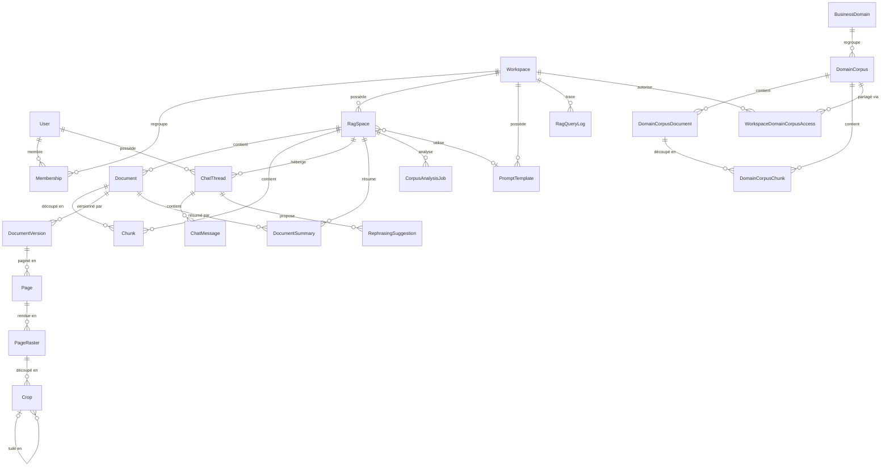

# Modèle de données

Objectif : décrire les entités backend de RagATM, leurs relations, contraintes, portées d'isolation
et cycles de vie. Public : développeurs backend. Le code reste la source de vérité — ce document
n'expose pas le Python brut mais la sémantique métier.

## Panorama (cluster central)

Deux **couches documentaires physiquement séparées** : les documents **privés**
(`rag_document`/`rag_chunk`, par RagSpace) et le **corpus métier** partagé (`domain_corpus_*`,
géré par le superuser). Aucune opération sur l'une ne touche l'autre. Voir
[corpus-metier.md](corpus-metier.md).

## Tenancy et RBAC

### `Workspace` (`workspace`)
Racine de tenancy (le « tenant »). Champs : `name`, `created_at`. Portée : globale.

### `Membership` (`workspace_membership`)
Lie un `User` à un `Workspace` avec un `role` ∈ {owner, admin, member, viewer} (défaut `member`).
Contrainte **unique(`workspace`, `user`)**. Portée : workspace. Voir la matrice de droits dans
[permissions-isolation.md](permissions-isolation.md).

## Moteur RAG (`rag_core`)

### `RagSpace` (`rag_space`)
Unité d'isolation RAG, rattachée à un `Workspace` (CASCADE). **Toutes** les entités RAG filtrent
par RagSpace.

- Identité : `id` (UUID), `name`, `created_at`.
- Config chat : `llm_provider` (défaut `ollama`), `llm_model` (défaut `llama3.1:8b`).
- Config embeddings : `embedding_provider` (défaut `ai_gateway`), `embedding_model`
  (défaut `legacy-768`, profil logique du registre de la Gateway). Rappel policy : la génération passe par l'AI Gateway malgré ces
  défauts de code (voir [../06-ai/politiques-llm.md](../06-ai/politiques-llm.md)).
- `allow_external_fallback` : conservé mais sans effet (aucun provider externe vers lequel se replier).
- `prompt_template` (FK, SET_NULL).
- **`deleted_at` / `deleted_by`** : vestige de l'ancien soft delete. **Plus alimenté** — `DELETE` est désormais une purge irréversible (cf. [suppression-ragspace.md](suppression-ragspace.md)). Un espace ainsi marqué (données héritées) est exclu des listings et
  bloqué en écriture.
- Champs de scoping Core `project`/`environment` : additifs/inertes.

### `Document` (`rag_document`)
Document privé, rattaché à un `RagSpace` (CASCADE).

- Métadonnées : `filename`, `content_type`, `size_bytes`, `sha256`, `storage_file`
  (`MEDIA_ROOT/rag_docs/<rag_space_id>/<doc_id>/<fichier>`), `document_date` (date extraite du
  **contenu**), `meta` (JSON, métadonnées d'extraction).
- `status` (technique d'ingestion) : `PENDING | INGESTING | READY | FAILED` — voir la machine à
  états ci-dessous.
- `error_message`, empreinte d'embedding (`embedding_provider`/`embedding_model`,
  `reindex_required`).
- Champs Core inertes, **distincts** du `status` technique : `collection`, `source_app`,
  `confidentiality`, `document_status` (statut **métier**, défaut `active`), `version`.
- **Contrainte partial-unique**(`rag_space`, `sha256`) quand `sha256` non vide ET `status ≠ FAILED`
  → déduplication dure par espace.

### `DocumentVersion` (`rag_document_version`) — *implémenté (CV-3B), fondation interne*
Version **immuable** des octets d'un `Document` (CASCADE). `Document` reste l'identité
**logique** ; une version identifie un **contenu**. Relation 1 → N (aujourd'hui N = 1 :
aucun flux de remplacement n'existe).

- `content_sha256` : **même définition** que `Document.sha256` (SHA-256 des octets bruts
  stockés) ; `size_bytes` : repris de `Document.size_bytes` ; `storage_key` : nom
  **logique** du fichier dans le stockage Django (`storage_file.name`, relatif à
  `MEDIA_ROOT`, jamais un chemin machine) ; `created_at`.
- Contraintes : unique(`document`, `content_sha256`) ; `content_sha256` = 64 hex
  minuscules ; `size_bytes ≥ 0` ; `storage_key` non vide. Index non unique sur
  `content_sha256`. **Aucune** unicité globale : deux documents logiques peuvent porter les
  mêmes octets.
- **En ajout seul** : `save()` d'une ligne existante, `QuerySet.update`/`bulk_update`
  lèvent `ImmutableRowError`. Limite : un `UPDATE` SQL direct contourne la garde (aucun
  trigger). De nouveaux octets ⇒ nouvelle version, jamais une mise à jour.
- Création : `ensure_document_version` (idempotent), appelé par l'ingestion commune
  avant l'extraction, à partir des **seules** colonnes persistées — aucune lecture de
  fichier. Un document sans `sha256` valide ou sans fichier stocké n'a **pas** de version
  (politique « version différée ») : elle naît à la prochaine (ré)indexation, qui réécrit
  `sha256` depuis les octets ; un document sans fichier n'en a jamais.
- Backfill `0043` : une version par document aux données autoritaires (aucun fichier
  lu, exclus comptés dans le journal `rag_core.migrations`) ; inverse = suppression des
  versions seulement.

### `Page` (`rag_document_page`) — *implémenté (CV-3B), PDF seulement*
Page **physique** d'une `DocumentVersion` (CASCADE).

- `page_number` : ordre physique de l'arbre des pages, **1-based** (contrainte `≥ 1`) —
  même convention que `Chunk.page_number` et `#page=N` ; **pas** le numéro imprimé.
- `page_label` : libellé `/PageLabels` (`"xi"`, `"A-12"`…), **affichage seul**, jamais une
  clé ; `null` si le PDF n'en déclare pas (jamais déduit de `page_number`).
- `mediabox`, `cropbox` : `[x0, y0, x1, y1]` en **points PDF** (JSON, valeurs exactes du
  fichier, coins normalisés, `x1 > x0`, `y1 > y0`) ; `cropbox` = MediaBox si absente ;
  aucune intersection ni conversion raster.
- `rotate` : `/Rotate` **source** normalisé modulo 360, ∈ {0, 90, 180, 270} (contrainte) ;
  ce n'est pas une rotation de raster.
- Contrainte unique(`document_version`, `page_number`). En ajout seul, comme
  `DocumentVersion` : une géométrie différente pour les mêmes octets est un conflit
  (`page_geometry_conflict`, journalisé), jamais une mise à jour.
- Création : `ensure_pdf_pages` après une extraction PDF réussie, depuis la géométrie
  lue par pypdf dans l'enfant d'extraction (attributs hérités compris). Formats sans
  pages (texte, DOCX, PPTX, tableurs…) : aucune `Page`. Image native :
  `PAGE_SUPPORT_NATIVE_IMAGE = DEFERRED`.
- **Pas de backfill** : ni le nombre de pages ni la géométrie ne sont persistés ailleurs,
  et les déduire de `Chunk.page_number` perdrait les pages sans chunk
  (`PAGE_BACKFILL_DEFERRED`). Les pages d'un document existant naissent à sa prochaine
  extraction.
- La provenance ne fait jamais échouer une ingestion : conflit ou erreur base sont
  journalisés (`document provenance: <code>`) et l'ingestion suit son contrat historique.
- Verrous : RagSpace puis Document (ordre canonique), comme la publication — une purge
  d'espace concurrente est sérialisée.
- Rendu et découpe : voir `PageRaster` et `Crop` ci-dessous (CV-3C).

### `PageRaster` (`rag_page_raster`) — *implémenté (CV-3C) ; orchestration CV-3E1 désactivée par défaut*
Une **variante** de rendu d'une `Page` (CASCADE) selon le contrat `rasterizer_id =
ragatm-pdfium/1` et ses paramètres canoniques (`rasterizer_params`, haché en
`params_sha256` sur JSON canonique : clés triées, séparateurs compacts, UTF-8).

- Unicité : (`page`, `rasterizer_id`, `params_sha256`) — une page porte plusieurs variantes
  (150 / 200 / 300 dpi). `pixels_sha256` n'est **pas** une clé (deux pages peuvent avoir les
  mêmes pixels) ; index non unique.
- Identité **ID-B** : `pixels_sha256` = SHA-256(`uint32_be(W) ‖ uint32_be(H) ‖ RGB8`
  row-major, haut→bas, gauche→droite, sans alpha ni stride) = identité de **reproduction** ;
  `page_raster_sha256` (+ `encoding_id`) = intégrité d'un PNG de page **seulement s'il est
  persisté** — jamais par défaut (tous deux `null`).
- `implementation` : versions pypdfium2 / PDFium / Pillow / zlib-ng — **diagnostic**, hors
  identité. Un même contrat rendu avec d'autres bibliothèques réutilise la variante si les
  pixels sont identiques ; des pixels différents → `raster_pixels_diverged` (aucune
  réécriture) et, après évaluation, `ragatm-pdfium/2`.
- Contrat de rendu : CropBox rendue, `/Rotate` appliqué une fois par PDFium, taille
  `ceil(pt × dpi/72)` vérifiée (`raster_contract_mismatch`), `/UserUnit` **ignoré**,
  annotations et formulaires **non dessinés** (explicite), fond blanc, RGB8.
- **Isolation** : le rendu d'une police substituée dépend de l'historique du processus
  (CV-3C a mesuré trois pixels différents pour la même page). Chaque page est rendue dans
  un **interpréteur neuf** (`python -I`, sans Django), après un préchauffage synthétique
  fixe (`font_warmup = process-v1`) ; budget `RENDER_TIMEOUT_S` = 120 s, groupe tué à
  l'expiration.
- **Plafond** `MAX_RASTER_PIXELS` = 80 MP, vérifié **avant** tout rendu
  (`raster_pixels_exceed_limit`) : pic mesuré ≈ 3 o/px côté appelant + ≈ 3 o/px dans
  l'enfant (A1 300 dpi = 69,7 MP accepté ; A0 300 dpi refusé). Jamais de réduction
  silencieuse ; aucun rendu partiel.
- Vecteurs de test commités (`tests/tests_root/fixtures/raster_vectors/`, 39 cas mesurés
  par CV-3A sur Intel et AMD) : une montée de PDFium/pypdfium2 qui les fait diverger impose
  une évaluation — jamais une mise à jour silencieuse des valeurs attendues.
- Le chemin OCR historique (`ocr.py`, annotations dessinées, sans isolation) est **inchangé**.

### `Crop` (`rag_crop`) — *implémenté (CV-3C) ; orchestration CV-3E1 désactivée par défaut*
Sous-rectangle **exact** des pixels d'un `PageRaster` (CASCADE), contrat
`contract_version = ragatm-crop/2` (CV-3E1 ; `ragatm-crop/1` n'a jamais produit de ligne
en staging ni en production — 0 crop au passage).

- bbox autoritaire (`x_min`, `y_min`, `x_max`, `y_max`, entiers) en **pixels du raster**,
  origine haut-gauche, x → droite, y → bas, **demi-ouverte**, `0 ≤ x_min < x_max ≤ W`
  (idem y) ; `width`/`height` = taille de la bbox (contraintes base). Aucune bbox invalide
  n'est corrigée ; seul le padding est rogné au raster (`detected_bbox` + `padding_px`
  conservés).
- `origin` = {`detector_id`, `detector_fingerprint`, `reason`, `score`?} ; `origin_reason`
  matérialisé. Unicité (`page_raster`, bbox, `contract_version`, `origin_reason`) : même
  bbox pour une autre raison = autre crop. Aucune taxonomie `region_kind`.
- Identités : `crop_pixels_sha256` (même définition que `pixels_sha256`, reproduction) ;
  `crop_sha256` = SHA-256 des **octets PNG persistés** (`encoding_id = png-rgb8-zl6/1` :
  RGB8, compress_level 6, chunks IHDR/IDAT/IEND seulement), avant tout Base64 — ce que
  CV-3D comparera à `image.source_sha256` de la Gateway V2.
- **≤ 2 MP** pour un crop encodé (contrainte base = plafond pixels Gateway). Limite
  PRATIQUE d'envoi `MAX_SENDABLE_PIXELS = 1176² = 1 382 976` : au-delà, crop **parent sans
  artefact** + tuiles encodées (`parent_crop`) de côté ≤ **1176 px**, recouvrement **64 px**
  (≈ 8 mm à 200 dpi, > une ligne de texte 10 pt), pas 1112 px, dernière tuile alignée au
  bord, bbox des tuiles dans le repère du raster ; jamais de redimensionnement.
  Pourquoi 1176 et non 1414 (`ragatm-crop/1`) : la Gateway borne `image.data` à
  5 592 408 caractères Base64 (≈ 4,19 Mo de PNG) ; un PNG incompressible pèse +0,17 % de ses
  octets RGB bruts, donc 1414² (bruit, photo) dépassait la limite alors que 1176² tient
  (pire cas mesuré). Garde résiduelle : un crop dont le Base64 dépasse malgré tout est refusé
  AVANT envoi avec `crop_encoded_oversize` (non réessayable).
- Projection d'une région PDF (`services/raster/geometry.py`, CV-3E1) : le rectangle
  `pdf_visual` (`get_image_rects` : points, page NON pivotée, origine coin haut-gauche de la
  CropBox, y vers le bas) est pivoté dans le cadre de la CropBox (90° : `(H−y1, x0, H−y0,
  x1)` ; 180° : `(W−x1, H−y1, W−x0, H−y0)` ; 270° : `(y0, W−x1, y1, W−x0)`), mis à
  l'échelle `dpi/72`, arrondi **vers l'extérieur**, rogné au raster ; région invalide ou
  vide → `None`. Écart **mesuré** au rendu PDFium ≤ 1 px par bord (calage de l'image sur la
  grille de pixels) ; le crop applique une marge `VISUAL_CROP_PADDING_PX = 8`.
- Stockage : `rag_docs/<space>/<doc>/vision/<version_id>/crops/<crop_sha256>.png` (stockage
  Django), adressage par contenu **limité au document** (aucune déduplication entre
  documents). Écriture immuable : fichier présent de même hash = no-op, hash différent =
  `storage_integrity_failure`, jamais d'écrasement. Ordre : octets en mémoire → fichier →
  ligne en transaction courte (verrous RagSpace puis Document) ; un échec base laisse un
  orphelin signalé par `media_storage_audit`.
- Suppression : le service de suppression de document et la purge d'espace suppriment les
  fichiers de crop (compteurs `vision_files_*` de la purge) ; les lignes partent en cascade.
- En ajout seul, comme `PageRaster`. Orchestration : `VisualCropJob` ci-dessous (CV-3E1, éteinte) ; aucune observation métier (CV-3F).

### `VisualCropJob` (`rag_visual_crop_job`) — *implémenté (CV-3E1), table technique, rail désactivé par défaut*
État **mutable** de l'analyse Vision V2 d'un crop envoyable (migration `0045`, additive, sans
backfill). Ce n'est pas un modèle métier : aucune observation publiée, aucune citation, aucun
champ `Chunk.meta`.

- `crop` (CASCADE, part avec le document) ; `DocumentVersion` et `Page` se retrouvent par
  `crop → page_raster → page → document_version`, sans duplication.
- **Clé d'idempotence** (unique base `uniq_rag_visual_crop_job_key`) : `(crop, task,
  schema_version, context_sha256, expected_pipeline_fingerprint, analysis_generation)`,
  `schema_version = "2"`. `expected_pipeline_fingerprint` couvre le digest modèle (contrat
  CV-3D) : il n'est pas dupliqué.
- `state` ∈ {`pending`, `running`, `deferred`, `succeeded`, `terminal_failed`, `parked`,
  `ineligible`} (CHECK base). États finaux pour une génération : `succeeded`,
  `terminal_failed`, `parked`, `ineligible` — seule une nouvelle `analysis_generation` les
  rouvre.
- Compteurs **persistants**, bornés par la base : `model_attempts ≤ 4`,
  `capacity_deferrals ≤ 60`, `activations ≤ 72` (60 reports + 4 tentatives + 8 reprises) ;
  jamais remis à zéro par une continuation, une reprise de bail ou une redélivrance.
- Bail : `lease_token` + `lease_expires_at` présents **si et seulement si** `running`
  (CHECK). `next_eligible_at` = fin d'un report ; `enqueued_at` = dernier envoi au broker
  (fenêtre d'enfilement).
- `result_raw` : réponse V2 déjà validée (K1/K2/K3/K3+), présente **si et seulement si**
  `succeeded` (CHECK) — **interne**, aucun serializer ni route. `last_error_code` obligatoire
  pour `terminal_failed` / `parked` / `ineligible`.
- Transitions (`services/raster/orchestration.py`) : `pending`/`deferred` éligible, ou
  `running` à bail expiré → `running` (claim, `activations + 1`) ; `running` → `succeeded` |
  `terminal_failed` | `ineligible` | `parked` | `deferred` (report de capacité, continuation
  ou budget mural) | `pending` (porte refermée, sans ré-enfilement). `activations = 72` au
  claim → `parked` ; 60ᵉ report → `parked`.
- Aucun index supplémentaire : toute requête part d'une version et descend par les index
  uniques existants.

### `VisualScopePolicy` (`rag_visual_scope_policy`) — *implémenté (CV-3E4A), aucune ligne par défaut*
Politique de périmètre Vision V2 **par RagSpace** (une ligne au plus, `OneToOne`, CASCADE),
écrite par l'opérateur (`visual_v2_scope`), jamais par une migration.

- `mode` ∈ {`explicit`, `auto`} (CHECK) ; `enabled` (défaut faux) ; `reason` obligatoire
  (CHECK non vide) ; `updated_by` (utilisateur, nullable) ; horodatages.
- **Ligne absente = FERMÉ** (`enabled` faux, mode `explicit`). La politique s'AJOUTE aux
  portes de déploiement : elle ne peut que restreindre (cf.
  [ai-gateway.md §4quinquies](../06-ai/ai-gateway.md)).

### `VisualPrepareRun` (`rag_visual_prepare_run`) — *implémenté (CV-3E4A)*
Trace DURABLE d'une préparation Vision V2 `version × génération × empreinte` (unique
`uniq_rag_visual_prepare_run_key`), commitée AVANT tout envoi au broker. Une préparation
`auto` est écrite dans la transaction qui publie le document `READY` (CV-3E4C) : l'une
n'existe jamais sans l'autre ; aucun champ ni migration supplémentaire (contrat 0046).

- `state` ∈ {`pending`, `running`, `done`, `failed`, `cancelled`} (CHECK) ;
  `next_page_cursor` = prochaine page PHYSIQUE (1-based) à examiner (CHECK ≥ 1) ;
  `requested_kind` ∈ {`auto`, `operator`, `sweeper`} ; `requested_by`, `reason`,
  `last_error_code`, `enqueued_at`, horodatages ; index `(state, updated_at)`.
- `done`, `failed`, `cancelled` ne sont jamais relancés automatiquement.

**Index partiel `rag_vcj_open_idx`** (CV-3E4A) sur `rag_visual_crop_job (state,
lease_expires_at, next_eligible_at, enqueued_at)` **WHERE** `state IN ('pending','running',
'deferred')` : le balayeur ne lit que les jobs ouverts ; les jobs terminés n'y entrent pas.

### `Chunk` (`rag_chunk`)
Fragment indexé, rattaché à `document` (CASCADE) **et** `rag_space` (dupliqué pour l'isolation
par requête). Champs : `chunk_index`, `text`, `embedding` (`VectorField(dim=768)`, nullable),
`page_number`, `meta` (JSON). La dimension 768 est figée par la migration `0001` et validée par
`rag_core.E001`.

### `DocumentSummary` (`rag_document_summary`)
Résumé d'un document, rattaché à `rag_space` + `document`. Champs : `variant_key`
(`mode:scope:page:lang`), `mode`/`scope`/`page`/`language`, `summary`, `status`
(`PENDING | READY | FAILED`), `source_fingerprint` (invalidation de cache), champs de coût LLM.
Contrainte **unique(`document`, `variant_key`)**.

### `CorpusAnalysisJob` (`rag_corpus_analysis_job`)
Job d'analyse globale du corpus d'un RagSpace. Rattaché à `rag_space` + `requested_by`.

- `analysis_type` (clé de registre fermé), `parameters` + `parameters_hash`, `request_id`.
- `status` : `pending | running | succeeded | partial | failed | cancelled` avec **transitions
  imposées** (`transition_to` / `InvalidTransition`).
- Suivi : `phase`/progression, `preflight`, `corpus_fingerprint`, `coverage`, `result`,
  code/message d'erreur, `result_version`.
- Lien souple : `chat_thread` (SET_NULL) + `result_message_id`.
- Comptabilité : annulation, timing, expiration, tokens/coût.
- **Deux contraintes partial-unique** : idempotence(`requested_by`, `request_id`) et un seul job
  actif par (`rag_space`, `analysis_type`, `parameters_hash`, `corpus_fingerprint`).

### `RagBenchmarkQuestion` (`rag_benchmarkquestion`)
Question de benchmark : `rag_space_id` (indexé, **pas** de FK dure), `question`, `is_active`,
`expected_keywords` (JSON). Voir ../08-testing/benchmark-rag.md.

### `PromptTemplate` (`prompt_template`)
Rattaché à un `Workspace`. Champs : `name`, `version`, `content`, `is_active`. Contrainte
**unique(`workspace`, `name`, `version`)**. Une seule version active par (`workspace`, `name`),
géré applicativement (`activate_prompt_template`). Portée : workspace.

## Couche conversationnelle (`chat`)

### `ChatThread` (`chat_thread`)
Fil de conversation, rattaché à `user` + `rag_space`. Champs : `title` (auto depuis la 1re
question), mémoire hiérarchique (`memory_summary`, `memory_summary_until_message_id`,
`memory_summary_updated_at`). Portée : user × rag_space.

### `ChatMessage` (`chat_message`)
Message d'un thread. Champs : `role` (`system | user | assistant`), `content`, `sources` (JSON,
snapshot), `request_id`, liens **logiques** `rag_query_log_id` + `analysis_id` (UUID, pas de FK
dure), `created_at`, `updated_at`.

**Résumés de document persistés** (migration `chat/0007`, *implémenté*) — un résumé demandé
depuis le chat est un vrai message, pas un état frontend :

| Champ | Valeurs | Rôle |
|---|---|---|
| `kind` | `""` (standard) \| `document_summary` | nature du message |
| `status` | `""` (sans cycle de vie) \| `pending` \| `completed` \| `failed` | génération différée |
| `document_id` | UUID nullable | document résumé (lien **logique**) |
| `summary_id` | UUID nullable | `DocumentSummary` qui finalisera le message |

Tous additifs et à défaut neutre : **aucun backfill**, les messages antérieurs restent lisibles
(`kind`/`status` vides ⇒ rendu assistant standard).

Contrainte **unique partielle** `uniq_chat_message_summary_request` sur
(`thread`, `request_id`, `role`) `WHERE kind='document_summary' AND request_id <> ''` : c'est
elle — et non un contrôle applicatif — qui garantit l'idempotence des relances. Elle est
volontairement restreinte aux messages de résumé, qui n'existent qu'à partir de cette migration :
elle ne peut donc pas échouer sur des doublons historiques.

> Les liens sont des **UUID sans FK dure** (même convention que `analysis_id`) : le message reste
> lisible après suppression du document ou du résumé, son `content` étant un instantané autonome.

`DocumentSummary` est un **cache partagé** (unique sur `document` × `variant_key`) : plusieurs
messages, de fils et d'utilisateurs différents, peuvent référencer la même ligne. La finalisation
procède donc par **fan-out** `summary_id → messages pending`, jamais par un `result_message_id`
unique porté par le résumé, qui n'en servirait qu'un seul.

### `RephrasingSuggestion`
Suggestions de reformulation asynchrones, rattachées à `thread`. Champs : `request_id`, `status`
(`pending | ready | failed`), `suggestions` (JSON), `error_code`. Contrainte
**unique(`thread`, `request_id`)**. Ne stocke ni prompt, ni question, ni contexte.

## Audit et journaux (`audit`)

### `RagQueryLog` (`rag_query_log`)
Une requête = un log. Rattaché à `user`/`workspace`/`rag_space`. Champs : `question`, `answer`,
`status` (`ok | no_answer | error`), `error_stage`, `sources` (+ version de schéma), timing
(`latency_ms`, `prompt_hash`), LLM (`provider`/`model`/tokens/`llm_cost_estimated`), `request_id`,
`policy`, feedback (`feedback_score`/`feedback_reason`/`feedback_comment` — **colonnes
historiques**, cf. ci-dessous), `rerank` (JSON d'observabilité). Le coût est matérialisé
(`apps.rag_core.services.pricing`) : `0.0` pour un modèle local/ollama, `None` pour un modèle
non tarifé. Rétention purgée (`RAG_QUERY_LOG_RETENTION_DAYS`, défaut **365** dans le code ;
plusieurs pages documentaires annonçaient encore 90).

### `AnswerFeedback` (`answer_feedback`) — app `feedback`
Signal utilisateur **durable**. Aucune FK `CASCADE` : `query_log` et `created_by` sont en
`SET_NULL`, `message_id`/`thread_id` sont des UUID logiques, et tout le contexte est
dénormalisé à la création (`*_hist`, hash de question/réponse/prompt, empreintes de sources
et de déduplication). Conséquence : **l'incident survit** à la suppression de l'espace, du
workspace, du compte et à la purge du journal. Ni chunk, ni extrait, ni prompt. Les colonnes
`RagQueryLog.feedback_*` restent écrites pendant la transition
(`FEEDBACK_DUAL_WRITE_RAG_QUERY_LOG`).

### `FeedbackDiagnosticSnapshot` (`feedback_diagnostic_snapshot`) — app `feedback`
Matériel de diagnostic **sensible et expirable** (30 j), rattaché à un `AnswerFeedback` en
`CASCADE` (dans ce sens uniquement). Append-only. `capture_mode` distingue une capture
EXACTE (`buffer`) d'un replay tardif (`replay`) ou d'une capture partielle (`partial`).
Purger le snapshot ne purge **jamais** le signal. Voir
[feedback-incidents](feedback-incidents.md).

### `LlmSettingsChangeLog` (`llm_settings_change_log`)
Historique des changements de réglages LLM/embeddings d'un RagSpace. Rattaché à
`user`(SET_NULL)/`workspace`/`rag_space` ; anciennes/nouvelles valeurs chat + embedding. Aucun
secret.

### `ActionAuditEvent`
Journal **append-only** des actions (delete/upload/reindex/ingestion…). Modification interdite
(`save` bloque les updates, `delete` bloque les suppressions unitaires ; la purge en masse reste
possible). Champs : `event_name`/`action_name`/`version`, `actor`(SET_NULL),
workspace/rag_space/ids de ressource, `request_id`/`task_id`/`idempotency_key`, `status`
(`detected | started | queued | completed | failed | denied`), `error_code`, `detection_method`,
`metadata` **assainie** (dénie password/secret/token/prompt/question/answer/chunk/content/text ;
bornée profondeur 4 / 40 clés / 500 car / 8 Ko), `duration`. Émis via `emit_action_event`
(point d'entrée unique, **fail-open**), sous `ACTION_AUDIT_ENABLED`.

## Configuration dynamique (`rag_core`)

### `CoreConfigOverride` (`core_config_override`)
Override de config par portée : `scope_type` ∈ {global, environment, workspace, ragspace},
`scope_ref` (CharField libre : `""` global, nom d'env, id workspace ou uuid ragspace), `key`,
`value`. Contrainte **unique(`scope_type`, `scope_ref`, `key`)**. **Diagnostic uniquement** sauf
si `CORE_CONFIG_RUNTIME_ENABLED`. Voir [configuration-dynamique.md](configuration-dynamique.md).

### `CoreConfigAuditEvent` (`core_config_audit_event`)
Journal **append-only** des actions de config (`set | unset | rollback | test_gateway`).
`save`/`delete` bloqués. Valeurs sensibles redactées à la **lecture** via l'API.

## Corpus métier (`corpus`)

### `BusinessDomain` (`business_domain`)
Domaine métier : `slug` (unique), `name`, `description`, `is_active`. Portée : globale.

### `DomainCorpus` (`domain_corpus`)
Corpus rattaché à un `domain`. Champs : `name`, `slug`, `description`, `is_active`, embeddings
configurables **par corpus** : `embedding_provider` (`ai_gateway` uniquement), `embedding_model` (défaut
`legacy-768`). Contrainte **unique(`domain`, `slug`)**. Portée : globale/partagée.

### `DomainCorpusDocument` (`domain_corpus_document`)
Document de corpus, rattaché à `corpus`. Champs : titre/filename/mime/size/`sha256`,
`storage_file` (`MEDIA_ROOT/corpus_docs/...`), `status` (`PENDING | INGESTING | READY | FAILED`),
provenance (`source_url`/`reference`/`version_label`), `meta`. Contrainte partial-unique(`corpus`,
`sha256`) non-FAILED. **Table strictement distincte** de `rag_document`.

### `DomainCorpusChunk` (`domain_corpus_chunk`)
Fragment de corpus, rattaché à `corpus` (dupliqué pour isolation) + `document`. Champs : `text`,
`embedding` (`VectorField(768)`), `page_number`, `meta`.

### `WorkspaceDomainCorpusAccess` (`workspace_domain_corpus_access`)
**Unique mécanisme d'autorisation** corpus↔workspace : FK `workspace` + `corpus`, `enabled`.
Contrainte **unique(`workspace`, `corpus`)**. Un workspace n'interroge un corpus que via une ligne
`enabled=True` (et corpus `is_active`).

## Machine à états — statut d'ingestion des documents

S'applique à `Document.status` (privé) et `DomainCorpusDocument.status` (corpus).

| État | Signification | Transitions sortantes |
|---|---|---|
| `PENDING` | Document créé, ingestion pas encore démarrée (file d'attente async). | → `INGESTING` |
| `INGESTING` | Extraction + chunking + embeddings en cours. | → `READY` (succès) · → `FAILED` (erreur) |
| `READY` | Chunks indexés, document interrogeable. | → `INGESTING` (réindexation) |
| `FAILED` | Échec d'ingestion ; `error_message` renseigné. Exclu de la contrainte de dédup. | → `INGESTING` (nouvelle tentative/réindex) |

Notes :
- La suppression d'un document est **bloquée (409)** tant qu'il est `PENDING`/`INGESTING`.
- L'ingestion corpus est **synchrone** (pas de Celery) : le passage `PENDING → INGESTING → READY`
  se fait dans la même requête. Voir [taches-asynchrones.md](taches-asynchrones.md).

## Contrat « sources »

Le **payload de sources** exposé par le retrieval porte un champ `schema_version`, dont la
valeur courante est **3** (`SOURCES_SCHEMA_VERSION = 3` dans `query/audit.py`). Historique :
`source_type` introduit en **v2**, métadonnées de citation Excel (feuille + plage) en **v3**.
Chaque source porte un `source_type` :

- `workspace_document` → `+ workspace_id`, `rag_space_id` ;
- `domain_corpus` → `+ corpus_id`, `corpus_name`, `business_domain_id`, `business_domain_name`.

Nuance : la colonne `RagQueryLog.sources_schema_version` a un **défaut historique de 1** et
certains chemins (résumés, intent *news*) écrivent encore `1` ; les anciens logs `v1` (sans
`source_type`) restent lisibles, le frontend applique un fallback `workspace_document`. Le
contrat est propagé jusqu'à la réponse chat et au log d'audit (`RagQueryLog.sources`,
`ChatMessage.sources`).

## Notes de portée / cycle de vie

- **Soft delete** : `RagSpace` uniquement. `Document`/`Chunk` sont supprimés physiquement
  (suppression = doc + chunks + résumés + fichier).
- Le `prompt_template` d'un RagSpace doit appartenir au même workspace ; le contrôle est
  applicatif (à vérifier côté DB).

## Références d'implémentation

- `backend/apps/workspaces/models.py`
- `backend/apps/rag_core/models/` (`rag_space.py`, `document.py`, `document_version.py`, `page_raster.py`, `chunk.py`, `summary.py`, `corpus_analysis_job.py`, `benchmark.py`, `core_config.py`, `visual_crop_job.py`, `visual_policy.py`)
- `backend/apps/rag_core/services/documents/provenance.py`, `backend/apps/rag_core/services/ingest/extraction/pdf_geometry.py`, migrations `0042`/`0043`/`0044`/`0045`/`0046`
- `backend/apps/rag_core/services/raster/` (`contract.py`, `pdfium_render_child.py`, `crops.py`, `store.py`, `geometry.py`, `vision.py`)
- `backend/apps/chat/models.py`
- `backend/apps/audit/models.py`
- `backend/apps/corpus/models/` (`domain.py`, `corpus.py`, `document.py`, `chunk.py`, `access.py`)
- `shared/contracts/` (schéma JSON des sources)
