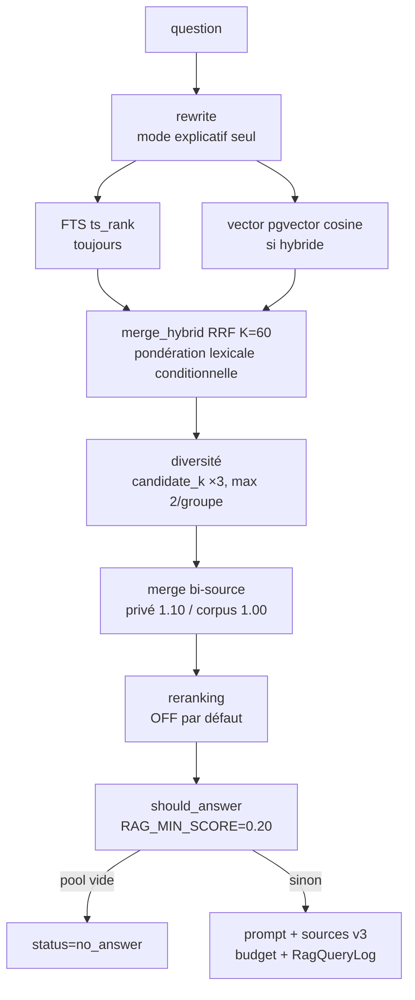

# Pipeline de retrieval

Objectif : décrire le pipeline **réellement exécuté** par `query_rag`, du texte de la
question jusqu'au `prompt` et aux `sources` renvoyés. Public : développeurs backend.

Point d'entrée : `query_rag(...)` dans `apps/rag_core/services/query/orchestrator.py`.
Consommé par le chat (`apps/chat/services/chat_service.py::_run_retrieval`), par le
benchmark, et par la façade
`apps.rag_core.core.retrieve` (parité stricte, délègue à `query_rag`).

> **`query_rag` NE génère PAS la réponse.** Il retourne un `prompt`, des `sources`, un
> `answer_kind` et un `RagQueryLog`. La génération LLM est faite en aval par le chat.
> Voir [chat & génération](chat-generation.md).

Toutes les valeurs citées sont les défauts de `backend/config/settings/base.py`
(voir [variables d'environnement](../10-reference/variables-environnement.md) et
[feature flags](../10-reference/feature-flags.md)).

---

## Vue d'ensemble



Chaque mécanisme ci-dessous porte son **statut** et le **setting** associé.

---

## 1. Réécriture de requête — activé (mode explicatif seul)

`query/rewrite.py::build_queries_for_search` construit la liste
`[original (+ réécrite LLM) (+ keywordisée)]`.

- Réécriture LLM (`RAG_QUERY_REWRITE_ENABLED`, **défaut `0`**) et keywordize
  ne s'appliquent qu'en mode **explicatif**. Provider `ollama`, timeout 6 s, max
  `RAG_MAX_SEARCH_QUERIES=3`. Échec LLM → `""` (silencieux, safe).

  > **Désactivée par défaut depuis le 30/07/2026.** Elle ne se déclenchait jamais avant
  > l'arrivée de la détection d'intention. Mesurée alors en A/B sur 100 questions, même
  > code, même base, même configuration : **aucune source indispensable récupérée ni
  > perdue**, décisions d'admission **identiques** (VP 29, FP 1, VN 34, FN 6), 570 sources
  > dans les deux bras, 53 documents apportés contre 49 retirés — une permutation, pas un
  > gain. Coût : **P95 +102,6 %** (5 699 → 11 545 ms), +7,9 s médian sur les 27 questions
  > concernées.
  >
  > Cause du non-gain, lisible dans les requêtes produites : le modèle **traduit la
  > question en français** (« Retours investissements capital risque ») alors que le fonds
  > interrogé est anglophone.
  >
  > Le coût n'est **pas** celui du LLM (4,4 s à froid, 0,3 s à chaud) mais celui des deux
  > passes de retrieval supplémentaires : la requête keywordisée est une disjonction
  > large, dont le `ts_rank` coûte 2,7 s côté privé et 1,2 s côté corpus. Raccourcir le
  > timeout du LLM n'y changerait rien — c'est pourquoi une réécriture « conditionnelle à
  > timeout court » n'a pas été retenue.
  >
  > Réactiver impose de re-mesurer : le verdict dépend de la langue du fonds documentaire.
- **Comparaison explicite : expansion DÉTERMINISTE, aucun appel LLM** — la question
  d'origine + une requête portant les DEUX objets détectés (`build_comparative_queries`).
  Mesuré : la reformulation LLM coûtait +1,8 s médian sans gain de couverture ; deux requêtes
  séparées (une par objet) dégradaient la couverture à la fusion.
- Heuristiques de mode (`query/heuristics.py`) : `is_inventory_question`,
  `is_explanatory_question`, `detect_comparative_intent`, `news_mode`
  (`RAG_ENABLE_NEWS_HEURISTIC`, **défaut False**). Une question **comparative** exige deux
  objets explicitement mis en relation (« différences entre X et Y », « X vs Y ») ; elle
  hérite des budgets analytiques (`RAG_EXPLAIN_*`, défauts = budgets standards) et reçoit la
  politique de prompt `compare` — voir
  [../06-ai/politique-comparative.md](../06-ai/politique-comparative.md).

> La mémoire de conversation n'entre **pas** dans la question de recherche : elle n'est
> injectée que dans le prompt LLM (voir [chat & génération](chat-generation.md)).

---

## 2. Retrieval lexical (FTS) — activé (requis)

`chunk_repository.search_chunks_hybrid` — **toujours exécuté** (sinon `ImportError`).

- PostgreSQL `to_tsvector/to_tsquery`, config `RAG_FTS_CONFIG=simple` (whitelist
  simple/french/english). Score = `ts_rank`.
- **Vecteur lexical stocké** — *activable par flag, désactivé par défaut*. Avec
  `RAG_FTS_STORED_VECTOR_ENABLED=1`, la requête lit la colonne générée
  `text_tsv_french` (index GIN dédié) au lieu de recalculer `to_tsvector` **trois
  fois par ligne candidate** (projection du rang, condition `@@`, filtre
  `min_rank`). Voir [§2bis](#2bis-vecteur-lexical-stocké-colonne-générée).
- Plan `build_tsquery_plan` : de la plus sélective (entités capitalisées + identifiants à
  tiret en `AND`) à la plus large (mots-clés en `OR`). **Repli sur zéro résultat seulement.**
  Les identifiants à tiret (`A-1`, `2020-3`) sont préservés (`extract_identifiers`) ; les
  termes purement numériques n'élargissent pas.
- L'**exécution** du plan vit dans `rag_core/domain/fts_plan.execute_fts_plan` — source
  unique, partagée avec le leg corpus métier. Borne dure `RAG_FTS_PLAN_MAX_ATTEMPTS=6`
  (le plan le plus long en produit 6 : le défaut ne tronque rien). Déduplication par
  `chunk_id`, et télémétrie non sensible (`plan_index`, `attempt_count`, comptes par
  tentative — jamais la requête elle-même).

> Le leg corpus n'exécutait auparavant que `plan[0]`. Une question capitalisée
> (« **W**hat is venture capital ? » → `plan[0] = what:*`) lui rendait **zéro candidat**
> sans erreur ni trace, tandis que le leg privé repliait et répondait. La stratégie est
> désormais unique : la divergence n'est plus exprimable.
- Filtrage au **seuil lexical** `RAG_MIN_TEXT_RANK=0.0` (pas au seuil vectoriel).
- Isolation stricte par `rag_space_id` (double clause anti-fuite dans le SQL).

---

## 2bis. Vecteur lexical stocké (colonne générée) — activable par flag

*Statut : **activable par flag**, `RAG_FTS_STORED_VECTOR_ENABLED=0` par défaut —
mais **activé en staging ET en production**, constaté le 22/08/2026 (migrations
`rag_core.0039/0040` et `corpus.0006/0007` appliquées, colonnes générées et index GIN
présents et valides des deux côtés). Le gain de latence annoncé plus bas n'a **pas**
été mesuré sur ces environnements : le chemin est en service, il n'est pas qualifié.*

> Le drapeau est **exigé identique** entre staging et production par le manifeste de
> parité : il ne change pas un budget,
> il change la **requête**. Une campagne menée sur un chemin SQL et promue vers l'autre
> ne mesure pas ce qu'elle croit mesurer. Il appartient aussi à l'identité gelée d'une
> campagne (schéma de gel **v2**, cf. ../08-testing/holdout-config-gel.md) :
> la sémantique de classement est réputée identique entre les deux chemins SQL, et
> « réputée » est exactement ce qu'une qualification doit vérifier.

### Le problème mesuré

Le SQL FTS écrit `to_tsvector(config, c.text)` **trois fois** : dans la projection
du rang, dans la condition `@@`, dans le filtre `ts_rank >= min_rank`. Seule la
condition `@@` est indexable. L'index GIN d'expression rend donc les candidats
vite, mais chacun est ensuite **dé-TOASTé et re-tokenisé** pour le rang et le
filtre. Sur un corpus réel, l'attribution donne **91 % du temps SQL en travail
lexical CPU**, avec zéro lecture disque et zéro fichier temporaire : ce n'est ni
un problème de stockage, ni de `work_mem`, ni de l'ORM.

### Le mécanisme du gain

La colonne matérialise le calcul **une fois à l'écriture** :

```sql
ALTER TABLE rag_chunk ADD COLUMN text_tsv_french tsvector
  GENERATED ALWAYS AS (to_tsvector('french'::regconfig, text)) STORED;
CREATE INDEX CONCURRENTLY rag_chunk_text_tsv_french_gin
  ON rag_chunk USING GIN (text_tsv_french);
```

Le gain vient de la **suppression de travail CPU** (tokenisation, dé-TOAST du
texte long, calcul du rang) — pas d'un disque plus rapide ni d'un cache plus
grand. Le vecteur stocké est aussi bien plus petit que le texte source, donc
moins de pages à ramener.

`GENERATED ALWAYS ... STORED` n'est pas un cache applicatif : PostgreSQL
recalcule la colonne à chaque `INSERT`/`UPDATE` et **refuse toute écriture
directe**. Aucun trigger, aucune resynchronisation, aucune divergence possible.
L'ingestion n'a rien à changer.

### L'invariant config ↔ schéma

La config `french` est **figée dans le schéma**. Si `RAG_FTS_CONFIG` valait autre
chose, la requête renverrait des résultats calculés dans la mauvaise langue —
**sans lever d'erreur**. C'est le mode de panne le plus dangereux du dispositif,
donc il est refusé au démarrage :

| Check | Condition refusée |
|---|---|
| `rag_core.E120` | flag activé et `RAG_FTS_CONFIG` effectif ≠ `french` |
| `rag_core.E121` | flag activé et colonne `text_tsv_french` absente (`rag_chunk` ou `domain_corpus_chunk`) |
| `rag_core.E122` | flag activé, colonne présente, index GIN absent ou invalide (la recherche dégénérerait en parcours séquentiel) |
| `rag_core.W120` | flag activé, base injoignable — schéma non vérifiable (Warning : `collectstatic` et build d'image tournent sans base) |

Ces checks ne coûtent **rien** quand le flag est désactivé : aucune introspection
n'est faite. **Changer `RAG_FTS_CONFIG` impose de refaire la migration** — les
deux valeurs ne peuvent pas coexister sur une colonne unique.

### Aucun repli silencieux

Flag activé avec une config incohérente : `fts_vector_sql()` lève
`ImproperlyConfigured`. Colonne absente : PostgreSQL lève `UndefinedColumn`. Un
repli automatique sur le chemin historique rendrait le drapeau **indétectable** —
on croirait mesurer le chemin stocké en mesurant l'ancien.

### Migrations et fenêtre de verrou

| Migration | Effet | Verrou |
|---|---|---|
| `rag_core.0039` / `corpus.0006` | `ADD COLUMN ... GENERATED ... STORED` | `ACCESS EXCLUSIVE` — **réécriture complète de la table** |
| `rag_core.0040` / `corpus.0007` | `CREATE INDEX CONCURRENTLY` | pas de blocage des écritures |

Les index d'expression historiques (`rag_core.0014/0023`, `corpus.0002`) sont
**conservés** : ils servent le chemin flag OFF, qui reste la cible du rollback.

Les migrations de colonne posent `SET LOCAL max_parallel_maintenance_workers = 0`.
Les workers de maintenance parallèles allouent de la mémoire partagée via
`/dev/shm`, dimensionné à **64 Mo** par défaut sous Docker alors que
`maintenance_work_mem` vaut 512 Mo : sans ce garde-fou la migration échoue sur
`could not resize shared memory segment`. Le `SET` est **LOCAL** — aucun réglage
global n'est modifié, et la migration reste applicable sur n'importe quel hôte
sans changement d'infrastructure préalable.

### Rollback

Par **flag seul**, sans migration inverse : `RAG_FTS_STORED_VECTOR_ENABLED=0` +
redémarrage rend exactement le SQL historique, qui dispose toujours de son index.
La colonne et l'index stockés restent en place, inertes.

## 3. Retrieval vectoriel — activé

`chunk_repository.search_chunks_vector`.

- **pgvector cosine** (opérateur `<=>`), tri par distance croissante. Score = `1/(1+dist)` ∈ (0,1].
- HNSW tuning : `SET LOCAL hnsw.ef_search = RAG_HNSW_EF_SEARCH=40` (dans la transaction).
- **Cohérence embeddings (P1-D)** : ne compare qu'aux docs encodés avec le
  **provider+modèle courant** de l'espace **et** `reindex_required=FALSE`. Les incohérents
  sont exclus du vectoriel (restent trouvables en FTS).
- La question est encodée avec le même provider/modèle que l'espace (`resolve_space_embedding`).
- **L'espace doit être RÉSOLU avant la construction du DTO de requête.**
  `QueryExecutionContext` capture `request.rag_space` ; tant que la résolution de repli
  avait lieu après, un appelant ne passant que `rag_space_id` — tout l'outillage de
  benchmark et de holdout — faisait voyager `rag_space=None` jusqu'au
  `candidate_retriever`, et la garde P1-D **comme** le filtre de famille du pipeline
  gouverné devenaient inertes. Le chat n'était pas touché (il passe l'objet, cf.
  `apps.rag_core.core.facade.retrieve`), mais les benchmarks ne mesuraient pas ce que la
  production exécute. Corrigé et verrouillé par
  `tests/tests_root/unit/query/test_orchestrator_space_resolution.py`.

---

## 4. Hybridation RRF — activé

`query/merge.py::merge_hybrid`, `RAG_HYBRID_ENABLED=1`.

> **Correction d'une contradiction de l'ancienne doc.** La fusion n'est **pas** un
> `max(text_score, vector_score)` : c'est un **RRF (Reciprocal Rank Fusion)**, `RRF_K=60`.
> Le classement se fait par **rang réciproque**, pas par score brut — car les échelles
> `ts_rank` (~0,01–0,1) et cosinus (~0,4–0,9) sont incomparables.
> `fusion_score = Σ poids / (K + rang)`. Le champ `score` exposé reste
> `max(text_score, vector_score)` (pour affichage), mais **le classement, lui, suit RRF**.

- **Pondération lexicale conditionnelle (P1.5)** :
  `RAG_RRF_CONDITIONAL_LEXICAL_WEIGHT_ENABLED=1`. Si la question porte un **identifiant fort**
  (`extract_identifiers` : `Series A-1`, `REF-2026-04`…), poids lexical =
  `RAG_RRF_STRONG_IDENTIFIER_LEXICAL_WEIGHT=1.5` ; sinon `(1.0, 1.0)` → fusion historique
  bit-pour-bit (neutralité structurelle). Le poids est appliqué **avant** la troncature
  candidate_k, sinon le chunk-preuve serait coupé avant toute diversité.
- Si `search_chunks_vector` est absent → warning, dégradation en **FTS-only**.
- `merge_candidates` : fusion simple par `chunk_id` (garde le meilleur score), utilisée pour
  le multi-pass FTS et la fusion bi-source.

---

## 4bis. Déterminisme du classement — ordre total garanti

**Garantie.** À base identique, corpus identique, question identique et configuration
identique, le moteur renvoie **toujours** le même ordre de chunks, le même top-k et les
mêmes citations. Cette garantie vaut entre deux appels, entre deux processus, après
réinsertion des mêmes données, et sur tous les legs du retrieval.

### Le défaut corrigé

`ORDER BY text_rank DESC` **n'est pas un ordre total**. Mesuré : 30 chunks au texte
identique produisent **une seule** valeur distincte de `ts_rank` — donc 30 ex æquo
parfaits. Sur un corpus réel, une question mono-terme met couramment des dizaines de
chunks à égalité stricte (jusqu'à **96 candidats sur 96** sur un cas Mission).

SQL ne définit alors aucun ordre entre eux. Le plan mesuré était
`Limit → Sort (top-N heapsort) → Bitmap Heap Scan` : un heapsort n'est pas stable, son
entrée est l'ordre **physique** des blocs, et le `LIMIT k` retenait donc k lignes
arbitraires. Conséquence reproduite : après une réindexation partielle (suppression de
chunks + `VACUUM` + recréation), le top-5 changeait **intégralement** — mêmes scores,
cinq chunks entièrement différents.

Ce n'était pas qu'un flake de tests : c'était, en production, la même question recevant
des citations différentes, et un benchmark dont l'écart entre deux exécutions ne mesurait
plus le moteur.

### La règle de départage

Source unique : [`domain/ranking.py`](../../backend/apps/rag_core/domain/ranking.py)
(`SQL_TIE_BREAK`, `tie_break_key`, `sort_candidates`).

| Rang | Clé | Rôle |
|---|---|---|
| 1 | **score métier** (`text_rank`, distance, `fusion_score`…) | la pertinence — **inchangée**, elle décide seule tant qu'elle discrimine |
| 2 | `document_id` ASC | position documentaire — stable à la réindexation |
| 3 | `chunk_index` ASC | idem ; reproduit à l'identique par le chunker déterministe |
| 4 | `chunk_id` ASC | garantit l'ordre **total** |

En SQL : `ORDER BY <pertinence>, c.document_id ASC, c.chunk_index ASC, c.id ASC`, dans le
**même `ORDER BY` que celui qui porte le `LIMIT`** — sinon le moteur choisirait ses ex æquo
avant le départage.

**Pourquoi pas `chunk_id` seul** (le réflexe naturel) : `Chunk.id` est un `uuid4()`
**régénéré à chaque réindexation**. L'ordre serait total, mais changerait à chaque
réingestion d'un document inchangé — on aurait remplacé un non-déterminisme par un autre,
plus discret. **Pourquoi pas `page_number`** : nullable (`None` pour un classeur et une
présentation) et redondant avec `chunk_index`.

### Portée

Départage appliqué aux **9 points de classement** du pipeline : les 4 requêtes SQL (FTS et
vectoriel, privé et corpus métier), la fusion RRF, `merge_candidates`, `clean_candidates`,
la diversification, le reranking (stub et cross-encoder) et le tri « news ». Les groupes
d'embeddings du corpus sont eux aussi ordonnés (`_group_corpus_ids_by_embedding`) : ils
sont fusionnés séquentiellement, donc leur ordre changeait la sélection.

Coût mesuré : **nul** (−1,13 ms sur 5 000 chunks, 60 mesures entrelacées — dans le bruit).
Le coût dominant est le `to_tsvector`, pas le tri.

**Ce départage est fonctionnel** : il garantit la reproductibilité des citations en
production, pas seulement la stabilité de pytest. Ne pas le retirer.

### Limite connue — HNSW

L'index vectoriel HNSW est **approximatif** (`RAG_HNSW_EF_SEARCH=40`). Le départage rend
déterministe l'ordre **à l'intérieur** du jeu retourné, mais pas le jeu lui-même : à
`ef_search` bas, le parcours du graphe peut renvoyer des ensembles différents selon
l'ordre d'insertion des vecteurs. Seul un `ef_search` élevé ou un scan exact l'éliminerait.
Non traité ici (c'est un arbitrage rappel/latence, pas un défaut d'ordre).

Tests : `test_retrieval_determinism.py`
(chemin de production réel, répétition ×50, brassage de base, indépendance au plan) et
[`test_ordering_tie_break.py`](../../tests/tests_root/unit/test_ordering_tie_break.py) (la règle).

---

## 5. candidate_k, top_k, diversité — activé

- `top_k = RAG_TOP_K=8`, `vector_top_k = RAG_VECTOR_TOP_K=8`. Les modes inventaire /
  explicatif / **comparatif** / news élargissent ces bornes (`RAG_INVENTORY_*`,
  `RAG_EXPLAIN_*` — partagés par le comparatif —, `RAG_NEWS_*`).
- **Bruit structurel (P0, désactivé par défaut)** : juste avant la sélection, les
  passages interrogatifs et assimilables à des titres voient leur clé de classement
  pondérée par `RAG_STRUCTURAL_NOISE_PENALTY_FACTOR` (0,75). Non destructif, `score`
  brut conservé, seuils et diversification inchangés — voir
  [bruit structurel du contexte](bruit-structurel-contexte.md).
- **Pool élargi candidate_k (P1.4)** : `RAG_RETRIEVAL_DIVERSITY_ENABLED=1`.
  `candidate_k = RAG_RETRIEVAL_CANDIDATE_K` (0 → `top_k × RAG_RETRIEVAL_CANDIDATE_MULTIPLIER=3`,
  soit 24). Lexical/vectoriel/fusion travaillent sur candidate_k ; **troncature au top_k
  APRÈS diversité**.
- **Diversification** (`query/diversify.py::diversify_ranked_results`) : plafond **souple**
  `RAG_RETRIEVAL_MAX_PER_GROUP=2` par groupe.

| Cas | Clé de groupe |
|---|---|
| chunk Excel structuré | `document_id + sheet_name + column_group` |
| Excel sans groupe de colonnes | `document_id + sheet_name` |
| PDF, DOCX, CSV… | `document_id` |

La **page PDF n'est jamais une clé** (sinon un PDF long raflerait la diversité).
Passe 1 stricte (≤ 2/groupe), passe 2 de complétion sans plafond. L'ordre RRF est rétabli
à l'entrée (l'étape d'hygiène re-trie sur `score = max(...)`, incomparable, donc restauré).
Non appliqué en mode inventaire, qui a sa propre `diversify_by_document` (plafond
1/document jusqu'à `RAG_INVENTORY_MIN_UNIQUE_DOCS`).

### 5bis. Voisinage visuel de page — implémenté, activé par défaut (VISUAL-RETRIEVAL-QUALITY-1B)

**Le défaut corrigé** (diagnostic VISUAL-RETRIEVAL-QUALITY-1A, espace de qualification
staging). Pour « combien de phases compte le plan de phasage… », le texte natif de la
page 22 (8 *étapes* de pose) sortait premier ; la description visuelle de la **même**
page (« Phase n°1 … n°6 ») était candidate, soumise au reranking (9e), puis reléguée au
24e rang par la passe 1 de la diversification — qui réserve d'abord des places aux
autres documents, même très mal classés — et coupée par le budget de prompt. Le modèle
ne lisait que le texte natif et répondait « 8 ».

**Le mécanisme** (`query/visual_neighbors.py::promote_same_page_visuals`), appliqué dans
`query_rag` **après** la sélection (diversification + reranker historique) et **avant**
l'enrichissement des dates et le budget de prompt : pour chacun des
`MAX_NATIVE_NEIGHBOR_EXPANSIONS = 3` premiers passages **natifs** retenus, au plus
`MAX_VISUAL_NEIGHBORS_PER_NATIVE = 1` passage **visuel** du même document et de la même
page est placé juste derrière lui.

| Règle | Détail |
|---|---|
| Visuel / natif | présence de `source.meta.visual` (contrat persisté) — jamais le texte, `kind` ni le nom de fichier |
| Même document | même `source.document_id` **et** même provenance (`source_type`) ; un homonyme de fichier n'est pas un voisin |
| Même page | `source.page_number` entier, non nul, égal des deux côtés ; jamais déduit d'un repère, d'un ordinal ou d'une position |
| Pool fermé | seuls les candidats déjà récupérés : aucune requête, aucune recherche par page |
| Garde | `requires_visual_check=true` ou texte vide : jamais promu |
| Ordre des visuels d'une page | ordre canonique du pool (rerank s'il a eu lieu, RRF sinon), départage déterministe |
| Déjà retenu | déplacé derrière son natif, jamais dupliqué ; déjà **devant** son natif : laissé en place |
| Scores | aucun champ lu pour décider ni réécrit |
| Longueur | inchangée : un visuel venu du pool fait sortir le dernier passage ; le budget de prompt (`RAG_MAX_PROMPT_CHARS`) tranche ensuite **exactement comme avant** |
| Hors champ | mode inventaire, leg temporel ; DOCX et image autonome (pas de page) ; **PPTX** (position en `slide_number`, non assimilée à une page) |

Aucun réglage : les deux constantes sont internes et qualifiées sur le corpus figé de 1A
(matrice N ∈ {3, 5, 8} × voisins ∈ {1, 2}, 3 générations par contexte) — la combinaison
la plus restrictive, N=3 et 1 voisin, corrige les deux questions en échec (0/3 → 3/3)
sans dégrader les dix autres. Surcoût mesuré : moins d'une milliseconde, aucune
réindexation. Les promotions sont consignées dans la trace (`visual_neighbors`, voir
[observabilité du retrieval](retrieval-observabilite.md)).

**Limites assumées.** Un visuel **erroné** mais sûr de la même page peut être promu (la
description reste celle du modèle vision) ; texte natif et visuel d'une même page
peuvent se recouvrir ; un visuel promu évince la source de fin de liste. Le défaut
d'ordre de la diversification **pour le texte seul** (une question purement textuelle
dont le bon passage est 4e de son document) n'est **pas** traité ici.

---

## 6. Multi-source (bi-source privé + corpus métier) — activé si corpus associé

`candidate_retriever` assemble les deux provenances. **Deux modes**, gouvernés par
`RAG_BUSINESS_CORPUS_UNIFIED_FUSION_ENABLED` (défaut `0`) :

| Mode | Assemblage | Conséquence sur le classement |
|---|---|---|
| **OFF** (défaut, historique) | `_merge_bi_source_legacy` : le privé est fusionné (RRF) d'abord, le corpus est **ajouté ensuite** | les candidats corpus n'ont **pas** de `fusion_score` ; la diversification, qui classe sur `(fusion_score, score)`, les range derrière **tout** candidat privé, quelle que soit leur pertinence |
| **ON** (activable, qualification benchmark) | `merge_rrf` : les **quatre** listes classées (privé lexical, privé vectoriel, corpus lexical, corpus vectoriel) votent dans la **même** fusion de rangs | tous les candidats portent une clé de classement comparable, obtenue par la même méthode : `Σ poids / (K + rang)` |

Typage et boosts (étape unique, **après** la fusion donc sur des scores comparables,
**avant** la diversification) :
- privé `source_type=workspace_document`, boost `RAG_WORKSPACE_SOURCE_BOOST=1.10` ;
- corpus `domain_corpus`, boost `RAG_DOMAIN_CORPUS_SOURCE_BOOST=1.00`.

Le boost agit sur `score` (seuils, confiance, départage), **jamais** sur `fusion_score` :
c'est le rang qui classe.

**Aucun quota de provenance** n'est appliqué dans un mode ni dans l'autre : aucune place
n'est réservée au corpus, et un candidat corpus moins bien classé reste exclu.

> Propriété assumée du RRF, à connaître avant d'activer le flag : à poids égal, le
> meilleur candidat de **chaque** leg reçoit la même contribution `1/(K+1)`. Deux legs
> lexicaux (privé et corpus) s'entrelacent donc rang par rang. Ce n'est pas un biais de
> provenance — c'est la sémantique du vote de rang, celle qui gouverne déjà lexical vs
> vectoriel. Mesure : `python manage.py bench_bi_source_retrieval`.

### Pondération des legs corpus — `RAG_BUSINESS_CORPUS_RRF_LEG_WEIGHT`

Scénario de référence (données synthétiques) à α = 1.0 : les deux legs corpus **concordent** (corpus dense et
thématiquement homogène), leurs chunks cumulent donc deux votes en tête pendant que les
chunks privés se dispersent entre leurs propres legs. Résultat : rétention privée 0,00
sur 3 questions cibles sur 4.

Le levier est le **poids du vote**, pas un quota :

```
score_rrf(c) = Σ  poids_leg / (K + rang_dans_le_leg)
    legs privés : poids = 1.0        (constante `WORKSPACE_RRF_LEG_WEIGHT`)
    legs corpus : poids = α          (`RAG_BUSINESS_CORPUS_RRF_LEG_WEIGHT`, α ∈ ]0, 1])
```

α = 1.0 reproduit la fusion non pondérée. Aucune place n'est réservée à une provenance :
un candidat corpus mieux classé passe toujours devant. Valeur hors ]0, 1] : **refusée**
au démarrage (`RetrievalConfigurationError`), jamais ramenée en silence à 1.0.

Grille de qualification : `python manage.py bench_bi_source_retrieval_weights`.

### Filtrage vectoriel par empreinte d'indexation

*Statut : **implémenté, activable par flag**
(`RAG_BUSINESS_CORPUS_EMBEDDING_FINGERPRINT_ENFORCEMENT_ENABLED`, défaut `0`).*

Le leg vectoriel corpus ne compare la question qu'aux documents portant l'empreinte
**exacte** de l'identité courante du corpus. Le filtre est appliqué **en SQL**, dans la
requête qui trie par distance :

```sql
AND d.embedding_fingerprint = %(fingerprint)s
AND lower(d.embedding_provider) = %(fp_provider)s
AND d.embedding_model       = %(fp_model)s
AND d.embedding_dimension   = %(fp_dimension)s
AND d.reindex_required      = FALSE
```

L'empreinte suffirait — elle hache le triplet — mais le filtre SQL reprend les quatre
conditions du filtre ORM utilisé par les compteurs : deux chemins qui décident la même
chose doivent la décider de la même façon, sinon un compteur annonce « incohérent »
pendant que le SQL continue de comparer.

Le charger en Python après coup ferait payer le calcul de distance sur des vecteurs
qu'on sait incomparables, et laisserait la fenêtre `LIMIT` se remplir de documents à
exclure.

Le **leg lexical n'est pas filtré** : un `ts_rank` ne dépend d'aucun modèle
d'embeddings. Un document dont l'empreinte vectorielle est douteuse reste donc
trouvable lexicalement — mais la trace le dit (`embedding_consistency_status`), et la
porte d'admission, elle, refuse un corpus dont le signal vectoriel n'est pas disponible.

La cohérence est évaluée **par corpus**, jamais par groupe : dans un workspace lié à
plusieurs corpus, un corpus cohérent participe même si un autre ne l'est pas.

États exposés (`embedding_consistency_status`) : `consistent`, `partially_consistent`,
`reindex_required`, `fingerprint_missing`, `identity_mismatch`, `no_ready_documents`,
accompagnés de `vector_retrieval_available` et des décomptes documentaires.

**Pourquoi un flag.** À la sortie de la migration, aucun document ne porte d'empreinte :
activer le filtre avant le backfill exclurait 100 % des documents et tuerait le leg
vectoriel, donc l'admission. Séquence : déployer `0`, prouver les empreintes avec
`backfill_corpus_embedding_fingerprints`, puis passer à `1`. Rollback : repasser à `0` —
les colonnes restent, aucune réindexation n'est nécessaire.

### Admission calibrée d'un corpus — `RAG_BUSINESS_CORPUS_CALIBRATED_ADMISSION_ENABLED`

*Statut : **implémenté, activable par flag**. Défaut `0` partout ; aucun environnement
n'est activé à ce jour.*

**Admission et pondération sont deux mécanismes distincts, et l'ordre importe :**

```
admission  : ce corpus peut-il participer à cette question ?   (tout-ou-rien)
     puis
α          : quel poids donner à son vote une fois admis ?
```

Un corpus rejeté ne vote pas du tout ; un corpus admis n'a aucune place réservée.

#### Pourquoi

Mesuré sur 70 questions annotées (35 pertinentes corpus / 35 non), en clone anonymisé de
production : **sans porte, 52 % des passages du top-8 viennent du corpus métier même sur
les questions manifestement hors sujet**. α ne corrige pas cela — il réduit contamination
et service utile dans le même rapport (à α = 0,85 : 19,3 % de contamination, et 25/35
questions hors sujet encore polluées).

Un seul signal discrimine. Les autres ont été mesurés et **écartés** :

| Signal | ROC-AUC | Verdict |
|---|---|---|
| `corpus_vector.top10_mean` | **0.962** | retenu |
| `corpus_vector.top1` | 0.948 | corrélé, moins stable |
| `corpus_fts.top10_mean` | 0.424 | **anti-corrélé** — `ts_rank` récompense les mots rares |
| `workspace_vector.top10_mean` | 0.654 | l'espace privé répond partout |
| `workspace_fts.top10_mean` | 0.478 | non informatif |
| marge relative privé/corpus | 0.772 | instable (change de signe entre plis) |

#### Ce qui est appliqué

```
candidats corpus_vector
      ↓  moyenne des 10 meilleures similarités        (signal, `domain/corpus_admission.py`)
      ↓  calibrateur logistique PROPRE AU CORPUS      (`domain_corpus_admission_calibration`)
      ↓  p = sigmoid(intercept + coefficient × signal)
      ↓  p >= RAG_BUSINESS_CORPUS_ADMISSION_PROBABILITY_THRESHOLD ?
   admis → les DEUX legs corpus votent, avec le poids α
   rejeté → aucun candidat de ce corpus n'entre dans la fusion
```

La décision est prise **par corpus et par question** : plusieurs corpus associés sont
jugés séparément, sinon un corpus hors sujet entrerait à la faveur du signal d'un autre.
**Aucun filtrage chunk par chunk** : rien dans les mesures ne le soutient.

Le signal est calculé sur le leg vectoriel **brut** (`CorpusCandidateLegs.vector_raw`),
c'est-à-dire **avant** le filtrage au seuil `RAG_MIN_SCORE`. Le calculer après le ferait
dépendre d'un réglage sans rapport, et surtout : un corpus dont *toutes* les similarités
sont basses — le cas même que la porte doit rattraper — n'aurait plus aucun candidat,
donc plus de signal. « Faible » deviendrait « inconnu ». `vector_raw` ne sert **qu'**au
signal, jamais au classement.

#### Le seuil porte sur une probabilité, jamais sur le score brut

Le seuil brut observé (≈ 0,645 sur `corpus_vector.top10_mean`) ne vaut que pour le couple
(corpus, modèle d'embeddings) mesuré : l'échelle d'un autre corpus observée (0,550–0,790)
passe **sous le minimum** de l'espace privé nomic (0,667). La calibration convertit le
score en probabilité — seule grandeur comparable d'un corpus à l'autre. Le réglage
d'exploitation (`…_PROBABILITY_THRESHOLD`, défaut `0.65`) porte donc sur `p`.

#### États et refus

| État | Comportement | Raison tracée |
|---|---|---|
| flag OFF | comportement historique **inchangé** | `feature_disabled` |
| calibration active et valide, `p >= seuil` | corpus admis | `probability_above_threshold` |
| calibration active et valide, `p < seuil` | corpus rejeté | `probability_below_threshold` |
| aucune calibration | corpus **rejeté**, code `corpus_admission_calibration_missing` | `calibration_missing` |
| calibration incohérente (corpus, provider, modèle, dimension, signal, version) | corpus **rejeté**, code `corpus_admission_calibration_invalid` | `calibration_invalid` |
| leg vectoriel en erreur ou non exécuté | corpus **rejeté**, code `corpus_admission_signal_unavailable` | `vector_leg_error` |
| aucun candidat vectoriel | corpus rejeté | `no_vector_candidates` |

Jamais de porte ouverte silencieuse : un corpus non calibré n'est pas un corpus réputé
pertinent. Les legs privés continuent dans tous les cas.

Conséquence à connaître : le signal reposant sur le leg vectoriel, activer la porte avec
`RAG_HYBRID_ENABLED=0` retire le corpus métier de la fusion — refus visible, pas
dégradation muette.

#### Calibrer un corpus

```bash
python manage.py calibrate_business_corpus_admission --corpus refvc \
    --dataset annotations.json                       # plan + métriques, aucune écriture
python manage.py calibrate_business_corpus_admission --corpus refvc \
    --dataset annotations.json --output rapport.json --apply
```

La commande refuse de persister une calibration qui n'atteint pas les critères minimaux
(ROC-AUC ≥ 0,90 · PR-AUC ≥ 0,90 · rappel ≥ 0,80 · spécificité ≥ 0,80 · exactitude
équilibrée ≥ 0,80 · Brier ≤ 0,15 · ≥ 20 positifs · ≥ 20 négatifs · ≥ 3 familles
négatives), et rapporte trois schémas de validation croisée — stratifié, par document
dominant, et **une famille retirée** (`leave-one-category-out`). Toutes les métriques
sont calculées **hors pli**. Les calibrations précédentes sont conservées, désactivées :
une décision prise en production doit rester explicable après un recalibrage.

**Recalibrer est obligatoire** après un changement de modèle d'embeddings du corpus (la
calibration est alors refusée, pas appliquée), et recommandé après une modification
importante de son contenu.

### Arithmétique du budget de prompt

Le budget porte sur le prompt **entier**. Avec des extraits de 800 caractères
(`RAG_SNIPPET_MAX_CHARS`), une source coûte **823 caractères** — c'est une constante du
gabarit, indépendante des consignes :

| version du gabarit | coût fixe | 8 sources | marge à 8000 | marge à 8300 |
|---|---|---|---|---|
| avant le chantier d'intention | 842 c | 7 426 c | **574 c** | 874 c |
| première rédaction du bloc de format (688 c) | 1 415 c | 7 999 c | **1 c** | 301 c |
| **bloc condensé (445 c)** | **1 106 c** | 7 690 c | 310 c | **610 c** |

La valeur qualifiée est **`RAG_MAX_PROMPT_CHARS=8300`** : elle restitue une marge
supérieure à celle d'avant le chantier d'intention, tout en gardant les gains de
classification des modes. Elle n'est pas un ajustement arbitraire — le surcoût du bloc
est de 573 caractères, la condensation en rend 243, le budget les 300 restants.

Le coût fixe est **borné par un test** : `overhead_ratio ≤ 0,18`, avertissement au-delà
de 0,15. Toute consigne ajoutée au gabarit fait désormais échouer la suite avant de
retirer des sources en silence.

### Le budget ne peut plus vider le prompt de ses sources

*Statut : **implémenté**.*

Le budget est un plafond sur le prompt **entier** : consignes, sources et question
puisent dans la même enveloppe. La boucle de réduction s'arrêtait quand la liste de
sources était **vide**, pas quand elle était à un élément. Une question dont le contexte
tenait en une seule grosse source produisait donc un prompt dont la section SOURCES était
vide — sans `no_answer`, sans erreur, sans trace. Le modèle répondait alors sans aucun
ancrage documentaire, et aucune citation n'était possible.

Comportement garanti désormais :

```
candidats retenus > 0   →   au moins UNE source dans le prompt
```

Trois étapes : borner les extraits, retirer les sources les moins prioritaires **jusqu'à
une**, puis **tronquer** l'extrait de cette dernière plutôt que la supprimer. Une source
tronquée reste citable et vérifiable ; une source absente ne prouve plus rien.

`RAG_MIN_FINAL_SOURCE_CHARS` (défaut **400**) fixe la taille minimale utile de cet
extrait. Si même lui ne tient pas, la source est **conservée malgré le dépassement** et
l'état est tracé (`prompt_budget_unable_to_fit_minimum_source`) : dépasser un plafond de
caractères de quelques centaines est moins grave que rendre une réponse sans preuve.

Le coût FIXE des consignes est calculé sur le prompt réel — `len(build_prompt(question, []))`
— et non tenu dans une constante qui divergerait du texte au premier ajout de règle.
C'est exactement ce qui avait rendu la régression invisible : un bloc de consignes élargi
de 573 caractères retirait une source à 92 % des requêtes sans que rien ne l'indique.

### Conformité du rendu et observabilité du budget (`RAG_PROMPT_RENDER_CONFORMANCE_V1_ENABLED`)

*Statut : **implémenté, activable par flag (défaut OFF)**, qualifié DEV sur les 105 prompts de
référence (lot PROMPT-RENDER-CONFORMANCE-FIX-1A, 26/10/2026) ; non activé en staging.*

Deux défauts de rendu, mesurés à l'empreinte près sur les 105 prompts DEV de la campagne
`ve1c-20261025T131253Z-1cc4cc` :

| Défaut | Mécanisme | Mesure (flag OFF) |
|---|---|---|
| **C1 — marqueur hors comptage** | `_truncate_table_text` conservait des lignes jusqu'au plafond, PUIS ajoutait le marqueur « … (extrait tronqué …) » (77 c) | 1 prompt à **8 350 c** pour un plafond de 8 300, sans aucun signalement (`VIS-000074-Q02`) |
| **C2 — en-tête dupliqué** | `chunk_repository._build_label` compose déjà « fichier (date) p.N » ; `build_prompt` ajoutait à nouveau « (date) p.N » depuis les mêmes métadonnées | **786 en-têtes sur 922** (100 prompts sur 105), ≈ 87 c perdus par prompt modifié |

Et un angle mort d'observabilité : les règles conditionnelles `RÈGLES CLASSEURS` (2 812 c) et
`RÈGLES TABLEAUX` (435 c) sont comptées dans le prompt mais **absentes de
`prompt_overhead_chars`** (mesuré sur `build_prompt(question, [])`, donc sans règle) ; leur
coût n'était lisible nulle part.

**Contrat OFF (défaut).** Rendu historique **à l'octet près** : 105/105 empreintes SHA-256,
105/105 listes de sources et 105/105 compteurs historiques identiques à la baseline ;
`build_prompt` est appelé avec sa signature historique, sans argument nouveau.

**Contrat ON.** Trois effets, et seulement ceux-là :

1. **C1** — le marqueur est compté dans la place allouée à l'extrait tabulaire (plafond
   `RAG_SNIPPET_MAX_CHARS_TABLE` comme place de la dernière source) : une ligne n'est
   conservée que si lignes + séparateurs + marqueur tiennent ; jamais de demi-ligne, jamais
   deux marqueurs (un marqueur déjà présent est reconnu). Mesuré : le prompt témoin passe de
   8 350 à 7 803 c (une ligne de 546 c de moins, marge 497 c).
2. **C2** — date et page déjà portées par le libellé ne sont pas répétées. Comparaison des
   suffixes **exacts** aux deux derniers jetons du libellé : une date différente, une page
   distincte, une version ou une référence métier dans le titre restent intactes ; feuille et
   plage Excel (`— CLASSEUR (…)`) inchangées. Mesuré : 786 en-têtes dédupliqués, 8 746 c
   rendus, **11 prompts sur 105 admettent une source de plus** (effet de budget direct du
   préfixe plus court — aucune de ces sources n'est un document ou une page attendus).
3. **V4** — `prompt_budget` expose en plus, sans aucun texte :

```
render_conformance_v1 · rules_kind (none | excel | table | excel+table)
conditional_rules_chars · source_context_chars · headers_deduplicated
prompt_total_chars · prompt_limit_chars · prompt_remaining_chars
prompt_limit_exceeded · prompt_limit_exception_reason (minimum_source_protection | unaccounted_overflow)
```

Relations, vérifiées sur les 105 prompts (composantes **disjointes**, calculées depuis les
parties réellement rendues, jamais depuis une constante) :

```
prompt_total_chars   = prompt_overhead_chars + conditional_rules_chars + source_context_chars
selected_source_chars = conditional_rules_chars + source_context_chars      (compteur historique, sens INCHANGÉ)
prompt_remaining_chars = prompt_limit_chars − prompt_total_chars            (négatif = dépassement)
```

`prompt_overhead_chars` reste le coût FIXE (consignes + question + mémoire retenue) ; il
n'a jamais contenu les règles conditionnelles et ne les contient toujours pas.

**Ce qui ne change pas, OFF comme ON** : les règles CLASSEURS/TABLEAUX (empreintes gelées
par test), la politique du plus long préfixe, la protection de la dernière source et son
minimum `RAG_MIN_FINAL_SOURCE_CHARS`, les budgets `RAG_MAX_PROMPT_CHARS` /
`RAG_SNIPPET_MAX_CHARS*`, le retrieval, les modèles.

**Exception explicite de budget.** Quand même l'extrait minimal de la dernière source ne
tient pas, la source est conservée (politique existante) et, sous ON, le dépassement est
**dit** : `prompt_limit_exceeded = true`, `prompt_limit_exception_reason =
minimum_source_protection`. Tout autre dépassement vaudrait `unaccounted_overflow` — 0 sur
les 105 prompts.

> **`RAG_MIN_PROMPT_SOURCES` ne garantit pas quatre sources dans le prompt final.** Il
> réserve la place de N sources **avant** d'allouer ce qui reste à la mémoire de
> conversation ; il ne crée pas de place. Un classeur volumineux (extrait ≤ 4 000 c +
> règles 2 812 c ≈ 6 800 c sur ≈ 6 750 disponibles) conduit toujours à un prompt à **une
> seule source** — 5 des 105 prompts DEV, quel que soit le flag.

**Activation en qualification** : le flag est lu à chaque construction de prompt
(`settings`), donc activable dans un processus isolé (harness, `override_settings`) sans
redémarrage. **Rollback** : remettre le flag à `0` restitue les prompts, les en-têtes, les
extraits et les compteurs historiques (vérifié OFF → ON → OFF sur 105/105) ; aucune
migration, aucune réindexation, aucun embedding.

### Deux plafonds de contexte, et non un seul

Le budget de prompt agit à **deux endroits indépendants**, dont un seul est configurable :

| Plafond | Où | Valeur | Effet |
|---|---|---|---|
| `RAG_MAX_PROMPT_CHARS` | `prompt_builder._build_prompt_with_budget` | configurable | retire les sources **en fin de liste**, une par une — **jamais la dernière** (cf. ci-dessous) |
| `MAX_TOTAL_CONTEXT_CHARS` | `domain/retrieval.build_prompt` | **codé en dur, 16 000** | `break` dès que le cumul dépasse : les sources suivantes ne sont **pas** insérées dans le contexte |

Conséquence à connaître : lorsque `RAG_MAX_PROMPT_CHARS` dépasse ~16 000 + préambule, le
plafond interne tronque **avant** que la boucle externe ne se déclenche. La liste
`sources` retournée — donc les citations affichées et auditées — peut alors annoncer plus
de sources que le modèle n'en a réellement lues. Ce lot **instrumente** ce point
(`stage_counts.after_prompt_budget`, `prompt_budget.dropped_*`) sans modifier les budgets.

**Étanchéité** : le corpus est limité aux ids autorisés pour le workspace
(`WorkspaceDomainCorpusAccess`, enabled + corpus actif). Aucun corpus associé → chunks
privés seuls (comportement historique strict). Toute exception corpus → fallback privé
(fail-open). Voir [corpus métier](corpus-metier.md).

---

## 7. Reranking — désactivé par défaut

`services/rerank.py`, `RAG_RERANK_ENABLED=0`. Déclenché si activé **et**
`len(chunks) >= RAG_RERANK_TRIGGER_MIN_CANDIDATES=6`.

- `RAG_RERANK_PROVIDER=stub` (défaut) : heuristique déterministe (bonus 0.05/terme présent).
- `cross_encoder` (derrière flag+provider) : `sentence_transformers.CrossEncoder`, modèle
  `RAG_RERANK_MODEL_NAME=BAAI/bge-reranker-base`, device `RAG_RERANK_DEVICE=cuda`, batch 16.
  Singleton lazy. **Fallback silencieux → stub** si dépendance/CUDA absente (tracé `RerankInfo`).
- Pool `RAG_RERANK_POOL_K` (20), garde `RAG_RERANK_TOP_K=4`. `RerankInfo` persistée dans
  `RagQueryLog.rerank`.

### Sémantique des champs de score — un champ, un sens

*Statut : **implémenté**.*

Le reranking via l'AI Gateway **enrichit** le candidat, il ne réécrit aucun champ existant.

| Champ | Sens, **stable de bout en bout** | Écrit par |
|---|---|---|
| `text_score` | `ts_rank` lexical | leg FTS |
| `vector_score` | similarité cosinus | leg vectoriel |
| `fusion_score` | somme RRF `Σ poids/(K+rang)` | `merge_rrf` |
| `score` | pertinence du retrieval — `max(text_score, vector_score)`, puis boost de source | `merge_rrf`, `candidate_retriever` |
| **`rerank_score`** | **sortie réelle du cross-encoder**, transportée sans transformation | reranking |
| **`rerank_rank`** | **rang choisi par le cross-encoder**, 1 = meilleur | reranking Gateway |

> **Défaut corrigé.** Le reranking Gateway imposait auparavant son ordre en écrivant un
> ordinal (`n - i`) dans `score` **et** `fusion_score`. Le classement était juste, la
> sémantique fausse : `score` valait 0,89 avant reranking et 40,0 après. Le drapeau de
> **confiance faible**, qui teste `best_score < seuil` (seuil ≈ `RAG_MIN_SCORE`), ne
> pouvait donc plus jamais se déclencher dès que le reranking réussissait. Le signal était
> désactivé en silence.

L'ordre du reranking reste autoritaire, mais il voyage désormais dans `rerank_rank`.
`diversify._rrf_key` sépare les deux régimes :

```python
rerank_rank présent  →  (1.0, -rang, 0.0)          # précède TOUTE la queue du pool
sinon                →  (0.0, fusion_score, score) # régime historique, inchangé
```

Cette séparation reproduit exactement la propriété que l'ordinal garantissait — la tête
reranquée passe devant les candidats que le reranker n'a pas vus — sans faire mentir un
champ. Le classement produit est **identique** : vérifié sur le benchmark gelé
(60/113 · 26/60, 5/5 sentinelles, mêmes identifiants et même ordre).

En **repli** (`FAIL_OPEN_RRF`), aucun champ de reranking n'est fabriqué : `rerank_score` et
`rerank_rank` restent absents, et l'ordre RRF canonique est rendu.

Départage à `rerank_score` égal : l'ordre d'entrée est conservé, et cet ordre est la clé RRF
canonique (`select_rrf_pool`). Le résultat ne dépend donc ni de l'ordre d'un dictionnaire,
ni de celui de la réponse HTTP.

### Contrat — l'ordre du reranker fait autorité

**Après le reranking, l'ordre des candidats fait autorité jusqu'à la troncature.** Toute
opération de nettoyage postérieure doit préserver l'ordre relatif des survivants. Toute
nouvelle étape de tri placée après le rerank doit prendre `rerank_score` comme clé
primaire — jamais le score de retrieval antérieur.

Ordre canonique après rerank (`services/rerank.py`, via `domain/ranking.sort_candidates`) :

```
rerank_score DESC → score retrieval DESC → document_id ASC → chunk_index ASC → chunk_id ASC
```

Le nettoyage post-rerank passe par `hygiene.dedupe_preserving_order` — **pas** par
`clean_candidates`, qui trie. La distinction est structurelle : **nettoyer ≠ classer**.

| Fonction | Filtre par score | Déduplique | Réordonne |
|---|:---:|:---:|:---:|
| `clean_candidates` | oui (par modalité) | oui, garde le **meilleur score** | **oui** — par `score` |
| `dedupe_preserving_order` | non | oui, garde la **première occurrence** | non |

Après le rerank, la première occurrence **est** la meilleure : c'est le reranker qui l'a
placée là. Et refiltrer y serait redondant — tout candidat qui atteint le rerank a déjà
traversé `clean_candidates` avec le seuil de sa modalité (legs lexical, vectoriel, puis
post-fusion).

> **Le défaut corrigé.** `clean_candidates(reranked)` était appelé entre le rerank et la
> troncature. Il retriait par `score` — le score de retrieval antérieur — donc le
> classement du reranker n'atteignait jamais l'utilisateur. Mesuré sur 66 cas du corpus
> Mission : le reranker était appelé 66 fois sur 66, et son ordre était **écrasé dans 49
> cas (74 %)**. Il consommait du temps (et un GPU en cross-encoder) pour rien.
>
> Second effet, plus discret : appelé **sans `min_score`**, il comparait un `ts_rank`
> (~0,06) au seuil VECTORIEL `RAG_MIN_SCORE` (0,76) sur un pool mono-modalité
> (`RAG_HYBRID_ENABLED=0`). La liste entière était anéantie, `reranked[:take]` valait `[]`,
> et le repli `or selected` restaurait l'ordre retrieval **en silence**. Ce repli est
> désormais journalisé (`retrieval.rerank fallback`) : c'est ce mutisme qui a permis au
> défaut de vivre.
>
> La configuration gelée P2.6 a `RAG_RERANK_ENABLED=0` : les mesures de benchmark
> publiées n'étaient donc **pas** affectées.

Détail et bascule : voir [reranking](../06-ai/reranking.md).

---

## 8. Décision « répondre ou non » (LIVE) — activé

> ⚠️ Le mécanisme **réellement exécuté en production** est le **seuil de score**
> `should_answer` (`domain/policies.py`), **pas** le module answerability déterministe (§9).

`RagPolicy` (depuis settings) : `min_sources=RAG_MIN_SOURCES=1`,
`min_text_rank=RAG_MIN_TEXT_RANK=0.0`, `min_score=RAG_MIN_SCORE=0.20`,
`rerank_enabled=RAG_RERANK_ENABLED`, `rerank_trigger_min_candidates=6`, `rerank_top_k=4`.
Le mode analytique (explicatif ou comparatif) peut abaisser ces seuils (`RAG_EXPLAIN_MIN_*`,
déclarés, défauts = seuils standards — cf. [../06-ai/politique-comparative.md](../06-ai/politique-comparative.md)).

`should_answer` (STRICT), par priorité :
1. `len(chunks) >= min_sources` ;
2. si `best_text > 0` → `best_text >= min_text_rank` ;
3. sinon si `best_vec > 0` → `best_vec >= min_score` ;
4. sinon `best_any >= min_score`.

**No-answer réel** (`status=no_answer`, « Je ne sais pas. ») **UNIQUEMENT si le pool est
VIDE** (`strict_refusal AND not chunks`). Si `should_answer=False` mais qu'il **reste des
chunks**, on ne refuse pas : passage en mode **`partial`** (preamble « réponds avec ce qui
est disponible, indique les limites »). Le refus dur exige donc un pool vide.

- **Low-confidence** (`query/lowconf.py`, `RAG_LOWCONF_ENABLED` défaut True) :
  `best_score < min_score × RAG_LOWCONF_FACTOR(1.0)` et ≥ `LOWCONF_MIN_SOURCES(1)` →
  label `low_confidence` + preamble prudent.
- Labels de policy : `ok | low_confidence | partial | explain` (+ `no_answer`,
  `no_rag_space`, `error`).

> **Garde Excel post-retrieval** (`apps/chat/services/excel_guard`) : neutralise le prompt
> (`prompt=None`) pour une question analytique (total, liste exhaustive) sur un classeur —
> refus **avant** le LLM. C'est un mécanisme **séparé** de l'answerability, côté chat.

Voir [answerability](../06-ai/answerability.md).

---

## 9. Answerability déterministe (P1.8) — implémenté, benchmarké, NON branché

`apps/rag_core/benchmark/answerability.py`.

**Statut : implémenté et benchmarké, mais NON branché au chemin live.** Seul usage hors de
son module : `manage.py rag_benchmark --answerability-strategy` et `benchmark/runner.py`.
L'orchestrateur live n'importe ni n'appelle ce module (vérifié : aucune référence dans
`orchestrator.py`, `chat_service.py`, `core/facade.py`).

Principe : *pertinence retrieval ≠ answerability*. Décide, à partir de (question, chunks),
si les preuves suffisent — **déterministe, explicable, sérialisable, zéro appel LLM**.
Signaux (`evidence_signals`) : `retrieval_score`, `score_margin`, **weighted_coverage**
(couverture pondérée IDF, signal central), `lexical_overlap`, `structured_value`,
`identifiers_covered`. Quatre stratégies : `none`, `retrieval_threshold`, `evidence_rules`
(preset `balanced` par défaut), `composite`.

Outil d'évaluation/tuning **offline** (benchmark P1.6–P1.8), prêt à brancher mais pas encore
câblé au chemin de réponse utilisateur. Détail complet : [answerability](../06-ai/answerability.md)
et benchmark RAG.

---

## 10. Citations, sources (v3), budget, audit, latence

- **Sources** (payload `schema_version=3` ; `source_type` depuis v2, citation Excel en v3) : `chunk_id`, `text`, `score`,
  `source{document_id, filename, document_date, page_number, label, meta, source_type…}`.
  Excel : feuille + plage dans `meta`. Enrichissement date document + tri news si `news_mode`.
- **Budget prompt** (déclaré, réglable) : `RAG_MAX_PROMPT_CHARS=18000`,
  `RAG_SNIPPET_MAX_CHARS=1200`, extrait tabulaire `RAG_SNIPPET_MAX_CHARS_TABLE=4000`
  (coupe sur frontière de ligne), extrait d'extraction structurée
  `RAG_SNIPPET_MAX_CHARS_STRUCTURED=4000` (unités logiques, couverture partielle déclarée,
  cf. [ai-gateway.md §4sexies](../06-ai/ai-gateway.md)). **Arbitrage même page** (lot
  PAGE-TABLE-ROUTING-1) : avant le budget, une ligne d'une source NON structurée (OCR, texte
  visible du `describe`) est remplacée par un marqueur si un fragment structuré de la **même
  page du même document** est dans le contexte et que la ligne porte le libellé d'une de ses
  rangées avec **exactement les mêmes chiffres** mais un autre rendu (signe ou séparateur
  perdus). Autre document, autre page, autres chiffres : rien n'est touché. Aucun poids de
  retrieval ni de reranker n'est modifié ; le reste de l'OCR est conservé. **Fiabilité des preuves
  numériques** (lot OCR-NUMERIC-CAVEAT-1, *implémenté, actif sans drapeau*) : avant le budget, chaque
  source reçoit `meta.numeric_evidence` d'après sa provenance déclarée — `structured_accepted`
  (fragment Structured Visual dont TOUT est déclaré par le Gateway — moteur qualifié :
  `qualified_for_production = true`, `experimental = false`, `extraction_status = success` (22B) ; valeur
  CERTIFIÉE (contrat 22A.1) : `evidence.certified = true`,
  `evidence.numeric_claims_supported = true`, `qualification.business_numeric_use_authorized = true` ; aucune
  anomalie : `evidence.consistency_status = no_anomaly_detected` et item non `anomalies_detected` — raison
  `structured_visual_certified`), `structured_unqualified` (toute autre sortie StructX, cas de TOUTES les sorties
  actuelles — le contrat déclare `certified` toujours faux ; schéma `1` sans bloc `evidence` jamais probant :
  recherchable et citable, **jamais preuve chiffrée**, `requires_visual_check` forcé ; raisons
  `structured_visual_unqualified`, `structured_visual_uncertified`, `structured_visual_consistency_anomaly` ; aucun
  score `confidence` n'en tient lieu), `native_text` (`source_is_ocr = false`),
- `asr_transcript` : transcription automatique d'un audio — TOUJOURS non vérifiée, quelle que soit la qualité apparente ; repli *fail-closed* si la provenance d'un chunk d'un document audio est perdue (`audio_document_provenance_missing`, jamais `unknown`). En-tête de prompt « — TRANSCRIPTION AUDIO <plage> (reconnaissance vocale automatique, non vérifiée…) ». Un horodatage `HH:MM:SS` d'une réponse est un repère, pas une valeur. Voir [ingestion-audio.md](ingestion-audio.md).
  `ocr_table_unverified` (OCR, ou lecture visuelle `describe`, d'une page dont le registre
  `Document.meta["structured_visual"]` porte un visuel classé TABLE, publié, refusé ou non extrait ;
  `requires_visual_check` forcé à vrai), `ocr_other`, `unknown` — et `numeric_evidence_reason`.
  Calculé **à la lecture** : aucune migration, fragments déjà indexés couverts. Une source
  `ocr_table_unverified` porte dans son en-tête de prompt « — TRANSCRIPTION OCR D'UN TABLEAU, NON
  VÉRIFIÉE (nombres non fiables, vérification visuelle requise) » ; les autres sources sont rendues à
  l'octet près. **Tableaux de PDF natifs** (lot NATIVE-TABLE-GUARD-1, *implémenté*, effectif avec
  `DOCUMENT_PDF_GENERIC_TABLES_ENABLED`) : un fragment du rail tabulaire (`meta.kind = table`) est
  `native_table_structured` (preuve, mais seulement sur la MÊME ligne — tous les jetons du libellé,
  jetons courts compris, présents dans la question ou la proposition —, dans la colonne qui correspond
  LE MIEUX au contexte parmi celles de la ligne, et avec une unité d'en-tête compatible :
  « 11 000 € » n'est pas prouvé par une colonne « P installée (W) » ; sous un en-tête **neutre**
  `Column N`, la colonne est invérifiable et la ligne ne prouve la valeur que si c'est son **seul**
  nombre — lot NATIVE-TABLE-RECOVERY-2, avant : acceptée ; un en-tête nommé de jetons courts,
  « SU m² », se vérifie par tous ses mots) ; **réduction d'une proposition** (lot NATIVE-TABLE-GROUNDING-3,
  `_reduce_proposition`) : une proposition à retirer qui contient une affirmation prouvée SÉPARABLE est
  réduite à ses parties autonomes prouvées, texte du modèle inchangé — découpage sur « ; » ou « , » +
  espace seulement, une affirmation par partie conservée, sujet en tête admis, aucune dépendance entre
  nombres (comparaison, écart, total, ratio, fourchette, « soit », « dont », « respectivement », condition,
  pourcentage, signe), aucune partie commençant par un renvoi (« sa », « son », « et »…), aucun autre nombre
  libre (chiffre seul compris), chaque partie évaluée dans SON contexte puis ré-évaluée dans le texte réduit,
  seules les citations des sources probantes conservées (sinon la source probante est citée). Sinon : retrait
  entier comme avant. Compteur `propositions_reduced` dans `numeric_evidence_guard` ;
  **ligne de texte natif** (lot NATIVE-TABLE-SAFETY-6, `_pertinent`) : une source `native_text` ne prouve
  une valeur que par une ligne qui la porte et partage un mot avec le contexte ; si cette ligne est d'allure
  **tabulaire** (libellé court + valeurs : au plus deux mots par valeur, ou quatre), elle doit en outre porter
  le libellé de la ligne désignée par la question (« la ligne / la rangée / le libellé / la catégorie « X » »,
  premier segment, mots entiers, sans tolérance de troncature) — constat réel : « Local CTA 1 38,74 38,74 »
  prouvait 38,74 pour « Local technique CFA » ; sans ligne désignée, une ligne tabulaire de trois valeurs ou
  plus ne prouve rien (colonne indéterminable). Une phrase (les mots dominent) garde la règle de recouvrement ;
  **frontière de phrase** (lot NATIVE-TABLE-RESPONSE-HARDENING-4) : une ponctuation finale avant ou
  après un caractère fermant (« ». », « .) », « . » ») termine la phrase — constat réel : deux phrases
  fusionnées faisaient retirer une valeur prouvée avec le nombre non prouvé de la phrase voisine ;
  **attribution de ligne** (même lot, `_check_row_attribution` ; réparé par NATIVE-TABLE-SAFETY-6) : dans le
  même périmètre, une attribution AFFIRMATIVE d'une ligne désignée par son libellé entre guillemets (« la ligne
  « X » », « une ligne intitulée « X » », « la catégorie « X » ») n'est conservée que si chaque source citée
  **et rattachée** au libellé contient CETTE ligne (chaque segment « A / B » comme suite de mots entiers :
  « Pompe A » ≠ « Pompe AB » ; seule tolérance, pour ce contrôle de citation et jamais pour une preuve
  numérique : dernier segment tronqué par le modèle s'il se complète de façon unique, « Indivi » →
  « Individuel »). Citations rattachées : celles qui suivent le libellé dans la même proposition (jusqu'à « ; »
  ou au libellé suivant, parenthèse immédiatement après le libellé comprise), à défaut la série la plus proche
  avant lui ; une citation dans une parenthèse incidente ailleurs porte une autre relation et n'est pas
  contrôlée. Négation ou condition (« ne … pas », « n'indique pas », « ne permet pas d'établir », « sans »,
  « aucune », « absence de », « il manque », « pour valider », « vérifier si »…) cherchée dans la SEULE portée
  de l'attribution (début de phrase → fin du libellé ou de ses citations) : attribution hors champ ; une
  négation placée après (« … [2] et [5], mais sans valeur ») ne la protège pas. Sinon : citations invalides
  retirées si chaque série rattachée garde une citation valide ; à défaut, phrase retirée avec un avis.
  **Jamais de citation de remplacement** (supprimé par SAFETY-6 — constat réel : le remplacement changeait le
  sens de la phrase). Libellés d'autres objets (section, tableau,
  lot, document, colonne…) hors champ. Compteurs `citations_dropped` et `attributions_removed` ;
  **absence contredite** (lot NATIVE-TABLE-RECOVERY-9, `_contradicted_absences`) : dans le même périmètre, une phrase
  qui affirme l'ABSENCE d'un objet nommé entre guillemets (« aucune mention de « X » », « la ligne « X » n'apparaît
  pas », « ne contient pas de ligne « X » », « aucune ligne correspondante à « X » », « … mais aucune ne
  correspond à « X » », « mais pas « X » », « « X » est absente ») ou son EXCLUSIVITÉ (« les seules mentions de / références
  mentionnant « X » se trouvent dans [2] ») n'est pas publiée quand une source fiable de SA PORTÉE contient X —
  chaque segment « A / B », courts compris, en mots entiers, casse et accents repliés, sans tolérance de
  troncature ; une lecture d'image (`ocr_*`) n'est jamais une preuve de présence. Portée : sources citées [n] et
  documents nommés par leur fichier ; à défaut, le corpus si la phrase le vise (« les sources fournies ») ;
  sinon (« ce tableau ») la phrase n'est retirée que si la même réponse a déjà affirmé à tort l'absence du MÊME
  libellé. Exclusivité : contredite si une source fiable hors des sources / documents désignés porte X. Hors champ :
  négations portant sur une valeur, une colonne, une unité ou une preuve (« La valeur … pour « X » n'est pas
  présente », « … « X » avec une valeur certifiée »), nom de fichier entre guillemets, phrase conditionnelle ou
  interrogative. Effet : phrase retirée, avis ; aucune affirmation de présence substituée, aucune citation
  ajoutée ; si plus rien d'exploitable ne reste, abstention existante. Prouver qu'une ligne EXISTE n'est pas
  prouver la valeur d'une colonne. Compteur `absences_removed` ; **preuve de présence sur le fragment
  récupéré entier** (lot CONTEXT-GROUNDING-11, `_presence_text`) : chaque source budgétée garde, à côté de son
  extrait (`text`), le fragment récupéré entier (`retrieved_text`, même objet donc même `chunk_id` et même
  [n]) ; le contrôle des absences le consulte s'il est COHÉRENT avec l'extrait (chaque morceau de l'extrait,
  hors marqueurs « … », y figure) — constat réel R05 : l'absence contredite par le fragment ne l'était pas
  par l'extrait. Aucune autre source, aucun nouvel accès ni retrieval ; le contrôle numérique et le modèle ne
  lisent que l'extrait ; `retrieved_text` n'est projeté ni vers l'API ni vers l'audit (listes blanches) ; un tableau du rail OCR reste
  `ocr_table_unverified` ; le texte d'une page à grille non structurée est `native_table_unverified`
  (jamais une preuve, en-tête de prompt « TEXTE DE TABLEAU APLATI… »). Ces deux statuts entrent dans le
  périmètre du contrôle (et du tampon de flux) ; le texte narratif natif seul n'y entre pas. Drapeau
  éteint : aucun fragment tabulaire, aucun marquage — le texte aplati reste `native_text` (limite).
  **Non-quantification contredite par le passage cité** (lot PRODUCTION-BLOCKERS-14,
  `_contradicted_quantifications`, *implémenté, actif sans drapeau*, **dans TOUS les contextes**, y compris hors
  périmètre numérique où c'est le SEUL contrôle appliqué). Constat réel B001 (FINAL-QUALIFICATION-13, sync et
  flux) : « While the report notes that "most of the transactions … may be classified as VC investments" [1], it
  does not quantify this share » alors que la même proposition du fragment récupéré de [1] porte « (43 %) », coupé
  de l'extrait par la fenêtre `centered`. Ancre exigée : la phrase NIE une quantification (« does not quantify /
  provide / specify », « is not reported », « remains unknown », « ne précise / ne la quantifie pas », « n'est pas
  chiffré », « reste inconnu »… ; jamais une négation de propriété « … si / whether … ») ET cite mot pour mot un
  passage d'au moins 6 mots (`QUOTE_ANCHOR_MIN_WORDS`) d'une source qu'elle désigne ([n], sinon tout le contexte)
  ET la PROPOSITION de cette source (fragment récupéré entier s'il est cohérent, `_presence_text` ; jamais une
  lecture d'image) qui contient ce passage porte un nombre du type nié (pourcentage pour une part, nombre d'au
  moins deux chiffres hors année sinon). Un nombre ailleurs dans le fragment ne suffit pas. Propagation, dans la
  SEULE réponse ancrée : autre négation de quantification de portée compatible portant sur la grandeur demandée
  par la question, ou partageant au moins 2 mots significatifs avec le passage cité
  (`QUOTE_PROPAGATION_MIN_SHARED`). Effet : phrases retirées, avis « ⚠️ N affirmation(s) selon lesquelles une
  source ne chiffre pas un élément… », aucune valeur substituée ; plus rien d'exploitable : abstention. Compteur
  `quantifications_removed`. **Flux hors périmètre** : la réponse n'est pas tamponnée ; le retrait s'applique au
  `done` (qui remplace le texte affiché) — le texte retiré a donc été visible pendant le flux.
  **Valeur d'énumération rattachée à une autre entité** (lot RELATION-GROUNDING-16, `_misattributed_list_values`,
  *implémenté, actif sans drapeau*, tous contextes comme la non-quantification ancrée). Constat réel B002 : source « … with EU
  (16) and Chinese ones (20 % and 16 %, respectively, …) » ; réponse « 16 % … impliquent un investisseur européen » [1] —
  la valeur existe dans [1], l'énumération la donne à la Chine. Règle : dans une phrase CITÉE, une proposition qui place une
  valeur d'une énumération « A, B … v1, v2 … respectively / respectivement » de la source citée près d'une autre entité de
  l'énumération, sans nommer l'entité de cette valeur, est retirée. Énumération retenue seulement si NON ambiguë (suite
  contiguë de pourcentages, autant d'entités, toutes distinctes ; un appel de note « (16) » n'est pas un pourcentage).
  Entités : lexique FERMÉ de noms géopolitiques EN / FR (`_GEO_ENTITY_PATTERNS`). Garde d'indépendance : aucun retrait si
  une autre phrase de la source citée relie la valeur à l'entité nommée — une affirmation étayée par sa source citée n'est
  jamais retirée. Limite documentée : même source citée, AUTRE métrique, valeur coïncidente → retirée comme non étayée (la
  métrique n'est pas comparée). Hors champ : sens d'une relation (« A avec B » / « B avec A »), nature d'un montant (taille
  de fonds / engagement), entités hors lexique. Compteur `list_attributions_removed` ; hors périmètre protégé, la correction
  arrive avec `done` (flux non tamponné).
  **Contrôle après génération, par affirmation** (lot NUMERIC-CLAIM-GUARD-2,
  `numeric_evidence.guard_answer`, appelé par `chat_service._numeric_evidence_guard`, même fonction en
  sync et en flux). **Périmètre** : contexte contenant au moins une source `ocr_table_unverified` ou
  `ocr_other` ; hors périmètre (texte natif, classeurs, corpus seuls) la réponse est inchangée. La réponse
  est découpée en propositions (lignes, puis phrases) ; chaque nombre affirmé (hors citations, dates,
  années, repères « p. / lot / section / n° », marqueurs de liste, nombres repris de la question ; un
  chiffre seul n'est contrôlé que s'il forme toute la réponse) reçoit un statut : **supported** (une source
  NON issue d'une lecture d'image porte la valeur exacte — signe, décimales, unité compatibles — de façon
  pertinente : pour un fragment structuré, une ligne dont tous les mots du libellé figurent dans la question
  ou la proposition, sous un en-tête qui y figure aussi ; pour un texte, la ligne qui porte la valeur partage
  un mot significatif ; si la question nomme un fichier présent dans le contexte, seules ses sources
  comptent), **conflicting** (une source fiable pertinente porte les mêmes chiffres avec une autre valeur :
  séparateur ou signe perdus), **unverified** (valeur portée seulement par de l'OCR, une lecture visuelle ou
  une source non pertinente — tableau détecté ou non), **unsupported** (aucune source). Une proposition qui
  contient un nombre non *supported* est **retirée entière** (jamais le seul nombre) ; s'il ne reste aucun
  nombre étayé : abstention contrôlée sans nombre, documents cités comme « consultés, qui ne la confirment
  pas », jamais une page présentée comme preuve (`answer_kind = numeric_evidence_unverified`) — libellé neutre
  quant à la provenance (« les éléments disponibles ne permettent pas de certifier la valeur demandée » ; lot
  NATIVE-TABLE-GEOMETRY-12 : l'ancien libellé « texte lu sur l'image » s'affichait pour du texte PDF natif) ; sinon,
  avis « ⚠️ N affirmation(s) … retirées » en tête. Un nombre étayé ne confirme jamais un autre nombre.
  **Unité affichée certifiée à part** (lot PRODUCTION-BLOCKERS-14, *implémenté, actif sans drapeau*, rejoué sur
  les 68 sorties réelles de FINAL-QUALIFICATION-13) : prouver une valeur ne prouve pas son unité. Constat réel :
  « **15,38** m² » publié sept fois (R05, R06) sans unité dans aucune source — le gras masquait l'unité et
  `_units_compatible` acceptait une source sans unité. Le statut de la VALEUR est inchangé (`_units_compatible`
  ne sert plus qu'au choix de la colonne) ; l'unité affichée (`NumericClaim.unit_phrase`, gras toléré, unité
  composée entière : « kg eq.CO2/m² », « kWh/m² ») reçoit un statut d'après la preuve de CETTE valeur
  (`unit_status`) : `unit_certified` (seule unité portée par la cellule, l'en-tête de sa colonne, la parenthèse
  du libellé de ligne, la colonne d'unité « UF / Unité » d'une colonne de quantité, ou la ligne de texte qui
  porte la valeur), `unit_absent_from_source`, `unit_ambiguous` (plusieurs unités), `unit_contradicted`. Hors
  certification, l'unité est **retirée et la valeur conservée** (`_strip_unit`, gras conservé), avis « ℹ️ N
  unité(s) non établie(s) par la source retirée(s) » ; jamais de réserve d'unité sur une valeur rejetée. La
  question n'est jamais une preuve d'unité ; une unité d'une autre colonne ou d'une autre section non plus.
  Notations d'équivalent CO2 confondues (« kg eq.CO2 » = « kgCO2 »). Compteur `units_removed`.
  Échec du contrôle dans le périmètre : abstention. **Flux** : dans le même périmètre (connu avant la
  génération), aucun fragment du modèle n'est émis ; la réponse validée part en un seul événement `token`
  puis `done` (chemins Gateway natif, pseudo-flux et Gateway désactivée). Décision rendue dans
  `numeric_evidence_guard` ; le journal porte la réponse contrôlée. Limites : statut OCR porté par la PAGE ;
  pertinence d'un texte natif par recoupement de mots ; un fragment structuré accepté peut être faux
  (page 8 d'un document réel observé) et compte comme preuve ; une valeur juste lue seulement par OCR ou vision n'est plus donnée
  (perte de service mesurée) ; le chemin « actualités » (sans sources RAG) n'est pas concerné. Réduction progressive du nombre de sources si
  dépassement — **c'est cette réduction qui tronque le contexte** : mesuré, 6 questions
  sur 55 ne recevaient qu'une partie de leurs sources à 18 000, aucune à 24 000. Couplé à
  `RAG_FACTUAL_NUM_CTX` (system check `rag_core.W003`).
  ⚠️ Ce sont les **défauts déclarés** ; les deux environnements réels tournent à
  `RAG_MAX_PROMPT_CHARS=8300` et `RAG_SNIPPET_MAX_CHARS=800`, posés dans leur `.env`.
  Ne jamais déduire la valeur en service de cette page (cf. § *Fenêtre de l'extrait*).
- **Fenêtre de l'extrait** (`RAG_SNIPPET_STRATEGY`, *activable par flag*, défaut `head`) :
  choisit **où** prendre les `RAG_SNIPPET_MAX_CHARS` caractères, jamais combien.
  - `head` — les N premiers caractères du chunk (comportement historique).
  - `centered` — les mêmes N caractères autour de la **phrase la plus proche de la
    question** (appariement par préfixe de 6 caractères sur la question brute, repli
    `head` sans correspondance ; bornes recalées sur des espaces, marqueurs `…` comptés
    dans le budget).

  Pourquoi : le chunker produit jusqu'à `RAG_CHUNK_SIZE_CHARS` (2 500) caractères et
  l'extrait en garde 800 — **68 % d'un chunk plein n'atteint jamais le modèle**. Mesuré
  (lot SNIPPET-TRUNCATION-1A) : 73,8 % des chunks non visuels de staging et 77,7 % de
  ceux de production dépassent 800 caractères ; 41 % des caractères retenus par le
  retrieval étaient supprimés en tête. Sur cinq échecs reproduits — bon chunk, rang 1 ou
  2, prompt sous budget, aucune source évincée, preuve aux caractères 796 à 1 959 —
  `head` répond juste 0 fois sur 15 générations, `centered` 15 fois sur 15, **sans perdre
  une source et sans changer le budget**. Élargir l'extrait à 2 000 corrige aussi, mais
  coûte la moitié des sources : c'est le placement qui manquait, pas la quantité.

  Le contrat **tabulaire est inchangé** dans les deux modes (coupe sur frontière de ligne,
  budget dédié, marqueur explicite) : une fenêtre centrée sur un tableau produirait des
  colonnes orphelines lues comme des données. Aucune migration, aucune réindexation,
  aucun embedding recalculé — les extraits sont construits à la requête, donc les
  documents déjà indexés en bénéficient, et remettre `head` suffit à revenir en arrière.
  **Ancrage sur la ligne désignée** (lot CONTEXT-GROUNDING-11, *implémenté*, mode `centered` seulement,
  `_anchor_on_designated_row`) : quand la question désigne une ligne (« la ligne / rangée / libellé /
  catégorie « X » ») et que le fragment récupéré porte X (chaque segment « A / B » en mots entiers, casse et
  accents repliés, sans troncature), l'extrait d'un fragment NON tabulaire qui ne montre pas déjà cette ligne
  est recentré sur elle — même budget, même fonction de fenêtre. Constat réel (REQUALIFICATION-10, R05) :
  la phrase la plus dense en termes de la question (« Tableau des surfaces utiles d'1 BCC ») attirait la
  fenêtre et l'extrait de 874 c. omettait « 3 Local ménage 4 3,85 15,38 » ; le modèle affirmait l'absence
  de la ligne. Sans libellé désigné, avec un libellé partiel, générique ou absent : fenêtre inchangée.
  Mode `head` et contrat tabulaire inchangés. Montrer une ligne ne certifie aucun de ses nombres : sur une
  ligne de tableau APLATI, une valeur décimale n'est prouvée que si elle est la seule valeur décimale
  distincte de la ligne (`_unambiguous_in_line` : « Local technique CFA 1 9,03 9,03 » prouve 9,03 ; « 3 Local
  ménage 4 3,85 15,38 » ne prouve ni 3,85 ni 15,38).
- **Audit** : chaque requête → `RagQueryLog` (status OK/NO_ANSWER/ERROR, sources normalisées,
  `prompt_hash`, `latency_ms`, `policy`, `rerank`, `request_id`). Minimisation optionnelle
  question/réponse (`RAG_QUERY_LOG_STORE_QUESTION/ANSWER`, défaut 1). Rétention
  `RAG_QUERY_LOG_RETENTION_DAYS=90`.
- **Latence** : `time.perf_counter`, **retrieval seulement** (la génération LLM, en aval,
  n'est pas comptée ici).

---

## 11. Liste blanche de fragments — *implémenté, usage interne*

`query_rag(..., chunk_allowlist=None)` / `core.facade.retrieve(..., chunk_allowlist=None)`
bornent un appel à un ensemble **figé** de fragments
(`rag_core/domain/chunk_allowlist.py`). **Absent, l'appel est exactement celui d'avant** :
aucun fragment SQL ajouté, aucune requête supplémentaire — chat et retrieval général ne
sont pas concernés. Présent, chaque leg qui lit `rag_chunk` ou `domain_corpus_chunk`
(lexical, vectoriel, diagnostic de famille, temporel, corpus métier) ajoute un `JOIN`
indexable sur la table du propriétaire, puis une garde finale refuse (échec fermé,
`RetrievalInvariantError`) toute source hors liste ou de provenance inconnue. Aucun
parcours utilisateur ne l'emploie aujourd'hui. Une restriction documentaire
optionnelle (`ChunkAllowlist.document_ids`) borne en plus la liste à des documents donnés ; absente, le SQL est inchangé.

## Récapitulatif des statuts

| Mécanisme | Statut | Setting |
|---|---|---|
| Réécriture requête LLM | activé (mode explicatif seul) | `RAG_QUERY_REWRITE_ENABLED=1` |
| FTS lexical | activé (requis) | `RAG_FTS_CONFIG=simple` |
| Vectoriel pgvector cosine | activé | `RAG_HYBRID_ENABLED=1` + HNSW `ef_search=40` |
| Fusion RRF | activé | `RRF_K=60` |
| Pondération lexicale conditionnelle | activé | `RAG_RRF_CONDITIONAL_LEXICAL_WEIGHT_ENABLED=1` (poids 1.5) |
| Diversité candidate_k | activé | `RAG_RETRIEVAL_DIVERSITY_ENABLED=1` (mult 3, max 2/groupe) |
| Voisinage visuel de page | activé (aucun réglage) | constantes internes : 3 natifs, 1 voisin |
| Bi-source corpus | activé si corpus associé | boosts 1.10 / 1.00 |
| Reranking | désactivé | `RAG_RERANK_ENABLED=0` (`stub`) |
| Reranking cross-encoder | derrière flag+provider | `RAG_RERANK_PROVIDER=cross_encoder`, cuda |
| No-answer live (should_answer) | activé | `RAG_MIN_SCORE=0.20`, `RAG_MIN_SOURCES=1` |
| Low-confidence preamble | activé | `RAG_LOWCONF_ENABLED=True` |
| Answerability déterministe P1.8 | **implémenté, benchmarké, NON branché** | `benchmark/answerability.py` |
| Façade `core.retrieve` | **point d'entrée unique du chat** | — (plus de flag) |
| News heuristic | derrière flag | `RAG_ENABLE_NEWS_HEURISTIC` (False) |
| Trace d'observabilité du retrieval (P1-A0) | activé par défaut (additif) | `retrieval_trace` / `retrieval_degraded` |

Le retrieval émet une **trace structurée** distinguant un résultat vide LÉGITIME
d'une DÉGRADATION interne, sans changer la politique de réponse — voir
[retrieval-observabilite.md](retrieval-observabilite.md).

---

## Références d'implémentation

- `backend/apps/rag_core/services/query/orchestrator.py` (`query_rag`)
- `backend/apps/rag_core/services/query/{rewrite,heuristics,merge,diversify,visual_neighbors,lowconf,hygiene,audit,source_meta}.py`
- `backend/apps/rag_core/repositories/chunk_repository.py` (`search_chunks_hybrid`, `search_chunks_vector`)
- `backend/apps/rag_core/domain/policies.py` (`should_answer`, `RagPolicy`)
- `backend/apps/rag_core/services/rerank.py`
- `backend/apps/rag_core/benchmark/answerability.py`
- `backend/apps/corpus/services/retrieval.py`
- `backend/apps/rag_core/domain/corpus_admission.py` (signal, calibrateur, décision — pur)
- `backend/apps/corpus/services/admission.py` (chargement de la calibration, filtrage)
- `backend/apps/corpus/services/calibration_training.py` (entraînement, validation croisée)
- `backend/apps/corpus/management/commands/calibrate_business_corpus_admission.py`
- `backend/apps/corpus/models/admission.py` (`domain_corpus_admission_calibration`)
- `backend/apps/rag_core/core/facade.py` (façade `core.retrieve` — contrat public interne)
- `backend/apps/chat/services/chat_service.py` (`_run_retrieval`), `apps/chat/services/excel_guard.py`
- `backend/apps/rag_core/services/query/trace.py` (trace P1-A0 — voir [retrieval-observabilite.md](retrieval-observabilite.md))
- `backend/apps/rag_core/services/query/prompt_builder.py` (budget, mémoire/sources, fenêtre de l'extrait)
- `backend/apps/rag_core/services/query/numeric_evidence.py` (statut des preuves numériques, contrôle des nombres affirmés) ; tests
  `tests/tests_root/unit/query/test_numeric_evidence.py`, `tests/tests_root/unit/query/test_unit_grounding.py`,
  `tests/tests_root/unit/query/test_quantification_negation.py`,
  `tests/tests_root/unit/query/test_list_attribution.py`,
  `tests/tests_root/integration/test_chat_numeric_evidence.py`
- `backend/config/settings/base.py`
- `backend/apps/rag_core/domain/retrieval.py` (`render_prompt` : rendu + comptabilité ;
  `_drop_metadata_already_in_label` : C2) et `services/query/prompt_builder.py`
  (`_truncate_table_text(count_marker=…)` : C1 ; compteurs V4) — flag
  `RAG_PROMPT_RENDER_CONFORMANCE_V1_ENABLED` ; tests
  `tests/tests_root/unit/query/test_prompt_render_conformance.py`
